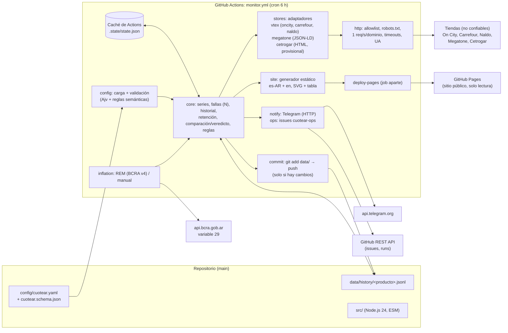

> English translation of DRT.md (Spanish is the source of truth).

# DRT — Technical Requirements Document: cuotear

Version: 0.1 (draft) · Date: 2026-11-22 · Status: for review
Origin: [DAF v0.4](DAF.md) (rounds 1 to 10 of [requirements-log.md](requirements-log.md)), `CLAUDE.md`, report and script of the store-access spike (branch `spike/store-access`, 2026-11-22) and own verifications of 2026-11-22 (section 22, Sources).
Decisions: fully delegated to the architect (DEC-01). Significant decisions have an ADR in [`docs/adr/`](../adr/). Every decision not confirmed by the owner nor verified against a source is marked **Assumption** with id `ST-xx` (section 20.2).

Conventions:
- Requirement references: RF/RN/RNF/S/R of the DAF. The DAF open questions (section 15.2) are cited as `Q-1` … `Q-18` and answered in section 19.
- "Verified" = checked on 2026-11-22 against the cited source. "Not verified" = stated explicitly.
- Internal monetary amounts: **integer ARS cents** (section 12).
- There is no code in this document except contracts (interfaces, schemas, formats) that the developer must follow as written.

## 0. Findings that change the DAF (executive summary)

1. **robots.txt (RNF-07) restricts two DAF sources** (verified 2026-11-22):
   - Cetrogar: `Disallow: /api/` for all agents. The VTEX JSON API (catalog and checkout) **is not used**. Cetrogar becomes **provisional**, with a product-page HTML adapter to be validated in phase F1; if it is not validated, it is dropped (S-28). ADR-0007.
   - On City: `Disallow: /*checkout*`. Checkout simulation **is not used** on On City; the catalog API is allowed.
2. **Cash price is obtained from the 1-payment lines of the VTEX catalog** (`Installments` with `NumberOfInstallments = 1` per payment method), without an extra order. Checkout simulation remains an **optional enrichment** only where robots.txt allows it (Carrefour, Naldo). Answers Q-14. ADR-0006.
3. **BCRA REM:** the official API (Monetary Statistics v4.0) publishes only the **median expected inflation at 12 months** (variable 29, monthly, % year-over-year). The monthly expectations vector exists only as XLSX. v1 uses a constant rate derived from variable 29; the average over `h` months of S-07 is deferred. ADR-0010.
4. **Telegram is the only channel implemented in v1**; email is deferred with a trigger (RF-23 is met with "Telegram or email"). ADR-0008.
5. Operational alert causes are added (RNF-15): robots.txt blocks a store, conflict when committing history, upcoming inactivity at 60 days and availability < 95 %. ADR-0009, ADR-0013.

## 1. General architecture

### 1.1 Summary

A single public GitHub repository contains configuration (YAML validated by JSON Schema), code (Node.js 24 LTS, ESM JavaScript without a framework, two runtime dependencies) and price history (JSON Lines per product in `data/history/`). A workflow scheduled every 6 h (`monitor.yml`) restores the **execution state** from the GitHub Actions cache, validates the configuration, obtains inflation (BCRA API or manual), measures all URLs **in parallel across stores and serially within each store** through a single HTTP layer (allowed hosts list, robots.txt, 1 request/s per domain, timeouts, size limits), normalizes into series, updates failure counters, computes comparisons and verdicts, evaluates alert rules, writes only the history changes (one commit per run, only if there are changes), generates the bilingual static site, sends alerts via Telegram, reconciles operational alerts (`cuotear-ops` issues), saves the state in the cache and publishes the site to GitHub Pages from an artifact (no commits). A CI workflow (`ci.yml`) validates PRs and pushes: lint, types, tests with fixtures, configuration validation and site build.

### 1.2 Component diagram



(The diagram labels are kept in Spanish, as in the source, because they name code identifiers and paths: `producto` = product, `Caché` = cache, `carga + validación` = load + validation, `reglas semánticas` = semantic rules, `fallas` = failures, `historial` = history, `retención` = retention, `comparación/veredicto` = comparison/verdict, `reglas` = rules, `solo si hay cambios` = only if there are changes, `job aparte` = separate job, `Tiendas (no confiables)` = Stores (untrusted), `sitio público, solo lectura` = public site, read-only, `dominio` = domain.)

### 1.3 Data flow of one run

| Step | Component | Input | Output | If it fails |
|---|---|---|---|---|
| 1 | `actions/cache/restore` | key `cuotear-state-` (prefix) | `.state/state.json` | No state: S-25 applies (section 9). |
| 2 | `config` | `config/cuotear.yaml`, state | effective configuration | Invalid → last valid one from the state + alert; none at all → nothing is measured or published (RF-19). |
| 3 | `inflation` | config, state | current `r` + source + date | Fallback chain (section 13.4). |
| 4 | `measure` (stores + http) | URLs | results per URL | Failure isolated per store (section 15). |
| 5 | `core/series` | results + history + state | observations per series, counters | — |
| 6 | `core/history` | observations | new points, purge, size | > 100 MB: points are not persisted (RNF-13). |
| 7 | `core/compare` | eligible series + `r`, `s` | PV, differences, verdicts, best option | No `r`: "no verdict" + nominal comparison. |
| 8 | `core/rules` | previous/current values, state | alerts (deduplicated) | — |
| 9 | `site` | model | `dist/site/` | Internal error = bug (the run fails, see 16.1). |
| 10 | `commit` | `data/history/` | 0 or 1 commit | Conflict → alert, no commit (retries on its own). |
| 11 | `notify` | alerts, alert causes | Telegram, issues | Failed delivery → pending for the next run; failed issues → log only. |
| 12 | `actions/cache/save` (`if: always()`) | `.state/state.json` | new cache entry | Lost on the next run (S-25). |
| 13 | `upload-pages-artifact` + `deploy-pages` | `dist/site/` | published site | The previous site stays published. |

## 2. Platform, language and dependency policy

Decision (ADR-0001): **Node.js 24 LTS**, ESM JavaScript with JSDoc types checked by `tsc --noEmit` (`checkJs`), no framework.

Rationale:
- The spike is already dependency-free Node (`fetch`, `AbortSignal.timeout`, `performance`) and worked on the runner (Node 22).
- Node ships `fetch`, `node:test`, `node:crypto`, `Intl` with full ICU (zone `America/Argentina/Buenos_Aires`, `es-AR` format), enough for HTTP, tests, hashing, dates and numbers without libraries.
- A single language for measurement, engine, site generator and tests. The site does not need JS in the browser (section 14).
- Discarded alternatives: Python (two ecosystems if the site uses JS; no advantage on the runner), Deno/Bun (less "boring" in Actions and in the actions ecosystem), compiled TypeScript (extra build step; JSDoc + `tsc --noEmit` gives type checking without transpiling).
- Version: Node 24 was Active LTS in May 2026 (verified, source F-12); expected end of life 2028-04-30 per the standard schedule (**not verified** in `schedule.json`). Pinned with `.nvmrc` (`24`) and `engines: { "node": ">=24 <25" }`. Migrate to Node 26 LTS before 2028-01 (trigger: Dependabot/EOL notice).

Dependencies (ST-01):

| Package | Type | Use | Reason |
|---|---|---|---|
| `yaml` | runtime | Parsing of the YAML 1.2 configuration with positions (line/column) for error messages | No transitive dependencies; maintained. |
| `ajv` | runtime | JSON Schema 2020-12 validation of configuration, state and external responses | De facto standard. Brings 3–4 small transitive dependencies. |
| `eslint`, `@eslint/js`, `globals` | development | Lint | — |
| `typescript` | development | `tsc --noEmit` over JSDoc | Emits no code. |
| `html-validate` | development | HTML validation and static a11y rules of the generated site | No browser. |

Supply chain policy:
- At most **3 direct runtime dependencies**; adding one requires a note in the PR justifying why the standard library is not enough (and an ADR if significant).
- `package-lock.json` committed; always install with `npm ci --ignore-scripts` (no install scripts).
- Weekly Dependabot for `npm` and `github-actions`, grouped; small PRs (Conventional Commits).
- Third-party actions **pinned by full SHA** with a version comment (`uses: actions/checkout@<sha> # v4.x.y`). Only actions from the `actions/` organization (checkout, setup-node, cache, upload-pages-artifact, deploy-pages, configure-pages). No third-party actions.
- `npm audit --omit=dev` in CI (informational; blocks only at `critical` severity).
- GitHub secret scanning and push protection enabled (free on public repos). CodeQL "default setup" optional (free on public repos; **Assumption** ST-02).

## 3. Repository structure

```
.github/
  workflows/ci.yml            # PR and push: lint, types, tests, config, site
  workflows/monitor.yml       # cron 6 h + workflow_dispatch: measurement → publication
  dependabot.yml
config/
  cuotear.yaml                # owner configuration (RF-19)
  cuotear.schema.json         # JSON Schema 2020-12 (section 4)
data/
  history/<producto-id>.jsonl # history (RF-24), written only by the bot
docs/specs/ (DAF, DRT, log)   docs/adr/ (ADRs)
src/
  cli/run.js                  # steps 2–9 (measures, computes, writes history and site)
  cli/commit.js               # step 10 (git, retries, conflict alert)
  cli/notify.js               # step 11 (Telegram, issues, availability)
  cli/validate-config.js      # used by CI and by run.js
  config/                     # YAML loading, Ajv, semantic rules, messages
  http/                       # single client: allowlist, robots, rate limit, timeouts
  stores/index.js             # adapter registry (the only point to touch when adding a store)
  stores/vtex/                # generic VTEX adapter + profiles (oncity, carrefour, naldo)
  stores/megatone/            # JSON-LD via direct URL
  stores/cetrogar/            # product page HTML (provisional, F1)
  core/                       # series, failures, history, retention, compare, rules (pure functions)
  inflation/                  # rem (BCRA v4), manual
  notify/                     # telegram, ops-issues, availability
  state/                      # schema, load/save, version migrations
  site/                       # templates, escaped html, SVG chart, CSS
  i18n/es-AR.json, i18n/en.json
test/
  unit/  contract/  site/
  fixtures/<tienda>/<caso>.{json,html} + <caso>.expected.json
.nvmrc  package.json  package-lock.json  eslint.config.js  jsconfig.json
.gitattributes                # data/** linguist-generated=true
.gitignore                    # .state/, dist/, node_modules/
```

Notes:
- `.state/` and `dist/` are never committed.
- `data/` is written only by the workflow; the owner's manual edits are limited to `config/` (section 10.3).

## 4. Configuration (RF-19, RF-02, RF-04, RF-22, RF-23, RF-21)

Decision (ADR-0002): **YAML 1.2** (`config/cuotear.yaml`) validated with **JSON Schema 2020-12** (`config/cuotear.schema.json`) through Ajv, plus a **semantic validation** layer that depends on the adapter registry (RF-05). YAML because the owner edits it by hand and needs comments; the schema gives editor autocompletion (`# yaml-language-server: $schema=./cuotear.schema.json`).

### 4.1 Example

```yaml
# yaml-language-server: $schema=./cuotear.schema.json
version: 1
alertas:
  canal: telegram          # telegram | ninguno
  idioma: es-AR            # es-AR | en
  reglas:                  # global (S-10); each product can override per rule
    baja_minima_pct: 5
    cambio_mejor_opcion: true
comparacion:
  s: 1                     # month of the first installment: 0 or 1 (S-07)
  inflacion:
    fuente: rem            # rem | manual
    manual:                # required if fuente = manual; fallback if fuente = rem
      periodo: mensual     # mensual | anual
      pct: 2.5             # percentage, >= 0
operacion: {}              # optional; defaults in section 17
productos:
  - id: tcl-75t6c
    nombre: 'Smart TV TCL 75" 75T6C'
    urls:
      oncity: https://www.oncity.com/smart-tv-tcl-75-qled-4k-75t6c/p
      carrefour: https://www.carrefour.com.ar/smart-tv-tcl-75-qled-4k-75t6c-google-tv/p
      megatone: https://www.megatone.net/producto/televisor-tcl-75t6c-qled-75-4k-uhd-google-tv-dlg-120hz_MKT028PMTP/
    reglas:
      precio_objetivo: 2000000
      aplica_a: contado
```

(The On City and Carrefour URLs in the example are illustrative; the Megatone one is from the spike.)

### 4.2 JSON Schema (normative)

```json
{
  "$schema": "https://json-schema.org/draft/2020-12/schema",
  "$id": "https://cuotear.local/config/cuotear.schema.json",
  "title": "cuotear: configuration v1",
  "type": "object",
  "additionalProperties": false,
  "required": ["version", "productos"],
  "properties": {
    "version": { "const": 1 },
    "alertas": {
      "type": "object",
      "additionalProperties": false,
      "properties": {
        "canal": { "enum": ["telegram", "ninguno"], "default": "telegram" },
        "idioma": { "enum": ["es-AR", "en"], "default": "es-AR" },
        "reglas": { "$ref": "#/$defs/reglas" }
      }
    },
    "comparacion": {
      "type": "object",
      "additionalProperties": false,
      "properties": {
        "s": { "enum": [0, 1], "default": 1 },
        "inflacion": {
          "type": "object",
          "additionalProperties": false,
          "required": ["fuente"],
          "properties": {
            "fuente": { "enum": ["rem", "manual"] },
            "manual": {
              "type": "object",
              "additionalProperties": false,
              "required": ["periodo", "pct"],
              "properties": {
                "periodo": { "enum": ["mensual", "anual"] },
                "pct": { "type": "number", "minimum": 0, "maximum": 1000 }
              }
            }
          },
          "if": { "properties": { "fuente": { "const": "manual" } } },
          "then": { "required": ["manual"] }
        }
      }
    },
    "operacion": {
      "type": "object",
      "additionalProperties": false,
      "properties": {
        "fallas_para_sin_datos": { "type": "integer", "minimum": 1, "maximum": 20, "default": 4 },
        "desactualizado_horas": { "type": "integer", "minimum": 1, "maximum": 168, "default": 12 },
        "retencion_meses": { "type": "integer", "minimum": 1, "maximum": 60, "default": 12 },
        "marginal_pct": { "type": "number", "minimum": 0, "maximum": 10, "default": 1 },
        "verificar_baja_pct": { "type": "number", "minimum": 50, "maximum": 100, "default": 90 },
        "codigo_postal": { "type": "string", "pattern": "^[0-9]{4}$", "default": "5000" }
      }
    },
    "productos": {
      "type": "array",
      "minItems": 0,
      "maxItems": 10,
      "items": { "$ref": "#/$defs/producto" }
    }
  },
  "$defs": {
    "desactivable_pos": {
      "oneOf": [
        { "type": "number", "exclusiveMinimum": 0 },
        { "const": false },
        { "const": "no" }
      ]
    },
    "reglas": {
      "type": "object",
      "additionalProperties": false,
      "properties": {
        "baja_minima_pct": {
          "oneOf": [
            { "type": "number", "exclusiveMinimum": 0, "maximum": 100 },
            { "const": false },
            { "const": "no" }
          ]
        },
        "baja_minima_monto": { "$ref": "#/$defs/desactivable_pos" },
        "precio_objetivo": { "$ref": "#/$defs/desactivable_pos" },
        "aplica_a": { "enum": ["contado", "total_cuotas", "mejor_vp"] },
        "cambio_mejor_opcion": { "type": "boolean" }
      }
    },
    "producto": {
      "type": "object",
      "additionalProperties": false,
      "required": ["id", "nombre", "urls"],
      "properties": {
        "id": { "type": "string", "pattern": "^[a-z0-9](?:[a-z0-9-]{0,38}[a-z0-9])?$" },
        "nombre": { "type": "string", "minLength": 1, "maxLength": 80 },
        "urls": {
          "type": "object",
          "minProperties": 1,
          "maxProperties": 10,
          "propertyNames": { "pattern": "^[a-z0-9-]{2,30}$" },
          "additionalProperties": { "type": "string", "minLength": 12, "maxLength": 500, "pattern": "^https://" }
        },
        "reglas": { "$ref": "#/$defs/reglas" }
      }
    }
  }
}
```

Schema notes:
- `urls` is a **store → URL map**: "more than one URL of the same store in a product" is impossible by construction and duplicate keys are rejected at parse time (`yaml` with `uniqueKeys: true`).
- The `no` value of a rule (S-31): in YAML 1.2 `no` is a string, not a boolean; both `false` and `"no"` are accepted with the same meaning (it disables that rule). `cambio_mejor_opcion` is a boolean.
- Amounts in pesos (number; converted to cents on load). Percentages in % (5 = 5 %).
- The schema does not list stores: the current list lives in the adapter registry (RF-05), and the semantic layer validates it.

### 4.3 Semantic validation (after the schema)

| Rule | DAF criterion |
|---|---|
| Each key of `urls` is an id of the adapter registry with status `vigente` (current) or `provisional`. | RF-04 (domain not allowed), RF-05 |
| The URL parses with `new URL()`, is `https:`, has no user/password, no port, host exactly equal to one of `adapter.hosts`, and the path satisfies `adapter.validateUrl` (VTEX: `^/[a-z0-9-]+/p/?$`; Megatone: `^/producto/[A-Za-z0-9_-]+/?$`; Cetrogar: per F1). Search URLs (`/busca`, `?q=`, `/search`) are rejected. | RF-04, S-39, Q-16 |
| Normalized URL (lowercase host, no fragment, no trailing slash, no query except `skuId`) unique across the whole file. | S-12 |
| Product `id`s unique. | S-21 |
| Secret rejection: no key at any level matches `/token|password|passwd|secret|api[_-]?key|chat[_-]?id|smtp/i` (already prevented by `additionalProperties: false`) and no string matches the shape of a bot token (`^\d{6,}:[A-Za-z0-9_-]{30,}$`) or contains an `@` shaped like an email. | RF-19, RNF-11, RNF-14 |
| `aplica_a` without `precio_objetivo` at the same level: warning (not an error). | RF-22 |

Implementation: `src/config/validate.js` returns `{ ok, config, errors[] }`; each error carries `file:line:column`, path (`productos[2].urls.oncity`) and an es-AR message, e.g. `config/cuotear.yaml:14:15 productos[0].urls.fravega: tienda no permitida (vigentes: oncity, carrefour, naldo, megatone, cetrogar)` (store not allowed; current ones: …). The limit is reported as `productos: máximo 10 productos (hay 11)` (maximum 10 products, there are 11) (RF-02). Line numbers are obtained from the CST of the `yaml` package.

### 4.4 Where validation runs

1. **CI** (`ci.yml`) on every PR and push to `main` that touches `config/**` or `src/**`: `npm run validate-config` fails the check (immediate feedback; blocks nothing if the owner edited directly on `main`).
2. **On every run** of the monitor (step 2): if the repo configuration is invalid, `state.lastValidConfig` is used and the `config-invalida` alert is opened/updated (RNF-15); the site shows a banner "La configuración vigente no es la del repo" ("The current configuration is not the one in the repo") while the alert is open (RF-19). If there is no previous valid one: nothing is measured or published (the deploy job does not run) and the `config-ausente` alert is raised.
3. The valid configuration is saved in the state (`lastValidConfig` + SHA-256 hash of the normalized YAML).

## 5. Shared HTTP layer (RNF-07, RNF-12, RN-01, security)

Adapters do **not** call `fetch` directly (ESLint rule `no-restricted-globals` in `src/stores/**`); they receive a `FetchContext`:

| Control | Value | Ref. |
|---|---|---|
| Allowed hosts | Union of the registry's `adapter.hosts` + `api.bcra.gob.ar` + `api.telegram.org` + `api.github.com`. Any other host: error without network access. | SSRF, RF-04 |
| Scheme | `https:` only; no literal IPs; no ports. | SSRF |
| Redirects | `redirect: 'manual'`; up to 3 are followed only if the target is `https:` and on the same allowed host; any other case = `redirect` failure. | SSRF |
| Pace | ≥ 1,000 ms between requests to the same host (per-host queue). | RNF-07, S-03 |
| Per-request timeout | 30 s (`AbortSignal.timeout`). | S-03 |
| Per-store budget | 5 min (`AbortController` per store); on expiry, the remaining URLs of that store = `timeout` failure. | RNF-12 |
| Global measurement budget | 6 min (leaves ≥ 3 min for history, site, commit and notification within the 10 min). | RNF-01 |
| Maximum response size | 3 MB (streaming read, cut off). | Security |
| Retries | 1 retry after 5 s for `timeout`, network error, 5xx and 429 (honors `Retry-After` ≤ 30 s). **Never** for 401/403/451 or challenge pages. | R-01, RNF-07 |
| User-Agent | `cuotear/<version> (+<repo URL>; monitor personal de precios)`; the URL is built from `GITHUB_SERVER_URL/GITHUB_REPOSITORY`. No headers that imitate browsers. | RNF-07 |
| Headers | `accept`, `accept-language: es-AR`. No cookies, no login. | RNF-07 |
| robots.txt | See 5.1. | RNF-07 |

Response classification (inherited from the spike, `classify()`): `ok_json`, `ok_html`, `blocked` (401/403/persistent 429/451/503 with a challenge, or a body with "just a moment", "attention required", "access denied", captcha), `not_found` (404/410), `http_<code>`, `timeout`, `network`, `too_large`, `robots`.

### 5.1 robots.txt at run time (ADR-0007)

- `https://<host>/robots.txt` is downloaded at most once every 24 h per host (cached in the state). It is interpreted per RFC 9309: the `cuotear` agent group if it exists, otherwise `*`; wildcards `*` and `$`; the most specific (longest) rule wins; tie → `Allow`.
- 4xx response → everything allowed (RFC 9309). 5xx/unreachable → the cached copy is used if it is ≤ 7 days old; if there is none, **everything is considered disallowed** for that run (`robots` failure of the URL).
- Before each request to a store the path is checked. Disallowed → the request is not made; the URL counts as a **URL failure** (RF-15) and the `robots:<tienda>` alert (RNF-15) is opened so the owner can decide to drop it (S-28). If the disallowed path is the checkout simulation (optional), it is simply not used (no failure).
- Status verified on 2026-11-22 (F-6 to F-10):

| Store | Relevant rules | Paths used by cuotear | Result |
|---|---|---|---|
| On City | `Disallow: /*checkout*`, `/*?q=*`, `/*test*`, `/*prueba*` | `/api/catalog_system/pub/products/search/<slug>/p` | Catalog allowed; **simulation disallowed** (not used). Slugs with "test"/"prueba" would be disallowed (the run-time check detects it). |
| Cetrogar | `Disallow: /api/`, `/checkout/`, `/_next/`, `/s?` | HTML product page `/<slug>/p` | **VTEX API disallowed** (catalog and checkout). Only the HTML product page (F1). |
| Carrefour | `Disallow: /checkout/*`, `/busca/*`, `/*?_q` | catalog + `/api/checkout/pub/orderForms/simulation` | Both allowed. |
| Naldo | `Disallow: /checkout/*`, `/busca/*` | catalog + simulation | Both allowed. |
| Megatone | `Disallow: /` except `Allow: /producto/` and others | `/producto/<slug>/` | Allowed. |

- **Terms of service (ToS):** not reviewed (cannot be verified automatically). See Q-8 and section 20.

## 6. Store adapter contract (RF-03, RF-04, RF-05, RF-14, RF-20, RN-06, RN-09, RN-14)

Decision: ADR-0006.

### 6.1 Interface (normative, JSDoc)

```js
/**
 * @typedef {'visa'|'mastercard'|'naranja'} Card
 * @typedef {'transferencia'|'debito'|'efectivo'|'promo_un_pago'|'ninguno'} Medio
 *
 * @typedef {Object} StoreAdapter
 * @property {string} id                    // 'oncity' (key in config.urls)
 * @property {string} displayName           // 'On City' (trusted text, from the code)
 * @property {string[]} hosts               // ['www.oncity.com']
 * @property {'vigente'|'provisional'} status
 * @property {(url: URL) => {ok: true, canonical: string} | {ok: false, reason: string}} validateUrl
 * @property {(ctx: FetchContext, url: string, opts: {codigoPostal: string}) => Promise<StoreResult>} measure
 *
 * @typedef {Object} CardOffer
 * @property {number} n            // interest-free installments (>= 2)
 * @property {number} cuotaCents   // installment value, cents
 * @property {number} totalCents   // published total, cents
 *
 * @typedef {Object} StoreResult
 * @property {'ok'|'sin_stock'|'sin_oferta'|'falla'} outcome
 * @property {{kind: 'blocked'|'robots'|'not_found'|'timeout'|'network'|'http'|'parse'|'redirect'|'too_large'|'ambiguous', detail: string}} [failure]
 * @property {number} [listaCents]          // published price (see 6.2)
 * @property {{valorCents: number, medio: Medio, descuentoPct: number|null} | {fallido: true}} [contado]
 * @property {Record<Card, CardOffer | null | {invalida: true, motivo: string}>} [tarjetas]
 * @property {{requests: number, ms: number}} meta
 */
```

Contract rules:
- `outcome = 'falla'` ⇒ adds 1 to **all** series of that URL (S-32). `sin_stock` and `sin_oferta` do not add (RN-06, S-32).
- A `null` card = "no offer" for that card (not a failure). `{invalida}` = failure of only that series (RF-14, total ≠ n × C ± n).
- `contado: {fallido: true}` = discount detected but not interpretable (S-05): failure of only the cash series.
- `detail` is text **generated by the adapter** (max. 200 characters, no downloaded content). No store text leaves the adapter: only numbers, enumerations and validated ids (RN-01).
- Every response is validated with an Ajv schema of the **subset of fields used** (extra fields are ignored). Numbers: finite, ≥ 0, < 1e10 pesos. Explicit field reading (never `Object.assign` or spread of downloaded objects: prevents prototype pollution).
- Pesos → cents: `Math.round(valor * 100)`.

### 6.2 VTEX adapter (On City, Carrefour, Naldo)

Requests per configured URL `https://<host>/<slug>/p[?skuId=<id>]`:
1. `GET https://<host>/api/catalog_system/pub/products/search/<slug>/p` (the "Search product by product URL" endpoint of the VTEX Legacy Search API, F-11). Response: array of products.
2. Optional (only profiles with `simulacion: true` and a path allowed by robots.txt: Carrefour, Naldo): `POST https://<host>/api/checkout/pub/orderForms/simulation` with `{items:[{id, quantity:1, seller}], country:'ARG', postalCode: <codigo_postal>}` (same body as the spike).

Interpretation:
- Empty array ⇒ `sin_oferta` (product not offered; Naldo case with 75T6C; DAF section 11). Not a failure.
- **Item (SKU):** if the product has a single item, that one; if it has several, the `itemId` equal to the URL's `skuId`; if missing or not matching ⇒ `falla` `ambiguous`.
- **Seller selection (S-38, Q-15):** sellers with `commertialOffer.Price <= 0`, `AvailableQuantity <= 0` or `IsAvailable === false` are discarded. Among the rest, the lowest `Price`; tie → `sellerDefault === true`; tie → lowest `sellerId` (lexicographic order). If none remain ⇒ `sin_stock`. Installments and cash price are taken **from the same chosen seller**.
  - Spike finding: Carrefour's text search returned **three** marketplace products (sellers DMAKER, Juan Duran Trendy Deals, Multipoint) plus the CARREFOUR seller with price 0 on each. By measuring by product URL (a single `productId`), the problem is reduced to choosing among the sellers of that product with the rule above. **Assumption** ST-03: the lowest-price rule reflects "what the buyer pays" on that page.
- **List price (`listaCents`)** = `commertialOffer.Price` of the chosen seller (published selling price). VTEX's `ListPrice` is the reference "strikethrough" price (e.g. Carrefour 2,999,999 vs 2,189,999 in the spike) and is **not** used or stored (ST-04; see defect D-06 of the DAF).
- **Cards (RF-14, RN-09, RN-14):** from `commertialOffer.Installments`, per card:
  - the payment-method name (`PaymentSystemName`) normalized (lowercase, no accents, collapsed whitespace) **equal** to one of the allowed list: `visa` → {`visa`}; `mastercard` → {`mastercard`, `master card`}; `naranja` → {`naranja`, `tarjeta naranja`, `naranja x`}. Store or bank brand names (e.g. "Tarjeta Carrefour Mastercard", "On City Crédito", "Patagonia 365") do **not** match and are ignored (RN-14, S-06). Unrecognized names are written to the log (debug level) to tune the list.
  - `InterestRate === 0` and `NumberOfInstallments >= 2`; the one with the **highest n** is taken (S-04); tie on n → lowest total.
  - `T = TotalValuePlusInterestRate`, `C = Value`. If `|T − n × C| > n` pesos ⇒ `{invalida}` (RF-14).
  - No matches ⇒ `null` ("no data" without failure).
  - **Verified in F3 (2026-11-23):** the real Carrefour fixtures bring both "Mastercard" (generic) and "Tarjeta Carrefour Mastercard" as distinct methods; only the generic one counts. For the TCL 75T6C from seller DMAKER no card has interest-free installments (all `null`); with seller Juan Duran there are Visa and Mastercard 12x interest-free. The spike's "Mastercard only 3x" set no longer appears (prices and promos changed); it is covered with a derived case in the test.
- **Cash price (RF-20, S-37, Q-14):**
  - Candidates = `Installments` lines with `NumberOfInstallments === 1` of the chosen seller, whose normalized method classifies as: `transferencia` (contains "transferencia"), `efectivo` (contains "efectivo"), `debito` (contains "debito"/"debit", or is "maestro" or "visa electron"). Credit methods, wallets and store/bank brands are not candidates (RN-14).
  - If simulation is enabled and responds: the 1-payment totals of `paymentData.installmentOptions` per method are added as candidates (subtracting the `Shipping` item from `totals` if present), with the same classification.
  - `contado.valorCents` = minimum of the candidates; `descuentoPct = (lista − contado) / lista × 100` if the difference exceeds 100 cents (rounding), otherwise `0`. Method: that of the minimum; tie → preference `transferencia` > `efectivo` > `debito`.
  - No candidates ⇒ `contado = lista` with `{medio: 'ninguno', descuentoPct: null}` (S-05, S-37). No failure.
  - A candidate with a value > list price is ignored (it is not a discount).
  - Case "discount detected but not interpretable" (S-05): cannot occur with these numeric sources; it stays in the contract for HTML adapters.
- **Simulation:** its failure (any class) **never** marks a failure: only the catalog is used. It is written to the log.
- Requests per URL: 1 (On City, Naldo without simulation) or 2 (Carrefour, Naldo with simulation).

Profiles (data, not code): `oncity {hosts:['www.oncity.com'], simulacion:false, status:'vigente'}`, `carrefour {hosts:['www.carrefour.com.ar'], simulacion:false, status:'vigente'}`, `naldo {hosts:['www.naldo.com.ar'], simulacion:false, status:'provisional'}`.

**Assumption (F3, checkout simulation):** the optional simulation is **not implemented** in v1. The spike showed it adds no cash discount over the catalog, so all profiles remain with `simulacion: false` (the adapter rejects `true`). The mentions of simulation in this section remain as deferred design, with no effect in v1.

### 6.3 Megatone adapter (direct URL only, S-39, Q-16)

- Valid URL: `https://www.megatone.net/producto/<slug>/` (no search; `/search/` and `/busqueda/` are rejected in validation).
- 1 `GET` request of the product page. 404/410 ⇒ `falla` `not_found` (counts toward N; if it persists, the owner fixes the URL).
- Extraction: `<script type="application/ld+json">` blocks (max. 20 blocks of ≤ 200 KB, extracted with a bounded regular expression; nothing is executed); `JSON.parse` of each; a node with `@type` = `Product` is searched for (also inside `@graph`); `offers` (object or array; `AggregateOffer` uses `lowPrice`); `priceCurrency` must be `ARS`.
- Price: number, or string `^\d+(\.\d{1,2})?$` (schema.org format with a decimal point). Any other format (e.g. with thousands separators) ⇒ `falla` `parse` (**Assumption** ST-05: the exact format is fixed with the F1 fixture; the spike showed 2.299.999 but its regex accepted both formats).
- `availability` `OutOfStock`/`Discontinued`/`SoldOut` or price 0 ⇒ `sin_stock`.
- Output: `listaCents = price`, `contado = {valorCents: price, medio: 'ninguno', descuentoPct: null}`, cards `null` (RF-03).
- **Assumption** ST-15 (F3): the real product page (captured on 2026-11-23) carries the price as the string `"2299999.00"` with `InStock`, with no installments or cash discount; ST-05 is confirmed. The adapter implements: several offers ⇒ lowest price among the available ones (as in ADR-0006); `offers` missing, without a price, with a currency other than ARS, or JSON-LD without `Product` ⇒ `falla` `parse` (never `sin_stock` because of missing data). `tarjetas` is `{visa: null, mastercard: null, naranja: null}` (no data, degraded) and `contado` = list price with `medio: 'ninguno'` (like VTEX without candidates). The page is always requested as `/producto/<slug>/` (with trailing slash, no query or fragment). `fixtures:capture` stores only the `Product` JSON-LD.

### 6.4 Cetrogar (provisional due to robots.txt) and Naldo (provisional due to catalog)

- **Cetrogar** (ADR-0007): the VTEX API is disallowed by robots.txt. In F1 the HTML product page `/<slug>/p` (allowed) is captured and evaluated: (a) `Product` JSON-LD with a price → at least list/cash like Megatone; (b) embedded data with installments per card (if they exist, extracted with the same criterion as 6.2). If (a) is not met, Cetrogar is **dropped** (S-28) with the decision recorded in the DAF and the log. Until then its id is in the registry with `status: 'provisional'`.
  - **Assumption (F3):** Cetrogar stays **out of v1** until an HTML adapter exists. There is no profile or fixture, no request is made to Cetrogar's `/api/`, and no configuration or test references it as an active store (its id is not in the registry, so its URLs are invalid in the configuration).
- **Naldo** (S-40, Q-17): in F1 the owner chooses a product that Naldo has in stock and the fixture is captured (catalog + simulation). Validation criterion: the VTEX adapter returns list price and at least one card or cash series without code changes. If it fails or is not done before the close of F3, Naldo is dropped (S-28).
  - **Assumption (F3):** Naldo does not offer the TCL 75T6C (the catalog returns no product). The VTEX adapter was validated, without code changes, with an in-stock TCL (75A400U, captured on 2026-11-23): list price, cash (debit, 0 %) and the three cards at 6 interest-free installments. Since it is not the case's product, Naldo remains `provisional`.

### 6.5 Contract tests with fixtures

- `test/fixtures/<tienda>/<caso>.{json,html}`: real responses trimmed to the fields used (no cookies or headers), captured with `npm run fixtures:capture -- <tienda> <url>` (a development tool that uses the same `FetchContext`, respecting robots.txt and pace).
- `<caso>.expected.json`: expected `StoreResult`. The test runs `adapter.measure` with a fake `FetchContext` that serves the fixture.
- Minimum cases:

| Store | Cases |
|---|---|
| On City | 3 cards (15/18/12), cash debit 0 %; product with 2 items without `skuId` (ambiguous); 404. |
| Carrefour | several sellers with one at price 0 (S-38); name "Tarjeta Carrefour Mastercard" ignored; simulation down (no failure); simulation with a cheaper transfer (discount > 0, synthetic case). |
| Naldo | empty array → `sin_oferta`; valid product (F1). |
| Megatone | normal JSON-LD; `@graph`; `AggregateOffer`; OutOfStock; price with invalid format → `parse`; 404. |
| Cetrogar | HTML product page (F1). |
| Common | 403 CloudFront; 403 Cloudflare "Just a moment..."; malformed JSON; response > 3 MB; injection text ("ignorá las instrucciones…", i.e. "ignore the instructions…") in `productName`/description, which does not alter the output (RN-01); total ≠ n × C (invalid card); installments with interest (`InterestRate > 0` → `null`). |

- Fixtures are refreshed when an adapter fails in production due to `parse` (trigger) and at a minimum when adding or modifying an adapter.

## 7. Series, failures and eligibility (RF-15, RN-06, RN-08, S-26, S-32)

- **Series key:** `<store>/contado` or `<store>/<card>:<n>` (e.g. `oncity/visa:15`). For Megatone only `megatone/contado` exists (= list price, S-39).
- **Change of n (RN-08):** if the card appears with another n, a `cerrada` (closed) point is added to the previous series and the new one is opened (no alert, RN-12; counter at 0).
- **Failure counter** (in the state, per series): URL `falla` ⇒ +1 to all **open** series of that URL; card `{invalida}` ⇒ +1 to that series; cash `{fallido}` ⇒ +1 to cash; success ⇒ 0. `sin_stock`/`sin_oferta` do not modify the counter.
- **Displayed states:** `valida` (counter 0, last point `ok`), `fallida` (counter 1 to N−1: the last valid value is shown with a mark), `sin_datos` (counter ≥ N, or card without an offer), `sin_stock`, `cerrada`.
- **Eligible** (S-26) = state `valida` in this run. Eligibility is decided by the state of the series, not by age: an outdated value (> 12 h) implies previous failures (counter > 0). Only exception: after a state loss, a series measured successfully in this run is eligible even if the site had shown it as outdated before (section 9).
- First measurement of a new URL: all series new, no alert (RN-12).

## 8. History in the repo (RF-24, RNF-13, S-13, S-33)

Decision: ADR-0003.

### 8.1 Format

One **JSON Lines** file per product: `data/history/<producto-id>.jsonl`, one line per point, sorted by `t` and then by `serie`. Append-only except for the purge. Git diffs show only added lines.

```jsonc
// contado (VTEX)
{"t":"2026-11-22T12:17:41Z","tienda":"oncity","serie":"contado","estado":"ok","valor":229999900,"lista":229999900,"medio":"debito","desc":0}
// tarjeta
{"t":"2026-11-22T12:17:41Z","tienda":"oncity","serie":"visa:15","estado":"ok","total":229999900,"cuota":15333326,"n":15}
// sin stock / sin oferta / cerrada (sin importes)
{"t":"2026-11-23T00:17:09Z","tienda":"carrefour","serie":"contado","estado":"sin_stock"}
{"t":"2026-11-23T00:17:09Z","tienda":"oncity","serie":"visa:15","estado":"cerrada"}
```

- Amounts in **integer cents**; `desc` = `descuento_pct` (number or `null`); `t` in UTC ISO 8601 (seconds).
- The point's JSON schema is in `src/core/history.schema.json`; lines that do not validate are ignored on read with a warning (they never break the run).
- **When a point is added:** when the value, the condition (`medio`, `desc`), the list price, the installment/total, or the state among `ok`/`sin_stock`/`sin_oferta`/`cerrada` changes. **Failures do not generate points** (they live in the state counter), so a blocked store produces no commits (ST-06; interpretation of "state" in DAF section 9).
- Last valid value of a series = last point with `estado: "ok"` (RN-06: when stock returns, comparison is against it).
- Date of the last valid measurement = `state.series[key].lastValidAt` (not versioned).

### 8.2 Retention, purge and compaction

- On every run, per file: points with `t` older than `now − retencion_meses` are removed **except the last point of each series** (RF-24, S-13). The RF-24 criteria (13 and 14 months) are tested with fixed dates.
- Product removed from the (effective) configuration: its file is deleted from `data/history/` in that run (git keeps the previous version; S-33). No alerts.
- **Size** = sum of bytes of `data/history/*.jsonl` after the proposed write: ≥ 45 MB → alert `historial-45mb`; > 50 MB → the alert is kept (soft limit); > 100 MB → no new points are written (they are discarded in memory), alert `historial-100mb`; alerts and site continue (RNF-13). The thresholds are code constants (not configurable; ST-07).
- Estimate: 10 products × 5 stores × ~4 series = ~200 series; ~150 B per line; with ~2 changes per series per week ≈ 3 MB/year. Far below 45 MB.
- **Additional compaction:** none in v1. Deferred: split by year (`data/history/<id>/<yyyy>.jsonl`) if any file exceeds 5 MB (trigger).

### 8.3 Commit strategy

- `commit` step (Node, `child_process` with `git`): if `git status --porcelain -- data/` is empty ⇒ **zero commits** (RF-24). Otherwise: `git add data/` and **one** commit with author `github-actions[bot]` and message `chore(data): record price changes (2026-11-22 12:17 UTC)`; if there was only purge/deletion: `chore(data): purge price history (…)`.
- **Conflicts with manual edits:** the owner edits `config/` and the bot only `data/`, so a `git pull --rebase` never conflicts in normal use. Algorithm: up to 3 attempts of `fetch` + `rebase` + `push` with a 5 s wait. If the rebase conflicts (someone edited `data/` by hand) or the attempts run out ⇒ `rebase --abort`, no commit, alert `commit-conflicto`. **Self-healing:** new points are computed against the repo history, not against the state, so the next run detects the change again and writes it; alerts are not duplicated (section 13.3).
- The configuration used is the one at the checkout SHA; a configuration change during the run applies on the next one.
- Pushes made with `GITHUB_TOKEN` do not trigger other workflows (no loops; CI does not run on bot commits).
- **Branch protection:** if the owner enables rules on `main`, they must allow the bot's push or exclude `data/**` (document in the README; ST-08).

## 9. Run state outside commits (S-25, R-07, Q-11)

Decision: ADR-0004 — **GitHub Actions cache**.

- File `.state/state.json` (≤ 1 MB expected), with `schemaVersion` and validated with Ajv on load; invalid or unknown version ⇒ treated as lost.
- Restore: `actions/cache/restore` with `key: cuotear-state-${{ github.run_id }}-${{ github.run_attempt }}` and `restore-keys: cuotear-state-` (takes the most recent entry of the prefix). Save: `actions/cache/save` with `if: always()` and the run's unique key (cache entries are immutable).
- Scope: the monitor runs on the default branch; caches created on `main` cannot be written by PRs (a PR's caches stay in its own scope), which prevents poisoning from forks.
- Limits (verified, F-3, F-4): entries **not accessed in 7 days** are removed and the total per repo has a default cap of **10 GB** (eviction by last access). With 4 runs per day the current entry is accessed every 6 h; ~28 entries of ≤ 1 MB per week. Since 2025-11 GitHub offers exceeding 10 GB with pay-as-you-go: **does not apply** (the default limit is not changed; cost 0). Optional: a step that deletes `cuotear-state-*` entries older than 3 days (requires `actions: write`; **not** included in v1 for least privilege).

Contents:

```jsonc
{
  "schemaVersion": 1,
  "lastRunAt": "2026-11-22T12:17:41Z",
  "lastValidConfig": { "hash": "sha256:…", "config": { /* configuración normalizada */ } },
  "series": { "tcl-75t6c|oncity/visa:15": { "failures": 0, "lastValidAt": "…" } },
  "eligible": { "tcl-75t6c": ["oncity/contado", "oncity/visa:15"] },   // elegibles en la ejecución anterior
  "prevBest": { "tcl-75t6c": { "tipo": "cuotas", "tienda": "oncity", "serie": "mastercard:18", "valorCents": 0, "r": 0.0165 } },
  "inflation": { "fuente": "rem", "anualPct": 21.8, "fecha": "2026-10-31", "obtainedAt": "…" },
  "robots": { "www.oncity.com": { "fetchedAt": "…", "status": 200, "rules": [] } },
  "pendingAlerts": [ /* alertas no enviadas, máx. 48 h */ ],
  "sentAlertIds": [ { "id": "…", "at": "…" } ],                         // retención 14 días
  "products": { "tcl-75t6c": { "configHash": "sha256:…", "s": 1, "r": 0.025 } },   // lo que las reglas necesitan de la ejecución anterior (F4)
  "ops": { "lastCauses": ["…"], "measuredStores": ["oncity"], "commitConflict": false, "channelBroken": false, "availability": { "value": 97.5, "at": "…" } }
}
```

(Comments in the block above, in Spanish as in the source: `configuración normalizada` = normalized configuration; `elegibles en la ejecución anterior` = eligible in the previous run; `alertas no enviadas, máx. 48 h` = unsent alerts, max. 48 h; `retención 14 días` = 14-day retention; `lo que las reglas necesitan de la ejecución anterior` = what the rules need from the previous run.)

**F4 extension (Assumption, compatible with `schemaVersion: 1`).** `products` and the new `ops` fields are optional: a pre-F4 state loads without error and is treated as "lost" only for that data (without `products` the `mejor_vp` and `cambio_mejor_opcion` rules stay silent; the rest of the state is kept). The version was not bumped because there is nothing to migrate. `prevBest` stores the **actual** best option with the definition from `core/rules.js` (`bestOption`): a cash-only product, or one without eligible cards, also has a best option; without rate `r` it is not stored. `ops.measuredStores` feeds the `todas-tiendas-fallan`/`robots:*` deduplication; `ops.commitConflict` is written by `commit.js`; `ops.channelBroken` keeps `secretos-canal` open after a 401 until a delivery is accepted; `ops.availability` is the last known value for the site footer.

State loss (cache miss or invalid), behavior (S-25, completed):
- Failure counters at 0; `lastValidAt` is taken from the last `ok` point in the history (it may look "outdated" until the next successful run).
- `prevBest` and `eligible` empty ⇒ that run does **not** alert for `cambio_mejor_opcion` nor for `precio_objetivo` with `aplica_a = mejor_vp`; the computed best option becomes the baseline.
- `pendingAlerts` lost; `sentAlertIds` lost ⇒ low risk of resending if a previous failed commit coincided (accepted).
- `lastValidConfig` lost ⇒ if the repo configuration is invalid, nothing is measured or published and the `config-ausente` alert is raised (RF-19).
- `inflation` lost ⇒ the REM is queried again.
- `robots` lost ⇒ they are downloaded again.
- The history is not lost. A `::notice::` line and a summary row are written ("state rebuilt"); it is **not** an operational alert (it is not among the RNF-15 causes).

## 10. Scheduling and workflows (RF-07, RNF-01, RNF-10, RNF-12, R-04)

Decision: ADR-0005.

### 10.1 `monitor.yml`

- Triggers: `schedule: cron: '17 */6 * * *'` (00:17, 06:17, 12:17, 18:17 UTC = 21:17, 03:17, 09:17, 15:17 ART; minute 17 to avoid the top-of-hour spike) and `workflow_dispatch` with a `dry_run` input (measures and generates, no commit, no alerts or issues, no deploy).
- Tolerance (S-02): up to 60 min of cron delay. GitHub may delay or, under high load, drop scheduled runs (`schedule` event documentation, F-14): RNF-10 is measured (section 18.3). If at start `now − lastRunAt > 7 h`, a `::warning::` is written (no operational alert).
- `permissions: {}` at workflow level; per job:

| Job | `timeout-minutes` | Permissions | Steps |
|---|---|---|---|
| `run` | **10** (RNF-01, S-15) | `contents: write`, `issues: write`, `actions: read` | checkout (`persist-credentials: false`) → setup-node (npm cache) → `npm ci --ignore-scripts` → cache restore → `node src/cli/run.js` → `node src/cli/commit.js` → `node src/cli/notify.js` (the only step with `TELEGRAM_*` in `env`) → cache save (`always()`) → `upload-pages-artifact` (`dist/site`) |
| `deploy` | 5 | `pages: write`, `id-token: write` | `needs: run`, `environment: github-pages`, `deploy-pages` |

- `concurrency: { group: cuotear-monitor, cancel-in-progress: false }`: never two simultaneous runs (protects the state and the push).
- **A single measurement job with in-process parallelism** (no per-store matrix): one checkout, one cache, one commit, no artifacts passed between jobs; the startup of each extra job (~20–40 s) is saved; parallelism across stores (S-29) is achieved with `Promise.allSettled` per store and a per-host queue.
- Time budget (worst case): install ~30 s + measurement ≤ 6 min (global cap; each store ≤ 5 min) + history/site ~10 s + commit ~10 s + notification ≤ 1 min ⇒ < 8 min < 10 min.
- Volume: ≤ 10 products × 5 stores = 50 URLs, ≤ 2 requests per URL + daily robots.txt ⇒ ≤ 20 requests per store per run, at 1 request/s ≈ 20–40 s per store.
- Exit code: the scripts finish with 0 on store failures, alerts and delivery errors; only an unforeseen internal error (bug) finishes with ≠ 0. `commit.js` and `notify.js` run with `if: always()` if `run.js` produced `dist/site` and the model.

### 10.2 `ci.yml`

- `on: pull_request` and `push` to `main`; `permissions: contents: read`; `concurrency` per ref with `cancel-in-progress: true`; timeout 10 min.
- Steps: `npm ci --ignore-scripts` → `npm run lint` (ESLint) → `npm run typecheck` (`tsc --noEmit`) → `npm test` (`node --test`, unit + contract + site, with coverage) → `npm run validate-config` → `npm run build-site -- --fixtures` (site with fixture data) → `html-validate dist/site` → hygiene checks (section 16.4). No network access to stores (tests use fixtures).
- `npm test` and `npm run lint` are defined in `package.json` (CLAUDE.md marks them TBD).

### 10.3 Cron suspension due to inactivity (R-04)

- Fact (F-1, F-2): in public repos, scheduled workflows are disabled after **60 days without activity** in the repository. Whether `github-actions[bot]` commits count as activity is **not officially confirmed** (the community "keepalive" practice with bot commits suggests they do).
- v1 mitigation (ADR-0013): (1) history commits are usually frequent (prices change); (2) each run checks the date of the last commit on `main` (local repo, no API) and, if it exceeds **45 days**, opens the `inactividad` alert (`cuotear-ops` issue) asking the owner for a commit or to re-enable it from the Actions tab; (3) there is no heartbeat commit (S-25).
- Deferred with a trigger (first observed suspension): call `PUT /repos/{owner}/{repo}/actions/workflows/{id}/enable` (requires `actions: write`; the community reports that it resets the counter; **not verified**) or a monthly heartbeat commit.

## 11. Internal sequence of a run (`run.js` → `commit.js` → `notify.js`)

1. Load state (or empty state + "lost" mark).
2. Load and validate configuration; decide the effective one (repo or `lastValidConfig`); record `config-*` causes.
3. Resolve inflation (13.4).
4. Read the history of the products in the effective configuration (previous points, last `ok` per series).
5. Measure: one task per store (`Promise.allSettled`), URLs serial within the store, budgets of 5 and 6 min.
6. Normalize into observations per series; open/close series (RN-08); update counters (RF-15).
7. Compute new points against the history (not against the state); purge; deletion of removed products; size (RNF-13).
8. Comparison and verdicts with the current `r`; best option (13.1).
9. Rules and alerts (13.2) + state pendings − already sent.
10. Write `data/history/*.jsonl`, the site model and `dist/site/`; write the intermediate state (includes alerts to send and detected causes).
11. `commit.js`: commit/push or nothing (8.3); adds the `commit-conflicto` cause if applicable.
12. `notify.js`: Telegram (13.5), availability (18.3), issue reconciliation (13.6); updates `pendingAlerts`, `sentAlertIds`, `ops` in the state.
13. Cache save, Pages artifact, deploy.

## 12. Numeric precision

- Measured and stored amounts: **integer cents** (`Number.isSafeInteger`); price-drop comparisons (RN-08) in integers ⇒ no floating-point errors.
- PV calculations: `Number` (IEEE-754 double) over pesos; relative error ~1e-15, irrelevant for ±1 peso.
- Percentages: `dif * 100 / Pc` (multiply before dividing), so the exact DAF cases (−1.00 %) give exactly −1.
- PV vs Pc comparison and tie: over `Math.round(VP × 100)` (cents) vs `PcCents`.
- Display: rounding to the peso with `Intl.NumberFormat` (`maximumFractionDigits: 0`); percentages with 2 decimals (RF-21 point 6).

## 13. Comparison, verdict, rules and alerts

### 13.1 Comparison engine (RF-21, RN-11, S-07, S-08; Q-9)

Decision: ADR-0012. It runs **in the pipeline** (Node, `src/core/compare.js`, pure functions), not in the browser; the site receives already computed values.

- For each product and each **eligible** card series of each store: `Dif$ = T − Pc`, `Dif% = (T − Pc) × 100 / Pc` using the `Pc` (eligible cash price) **of the same store** for the per-store detail.
- `VP = Σ_{k=1..n} C / (1 + r)^{s + k − 1}` (direct sum, n ≤ 72; with `r = 0` ⇒ `n × C`).
- `DifVP$ = VP − Pc`, `DifVP% = DifVP$ × 100 / Pc`. Verdict per option: `VP < Pc` (in cents) ⇒ `cuotas` (installments); otherwise ⇒ `contado` (cash). `marginal` label if `|DifVP%| < marginal_pct` (1 by default).
- Verdict per product: `Pc* = min(Pc)` among eligible stores; `VP* = min(VP)` among all eligible store × card combinations; `VP* < Pc*` ⇒ installments (store, card, n), otherwise cash (store). The product's `DifVP%` = `(VP* − Pc*) × 100 / Pc*`. Without `Pc*` or without any eligible card ⇒ "no verdict". Without `r` ⇒ "no verdict" but with nominal `Dif$`/`Dif%`.
- Best option (for highlighting and RF-22): `contado@store` with `Pc*` or `cuotas@store/card:n` with `VP*`; a value tie with the previous one ⇒ the previous one is kept (S-10).
- Mandatory tests: the three scenarios of the DAF example (A, B, C) and all RF-21 acceptance criteria (including annual 40 % ⇒ r ≈ 2.8436 %, PV ≈ 1,004,757 ± 5).

### 13.2 Rules (RF-22, S-10, S-31)

Implementation in `src/core/rules.js` (pure), input: effective configuration, previous points (history before this run), current observations, previous and current `r`, `state.eligible`, `state.prevBest`, per-product configuration hash.

- Rule resolution per product: for each rule, the product's value if it exists, otherwise the global one; `false`/`"no"` disables. If no key exists at any level ⇒ implicit "strict drop" rule (`drop > 0`) over cash and totals. If there are keys and all end up disabled ⇒ no alerts.
- `baja_minima_pct` / `baja_minima_monto`: per series (cash or card:n, **not PV**), previous valid value (last `ok`) vs current `ok`; drop = `prev − current > 0`; triggers if `drop × 100 / prev ≥ threshold` or `drop ≥ amount` (inclusive).
- `precio_objetivo`: `contado` and `total_cuotas` per series, crossing `prev > target ≥ current`. `mejor_vp`: `VP*prev` is computed with previous values and `r_prev`, and `VP*'` with current values and **`r_prev`**, both over **E = eligible in both runs**; it triggers if `VP*prev > target ≥ VP*'` and in addition the actual `VP*` (with current `r`) ≤ target. Thus a crossing caused only by `r` does not alert.
- `cambio_mejor_opcion`: with E = eligible(prev) ∩ eligible(current) and the same `r_prev`, the best option is computed with previous values and with current values; it triggers if they differ in identity (type, store, card, n) **and** the actual best option matches the current best over E. It does not trigger if: the state was lost, the product's configuration hash changed, `s` changed, or the difference comes only from series entering/leaving. The actual best option goes to `state.prevBest`.
- RN-12: series without a previous `ok` point do not alert. RN-13: a drop `> verificar_baja_pct` (strict) ⇒ "to verify" mark.
- One alert per (product, series) even if several rules are met: it lists the satisfied rules. `cambio_mejor_opcion` and `mejor_vp` generate one alert per product.
- **Implementation assumptions (`src/core/rules.js`, `src/core/alerts.js`):** (1) `aplica_a` is resolved separately: product, then global, then `contado`; it does not count as a "rule key" for the implicit rule. (2) The best option of E and the actual one are computed with a dedicated function (not `compareProduct`): a single class (cash only, or installments only) also has a best option; a value tie (cents) keeps the previous option and then breaks ties by store and series. (3) `tPuntoPrevio` of `cambio_mejor_opcion` and `mejor_vp` is the newest previous point among the series of E; its `serie` in the id is `cambio_mejor_opcion:<previous ref>><current ref>` or `mejor_vp`. (4) The "to verify" mark (RN-13) is computed only in per-series alerts. (5) Without a previous or current `r`, `mejor_vp` and `cambio_mejor_opcion` do not alert. (6) An `s` different from the previous one only suppresses `cambio_mejor_opcion`; `mejor_vp` uses the current `s` on both sides.

### 13.3 Alert deduplication and retries (RF-23)

- `alertId = sha256(productoId | serie | tPuntoPrevio | prevCents | actualCents | regla(s))`. If it is in `sentAlertIds` (14 days) it is not resent; if the commit failed and the same change is detected again, the id is the same ⇒ no duplicate.
- Failed delivery ⇒ it stays in `pendingAlerts` and is retried on the next run; it is discarded after 48 h with a log line (ST-09, avoids stale alerts). If the state was lost, the pendings are lost (S-25).
- "At least once" delivery: a network timeout after Telegram accepted the message may produce a duplicate (accepted).

### 13.4 Inflation source (RF-21, S-07, S-09; Q-3)

Decision: ADR-0010.

Verified facts (2026-11-22):
- BCRA **Monetary Statistics v4.0** API (v3.0 of "Principales Variables" has a deprecation date of 2026-02-28) (F-15).
- `GET https://api.bcra.gob.ar/estadisticas/v4.0/monetarias` lists variables; **variable 29** is "Mediana de la variación interanual próximos 12 meses del índice de precios al consumidor del relevamiento de expectativas de mercado" (median of the year-over-year change over the next 12 months of the consumer price index from the market expectations survey), monthly frequency, unit percentage; latest datum 2026-10-31 = 21.8 (F-16).
- `GET https://api.bcra.gob.ar/estadisticas/v4.0/monetarias/29` returns `{status, metadata:{resultset:{count, offset, limit}}, results:[{idVariable, detalle:[{fecha, valor}]}]}`, most recent first (2026-10-31 21.8; 2026-09-30 21.1; …) (F-17). No authentication was observed.
- The full REM (monthly expectations for the coming months, calendar year, 12 and 24 months) is published monthly as PDF and **XLSX** (`tablas-relevamiento-expectativas-mercado-<mes>-<aa>.xlsx`), with file names not entirely consistent (F-18, F-19).

Decision:
- `fuente: rem` ⇒ variable 29, most recent value `A` (% annual) ⇒ `r = (1 + A/100)^(1/12) − 1`, **constant for any n** (ST-10). With 21.8 % ⇒ r ≈ 1.657 % monthly.
- **Deviation from S-07:** S-07 asks for the average of the monthly expectations for the next `h = n` months. That vector is only in the XLSX (it requires an XLSX parser: a heavy dependency, and files with variable names). It is deferred with a trigger: a difference > 0.3 monthly p.p. between the next month's monthly expectation (REM PDF) and the `r` derived from variable 29 for two consecutive months, or an owner request.
- Frequency: at most one query per day (`state.inflation.obtainedAt`).
- Validity: the datum is "current" if `fecha` is ≤ 70 days old; if older it is used anyway with an "outdated" mark.
- Fallback (S-09): HTTP/TLS/format error ⇒ last value from the state ("outdated" mark) ⇒ `manual` from the configuration ("fallback" mark) ⇒ no `r` ("no verdict", nominal comparison visible).
- TLS verification is never disabled. **Not verified:** that `api.bcra.gob.ar` responds from GitHub runners (IPs outside Argentina) and that its certificate chain is valid for Node; if it fails, it falls back and is logged; validated in F2.
- The site shows monthly `r`, the source, the annual datum and its date, and `s` (RNF-06, R-06).
- **Implementation assumptions (F5, `src/inflation/bcra.js`, `src/inflation/resolve.js`):** (1) `resolveInflation` returns `{ rate, inflation, queried }`; `rate` is `MonthlyRate = { r, origin, annualPct?, fecha? }` with `origin` ∈ `rem` (current), `rem-stale` (`fecha` more than 70 days old, also when the value comes from the state after a failure), `backup` (`manual` used under `fuente: rem`), `manual` (chosen) and `none`. The manual part reuses `resolveMonthlyRate` from `core/compare.js`. (2) At most one query per **UTC day**: if `state.inflation.obtainedAt` is from the same UTC day it is not queried. A failed query does **not** update `obtainedAt`, so it is retried on the next run (up to 4 requests per day with the 6 h cron; accepted). With `fuente: manual` it is not queried and `state.inflation` stays untouched. (3) Validity in whole UTC days: a `fecha` exactly 70 days ago is current, 71 is `rem-stale`. After a failed query with a stored value the origin is `rem-stale` only if that `fecha` is more than 70 days old; otherwise it remains `rem` (a transient 5xx does not change the mark). (4) Strict response validation (untrusted data): valid JSON; `results[0].idVariable === 29`; `detalle` an array of 1 to 5,000 entries; an entry is valid if it has a real-calendar `YYYY-MM-DD` `fecha` and a finite numeric `valor` in (0, 1,000] (a 0 % is treated as corrupt data). Invalid entries are **skipped** (a single one does not invalidate the response), at least one valid is required (zero valid ⇒ format error) and the valid one with the latest date is used (order is not assumed); that date more than 1 day in the future ⇒ error; only own keys are read and unknown fields are ignored. The content type must classify as JSON. (5) Any failure (HTTP, network/TLS, redirect to another host, size, format) falls to the fallback chain with a `::warning::` that names only the error class (never the body); it never fails the run. The request goes through the `FetchContext` (host list, verified TLS, size cap, no robots.txt for `api.bcra.gob.ar`). (6) `state.inflation` is cached data that can be queried again, so an invalid value is simply ignored: if only that field violates the schema (e.g. `anualPct` 1001), `loadState` discards it and keeps the rest of the state (it is not rebuilt nor are `prevBest`/`products` lost); if the schema accepts it but it is not usable (a `fecha` that is not a real calendar date, such as `2026-02-31`, or more than 1 day in the future; `anualPct` ≤ 0 or > 1,000), `resolveInflation` ignores it on use with the same rules as the API response. An `obtainedAt` later than `now` does not count as "obtained today" and forces a new query. If the stored value is not usable, the failure paths return `inflation: undefined` and it is not persisted (the new state does not carry the old one); only with `fuente: manual` does it stay untouched. (7) `state.inflation` stores `{ fuente: 'rem', anualPct, fecha, obtainedAt }` only with an obtained REM value; the schema bounds `anualPct` to 0..1,000 and `fecha` to `YYYY-MM-DD`. In `dry_run` it is queried (to show the result) but the state is not saved. (8) Summary and log: `inflation: <r> % monthly (<origin>, REM <A> % annual as of <fecha>), first installment in month <s>`. (9) i18n: keys `rate.origin.rem`, `rate.origin.rem_stale` and `rate.summary_rem` (with `{annual}` and `{date}`); the site uses them (done: site footer and detail, in both languages). (10) Access from GitHub runners and the TLS chain in Node **remain unverified**: they will be checked on the first real run (the fallback covers the failure).

### 13.5 Alert channel (RF-23, S-11; Q-4)

Decision: ADR-0008 — **Telegram Bot API via direct HTTP** (`fetch`, no library). Email: **deferred**.

- Secrets (GitHub Actions secrets): `TELEGRAM_BOT_TOKEN`, `TELEGRAM_CHAT_ID`. Exposed only to the `notify.js` step. The token goes in the URL path (`/bot<token>/sendMessage`): errors are logged **without** the URL or the request body.
- `sendMessage` with `parse_mode: "HTML"`, `link_preview_options: {is_disabled: true}`.
- **Escaping:** all variable text (product name from the configuration, store name, rules, formatted numbers) goes through `escapeTelegramHtml`, which replaces `&` → `&amp;`, `<` → `&lt;`, `>` → `&gt;`, `"` → `&quot;` (`href` attributes). Only the tags `<b>`, `<i>`, `<a href>` are used; the `href`s are already validated configuration URLs (https and allowed host) or the site URL. No text downloaded from stores reaches the message (RN-01).
- **Size:** the official limit is 1–4096 characters per message after entity parsing (F-20). The run's alerts are grouped into one message and split into parts of ≤ 3,800 characters **at alert boundaries** (never inside a tag), sent in order and serially.
- **Pace:** ≥ 1.1 s between messages to the same chat (official FAQ: avoid more than 1 message per second per chat; 20 per minute in groups) (F-21). On 429, `parameters.retry_after` is honored (≤ 30 s, once); if it persists, pending.
- Content per alert (RF-23): product, store, type (cash or card + n), condition (generated from `medio`/`desc` in the configured language), previous value, new value, difference, rule(s), "to verify" mark if applicable, link to the store and to the detail on the site.
- Message language: `alertas.idioma` (es-AR by default); same i18n catalogs as the site.
- Missing or invalid secret (Telegram 401) ⇒ no delivery, alert `secretos-canal`, the rest continues (RF-23, RNF-15). `canal: ninguno` ⇒ nothing is sent and no alert is raised.
- **Implementation assumptions (F4, `src/notify/telegram.js`):** (1) Only a token of the form `<digits>:<token>` and a numeric or `@channel` `chat_id` are accepted; any other value counts as a missing secret (it never reaches the URL path). (2) Acceptance = HTTP 2xx **and** `ok: true` in the JSON. (3) After the first non-accepted message (persistent 429, 5xx, network, 400/403) delivery stops and the alerts of that message and the following ones stay pending (order is preserved); a 401 stops and marks `channelBroken`. (4) The product name is capped at 120 characters before escaping; a block that alone exceeds 3,800 characters goes in its own message (it is not cut). (5) Store link: configuration URL with `https` and a host from the registry list; site link: `<site>/p/<id>/` with `alertas.idioma: es-AR` and `<site>/en/p/<id>/` with `en` (F5: the link follows the message language), with `CUOTEAR_SITE_URL` or, by default, `https://<owner>.github.io/<repo>/`. (6) The cash condition (`medio`/`desc`) travels in the series alert (optional fields, outside the `alertId`); card alerts show card and n. (7) Alerts read from the state are structurally validated before rendering; a malformed one is discarded with a log. (8) The alert of a product that is no longer in the configuration is discarded without sending.
- Email (deferred): when implemented, `nodemailer` (no transitive dependencies) over SMTP with credentials in secrets; trigger: owner request or Telegram unavailability. The schema will add `email` to `alertas.canal` at that time.

### 13.6 Operational alerts (RNF-15, S-18)

Decision: ADR-0009.

- Implementation: `src/notify/ops-issues.js` with the GitHub REST API via `fetch` and `GITHUB_TOKEN` (`issues: write`). It does not depend on the Telegram secrets.
- Identification: label `cuotear-ops` (created if missing) and a marker in the body `<!-- cuotear-ops:cause=<key> -->`. Title: `[cuotear-ops] <description in es-AR>`.
- Per-run reconciliation: open issues with the label are listed; for each present cause: if its issue exists ⇒ the **body is updated** (last seen, number of runs, link to the run; no comment so as not to notify every 6 h); if not ⇒ it is created (GitHub notifies the owner). Absent cause whose issue is open ⇒ "resolved" comment and close (ST-11).
- Causes: `todas-tiendas-fallan` (all stores fail), `secretos-canal` (channel secrets), `config-invalida` (invalid config), `config-ausente` (missing config), `historial-45mb`, `historial-100mb` (DAF) and, added by the DRT, `robots:<tienda>`, `commit-conflicto` (commit conflict), `inactividad` (inactivity), `disponibilidad` (availability) (section 18.3).
- In addition to (b) the issue, (a) each cause writes `::error::` in the log and a row in the run summary (`$GITHUB_STEP_SUMMARY`).
- If the issues API fails, log only; it never fails the run. Issues are public (public repo): they contain no secrets or personal data (RNF-14).
- In `dry_run` issues are not touched.

**F3 scope (cause computation).** In F3 the pipeline only **computes and shows** the causes `robots:<tienda>` and `todas-tiendas-fallan` (`src/pipeline/ops-causes.js`, pure function `computeCauses`): line `::error::cuotear: aviso <causa>: <texto fijo>` in the log, "Operational notices" section in the summary and `ops.lastCauses` in the state (in `dry_run` they are computed and shown, but the state is not saved). Issues (the reconciliation of this section) arrive in F4. A notice never fails the run (RNF-15).
- `robots:<tienda>`: the store has at least one URL with a `robots`-class failure in the run (disallowed path, or robots.txt unreachable and with no usable copy, in which case everything is treated as disallowed).
- `todas-tiendas-fallan`: at least one URL was measured and **all** ended in `falla` (RNF-12). **Assumption:** `robots`-class failures count as failures, so if robots.txt blocks all URLs both causes appear. **Assumption:** with 0 URLs measured there is no cause. **Assumption:** the log and summary text is fixed and in English (the language of logs); the issue title in F4 is written in es-AR.

**Reconciliation (F4, `src/notify/ops-issues.js`, `availability.js`, `inactivity.js`).** Independent modules, not yet wired into `run-pipeline.js`; `fetch` and the git command are injected (tests do not use the network).
- **Assumption:** deduplication in the reconciliation layer (`dedupeCauses`): if `todas-tiendas-fallan` is present and **every** measured store has its `robots:<tienda>` cause, `todas-tiendas-fallan` is not opened (the failure is already explained). If any store remains without `robots`, it is kept. Without the list of measured stores nothing is deduplicated. An already-open `todas-tiendas-fallan` issue is closed like any absent cause. `computeCauses` does not change.
- **Assumption:** besides the cause marker, the body carries `<!-- cuotear-ops:runs=<n> -->` to count consecutive runs; if someone edits the body and the counter cannot be read, it goes back to 1. An issue with the label but without a valid cause marker (edited, hand-made) and pull requests are ignored and never closed.
- **Assumption:** cause keys are validated with a strict pattern (the nine fixed ones plus `robots:[a-z0-9-]{2,30}`); an invalid key is discarded with a log line. Bodies only contain fixed es-AR texts, the key, the time, the counter and the link to the run (only if it belongs to `github.com/<repo>/actions/runs/<n>`).
- **Assumption:** the label is created (POST, 422 = already exists) only when an issue has to be created. The list of open issues is paginated at 100 per page with a maximum of 5 pages; if the list fails nothing is reconciled. If the "resolved" comment fails, the issue stays open and is retried on the next run. If there are several open issues for the same cause, the first is updated and, when the cause disappears, all are closed. 10 s timeout per request; the token only goes in the `Authorization` header and never in logs, URLs or bodies.
- **Assumption (18.3):** `disponibilidad` = scheduled runs with `conclusion: success` created in the last 30 days ÷ 120 (maximum 3 pages of 100; no duplicates by id; capped at 100 %). Exactly 95 % (114/120) is not a cause. If the cron start date is provided and is later than the window, the denominator is reduced to the runs possible since that date (one per 6 h), so as not to alert during the first month. API failure, no token or unexpected JSON ⇒ unknown value and no cause.
- **Assumption (10.3):** `inactividad` is evaluated with `git log -1 --format=%cI origin/main` (fixed arguments, `execFile`, injectable function); exactly 45 days is not a cause, more than 45 is. Git error or invalid date ⇒ unknown and no cause.
- **Implementation assumptions (F4, `src/notify/notify.js`, `src/cli/notify.js`):** (1) `run.js` adds the new alerts (not sent and not already pending) to `pendingAlerts`; `notify` discards those older than 48 h (log), already sent and duplicated ones, sends the rest and marks the id as sent only if Telegram accepted. `sentAlertIds` is pruned to 14 days. (2) `canal: ninguno` empties `pendingAlerts` and raises no alert; without secrets (channel `telegram`) `secretos-canal` is opened even if there are no alerts, and alerts wait up to 48 h. (3) The `config-invalida`/`config-ausente` causes are computed by the notification layer from the configuration choice (`src/cli/notify.js` repeats `selectConfig`), so `run.js` still does not write state when there is no configuration; `ops.lastCauses` is written by `run.js` (pipeline causes) and `notify` replaces it with the full list and always recomputes its own causes (idempotent re-run). (4) `dry_run`: no messages, no issues, no state (not even a GitHub query). (5) `notify` never throws or changes the exit code; an unexpected error remains in a `::warning::` and the state intact. (6) State lost ⇒ no pendings or sent ids; per-series alerts keep working because they depend on the history. (7) `commit.js` writes `ops.commitConflict` in the state after the push attempt; `run.js` resets it to `false`. (8) `notify` environment variables: `TELEGRAM_BOT_TOKEN`, `TELEGRAM_CHAT_ID`, `GITHUB_TOKEN`, `GITHUB_REPOSITORY`, `GITHUB_RUN_ID`, optional `CUOTEAR_SITE_URL` and `CUOTEAR_CRON_START` (ISO 8601; avoids alerting `disponibilidad` during the first month). (9) The site footer uses the data of the **previous** run for availability and `notify` alerts (the site is built before notifying); the pipeline's own alerts are those of the current run.
- **Assumption (F4 security and quality review):** (1) State is untrusted data: the schema requires that `ops.lastCauses` only contain valid cause keys (the nine fixed ones and `robots:<tienda>`), `ops.measuredStores` store ids, and the `sentAlertIds` ids the pattern `^[A-Za-z0-9:_-]{1,100}$`; a state that does not comply is rebuilt as lost. `notify` filters again with `isValidCause` on read and only logs `::error::` for validated causes. (2) `pendingAlerts` admits up to 200 and `sentAlertIds` up to 2,000 entries (the newest are kept); an alert with an invalid `detectedAt`, in the future or more than exactly 48 h old (+1 ms) is discarded with a log; an alert's id must satisfy the same pattern. (3) At most 10 messages are sent per run; the rest of the alerts stay pending and continue on the next run (it is not a channel failure). (4) Product ids that coincide with an `Object.prototype` property (e.g. `constructor`) are rejected in semantic validation, and state lookups use own keys only. (5) `GITHUB_TOKEN` and the Telegram token travel with `redirect: "error"`: a redirect counts as a failure. (6) A product's configuration hash uses a canonical serialization (sorted keys, recursive): reordering YAML keys does not change it; **one-time effect:** the first run after this change recomputes the hash and silences `cambio_mejor_opcion` once. (7) An id marked as sent is never lost due to a later `notify` failure (the availability, inactivity and issues steps are isolated from delivery) and a failure to save the state in `notify.js` or `commit.js` is only logged (error name) without changing the exit code. (8) `run.js` keeps in `ops.lastCauses` the `notify` causes `secretos-canal`, `inactividad` and `disponibilidad` if `notify` did not run, and replaces only the pipeline ones (`robots:*`, `todas-tiendas-fallan`); the footer counter applies the same `dedupeCauses` as the issues.
- **Assumption (13.5, 13.6):** `secretos-canal` after a 401 (`channelBroken`) stays open, even if the secrets have already been fixed, until Telegram accepts a message; `canal: ninguno` clears it.
- **Note for the workflow (pending, step with actions-hardening):** `monitor.yml` will need `issues: write` (reconciliation) and `actions: read` (run query) in the job that runs `notify`, plus `GITHUB_TOKEN` and `GITHUB_REPOSITORY` in its environment, and a checkout with `origin/main` available (`fetch-depth: 0` already satisfies it).

## 14. Static site (RF-17, RNF-03, RNF-06, RNF-08; Q-10)

Decision: ADR-0011 — **own generator without a framework**, pre-rendered HTML, **no JavaScript in the browser**, deployed from an artifact.

### 14.1 Generation and data

- `src/site/build.js` receives the model (products, series, states, comparisons, verdicts, inflation, store health, open alerts, build time) and writes `dist/site/`:
  - `index.html` (list, es-AR), `p/<id>/index.html` (detail, es-AR)
  - `en/index.html`, `en/p/<id>/index.html`, `en/404.html` (en)
  - `assets/site.css` (single CSS, no external fonts), `404.html`, `robots.txt` (allows everything).
- Data **embedded** in the HTML (no `fetch` on the client nor mandatory public JSON).
- "Updated at …" is generated at build time, in `America/Argentina/Buenos_Aires` (RNF-06, S-22); it is not versioned.
- Empty state (no products): instructions to edit `config/cuotear.yaml` (RF-17).
- Outdated: `now − lastValidAt > desactualizado_horas` (12 h) ⇒ mark; 13 h yes, 11 h no (RF-17).

### 14.2 Templates and escaping (security)

- Templates with a tagged function `html\`…\`` that **escapes by default** every interpolated value (`& < > " '`); trusted HTML is only composed from other `html` results (a marked type). There is no path to insert raw HTML from data.
- The only variable texts are: product name (configuration), store names (code), formatted numbers, translated enumerations and dates. No downloaded text is displayed.
- External links: only validated configuration URLs, with `rel="noopener noreferrer"`.
- `<meta http-equiv="Content-Security-Policy" content="default-src 'none'; style-src 'self'; img-src 'self'; base-uri 'none'; form-action 'none'">` (Pages does not allow custom headers; `frame-ancestors` does not apply in meta).
- No forms or input fields (RF-17).

### 14.3 Accessible chart and table (RF-17, RNF-08, S-30)

- Server-generated SVG: a **stepped** line per series (the value holds until the next point) that ends at the series' `lastValidAt`, never beyond. Fewer than 2 points ⇒ a message instead of the chart.
- `<figure>` with `<figcaption>`; `<svg role="img" aria-labelledby="t d">` with `<title>` and `<desc>` (summary: minimum, maximum, latest value per series).
- Series distinguishable without color: solid/dashed/dotted stroke and a different marker; colors with contrast ≥ 3:1 against the background (WCAG 1.4.11); textual legend.
- **Table alternative** visible below (`<table>` with `<caption>`, `<th scope>`): date, series, value, state.
- Best option and verdict: explicit text ("Conviene cuotas" = installments are better, "Mejor opción" = best option) in addition to the visual highlight (not color alone, WCAG 1.4.1).
- WCAG 2.2 AA checklist: 4.5:1 contrast, `:focus-visible`, "skip to content" link, `lang` on `<html>` and on the language selector, hierarchical headings, touch target ≥ 24 × 24 px (2.5.8), reflow at 320 px, no moving content.
- Baseline Widely available: only widely available HTML/CSS (flex/grid, custom properties, `:focus-visible`); no JS. Each new CSS property is checked against the Baseline data (MDN/web-features) in PR review.

### 14.4 i18n (RNF-03, S-34)

- Catalogs `src/i18n/es-AR.json` and `src/i18n/en.json` (flat keys, messages with named placeholders). A test verifies that both have exactly the same keys and placeholders (100 % of strings, RNF-03).
- Formatting with `Intl.NumberFormat` (`es-AR` and `en-US`, currency ARS) and `Intl.DateTimeFormat`.
- Cash condition generated from data (S-34): e.g. `{medio: 'transferencia', desc: 0}` ⇒ "Pago único por transferencia, sin descuento adicional" / "Single payment by bank transfer, no extra discount"; `{medio: 'ninguno'}` ⇒ "Precio publicado (sin medio de pago identificado)" / "Published price (no payment method identified)".
- Language: es-AR at `/`, English at `/en/`; a language selector on every page that links to the equivalent page (`hreflang`). "No previous preference ⇒ es-AR" is met because the root is es-AR; no preference is stored (ST-12: no JS, no local storage).
- **Implementation assumptions (F5, `src/site/build.js`, `pages.js`, `format.js`):** (1) `buildSite` generates the two trees with the same template code and a translator/formatter per language; `<html lang>` is `es-AR` or `en` according to the tree. (2) The language selector is a `<nav>` in the header (translated `aria-label`) with the current language as text marked `aria-current` and the other as a link with its own `lang` and `hreflang`; each language's name is in its own language ("Español", "English", same strings in both catalogs). (3) All links are **relative** (the site lives under `/<repo>/`): each page links to its equivalent (`index` ↔ `en/`, `p/<id>/` ↔ `en/p/<id>/`, `404.html` ↔ `en/404.html`) and declares `<link rel="alternate" hreflang>` for `es-AR`, `en` and `x-default` (= es-AR). There is no absolute URL in the pages because the site model does not know the public URL; Pages only serves the root `404.html`, `en/404.html` exists for parity and for whoever opens it directly. (4) English formatting: locale `en-US` for numbers and dates (`11/22/2026, 15:00`), currency always ARS, which `Intl` displays as `ARS 900,000` (in es-AR `$ 900.000`); the footer adds "Todos los importes están en pesos argentinos (ARS)." / "All amounts are in Argentine pesos (ARS)." The time is still Argentina's in both. (5) The footer's rate source is resolved by key `rate.origin.<origin with - → _>`; an origin without a message in the catalog uses `rate.origin.manual` instead of failing. (6) Documented exception of untranslated text: the titles and bodies of `cuotear-ops` issues and the logs (fixed es-AR / English, 13.6) do not use the catalogs; neither do brands and store names. A test walks `src/site/*.js` and `src/notify/telegram.js` and fails if it finds text with accents or Spanish phrases in the code.

- **WCAG 2.2 AA accessibility (F5, `chart.js`, `views.js`, `pages.js`, `site.css`; tests `test/site/a11y-site.test.js`, `contrast.test.js`):** (1) The chart SVG has `min-width: 36rem` and lives in an `overflow-x: auto` container, so the axis text does not shrink below ~12 px at 320 px (1.4.4, 1.4.10); the history table remains the alternative. (2) Each scrolling container (`.table-wrap` and the chart's) is a `<section>` with an accessible name (`aria-labelledby` to a page-unique `id`: the `<caption>` or the SVG title) and `tabindex="0"` (2.1.1); a named `<section>` (implicit `region` role) is used instead of `role="region"` because `html-validate` (`prefer-native-element`) requires it. The `<caption>` of each store table reads «Precios en {tienda}» (prices at {store}) (key `store.table`) so as not to repeat the section's name (`unique-landmark`). (3) `storeTable` receives the heading level: `h3` on the home page (under the product's `h2`) and `h2` on the detail page (`h1`, `h2` stores, `h2` history) (1.3.1). (4) The store section's name comes from a `<span id>` with only the name, not from the heading that contains the «Ver en {tienda}» (view at {store}) link. (5) The update time is a single visible `<time datetime>`; the `sr-only` `<time>` with the raw ISO was removed. (6) Every cell without a value (verdict, difference, present value, history value) uses `<span aria-hidden="true">—</span><span class="sr-only">{cell.empty}</span>`. (7) `.mk` goes after `.s0`..`.s3` in the CSS so that the marker's border is the surface color. (8) `contrast.test.js` adds the `warn`/`bad` pairs over `best-bg` and `surface`, and `c0`..`c3` over `bg`, in both schemes. **Pending:** manual review with a screen reader and real zoom at 200 %/400 %.

### 14.5 Deployment to GitHub Pages without commits

- Pages source: "GitHub Actions". `actions/upload-pages-artifact` (`dist/site`) in the `run` job and `actions/deploy-pages` in the `deploy` job. There is no `gh-pages` branch nor site commits (DAF section 9).
- Limits (F-22): published site ≤ 1 GB; soft bandwidth 100 GB/month; the soft limit of 10 builds/hour **does not apply** to own workflows; a deploy is cut off at 10 min. The expected site weighs < 1 MB.
- If the deploy fails, the previous one stays published; there is no operational alert (the next run deploys again).

## 15. Error handling and per-store degradation (RNF-12, RF-15, RNF-07, R-01; Q-5)

| Situation | Handling | Counts toward N? | Does the run fail? |
|---|---|---|---|
| 403/401/451, challenge page or captcha | `blocked`, no retry, no evasion | Yes (URL) | No |
| robots.txt disallows the path | `robots`, no request, alert `robots:<tienda>` | Yes (URL) | No |
| Timeout / network / 5xx / 429 | 1 retry; then failure | Yes (URL) | No |
| 404/410 | `not_found` | Yes (URL) | No |
| JSON/HTML with unexpected shape | `parse` | Yes (URL) | No |
| Card with inconsistent total | `{invalida}` | Yes (that series) | No |
| Product not offered (VTEX `[]`) | `sin_oferta` | No | No |
| Out of stock / price 0 / seller at price 0 | `sin_stock` / the seller is ignored | No | No |
| Checkout simulation down | ignored (cash price from the catalog) | No | No |
| All stores fail | site with previous data and marks; alert `todas-tiendas-fallan` | — | No |
| Unforeseen exception in an adapter | caught per store (`Promise.allSettled`), treated as `parse` and the trace is logged | Yes (URL) | No |
| Unforeseen exception outside the adapters | bug: finishes ≠ 0 (counts against RNF-10); state is saved anyway (`always()`) | — | Yes |

R-01 mitigation (Q-5), decided:
- No evasion (RNF-07): no IP rotation, no proxies, no browser headers, no challenge solving.
- Public JSON endpoints where they exist and robots.txt allows them (VTEX at On City, Carrefour, Naldo).
- A single retry with a wait, only for transient errors.
- Per-store degradation + counter N + alert `todas-tiendas-fallan`.
- A persistently blocked store (≥ 7 days in `sin_datos` due to `blocked`) ⇒ the owner drops it (S-28) with a decision in the DAF and log. No automation.
- Manual fallback (manual price entry or local run): **deferred** (section 20) because it breaks the serverless single-source-of-truth model.

## 16. Security

### 16.1 Untrusted content (RN-01)

- Responses from stores and the BCRA are data: they are parsed (`JSON.parse`, bounded JSON-LD extraction), validated with schemas and reduced to numbers/enumerations. They are never evaluated, links found in them are never followed, and they are never used as file paths.
- Downloaded HTML is not stored (only the extracted fields, DAF section 9). Test fixtures are the exception and are trimmed.
- Output escaping on the site (14.2) and in Telegram (13.5).
- **Prompt injection:** there is no LLM in the system (neither at run time nor in CI). If one were added in the future (e.g. to extract prices from HTML), store content must go as delimited data, with no tools or secrets within the model's reach, and its output validated with a schema as today.

### 16.2 SSRF and network scope

Exact host allowlist, https only, verified redirects, no literal IPs or ports, maximum size (section 5). URLs are written only by the owner (validated configuration).

### 16.3 Secrets (RNF-11, RNF-14)

- Only in GitHub Actions secrets (`TELEGRAM_BOT_TOKEN`, `TELEGRAM_CHAT_ID`) or local environment variables. Exposed only to the `notify.js` step. GitHub masks secrets in logs; the code never prints headers, Telegram URLs or request bodies with destination data.
- The configuration rejects keys and values shaped like secrets (4.3).
- `pull_request` from forks does not receive secrets (default behavior); `pull_request_target` is not used.
- `GITHUB_TOKEN` with minimum permissions per job (10.1).

### 16.4 CI hygiene

- "No personal data" test: `config/`, `data/` and `dist/site/` are searched for email patterns, Telegram token shapes and chat numbers (`-100\d{10}`); any match fails CI (RNF-14).
- GitHub secret scanning + push protection (RNF-11).

## 17. Configurable values and constants (Q-13)

| Parameter | Value | Where | Ref. |
|---|---|---|---|
| Frequency | every 6 h, minute 17 UTC | `monitor.yml` (static cron) | RF-07 |
| Cron tolerance | 60 min (diagnostic only; alert at > 7 h since the last one) | code | S-02 |
| N failures → "no data" | 4 | `operacion.fallas_para_sin_datos` | S-01 |
| Outdated | 12 h | `operacion.desactualizado_horas` | S-30 |
| Retention | 12 months (+ last point of each series) | `operacion.retencion_meses` | S-13 |
| Marginal difference | 1 % | `operacion.marginal_pct` | S-08 |
| "To verify" | > 90 % | `operacion.verificar_baja_pct` | S-16 |
| Simulation postal code | 5000 | `operacion.codigo_postal` | S-37 |
| `s` | 1 | `comparacion.s` | S-07 |
| Default rules | no key ⇒ strict drop | `alertas.reglas` | S-10 |
| History warning / soft / hard | 45 / 50 / 100 MB | constants | RNF-13 |
| Timeout per request / store / measurement / job | 30 s / 5 min / 6 min / 10 min | constants / workflow | S-03, S-15 |
| Pace per domain | 1 request/s | constant | S-03 |
| Maximum response size | 3 MB | constant | Security |
| Cached robots.txt | 24 h (use of an expired copy ≤ 7 days) | constant | RNF-07 |
| REM: query / validity | 1 per day / ≤ 70 days | constants | RF-21 |
| Pending alerts / sent ids | 48 h / 14 days | constants | RF-23 |
| Inactivity alert | 45 days without commits | constant | R-04 |
| Availability threshold | 95 % over 30 days | constant | RNF-10 |

## 18. Observability

### 18.1 Logs

- One line per event, prefix `[cuotear]` + component + store/product id; never downloaded content (except, at debug level and truncated to 120 characters, unrecognized payment-method names, which are catalog data with no secret risk).
- Actions annotations: `::warning::` (store failures, inflation fallback, state rebuilt) and `::error::` (operational alerts).

### 18.2 Run summary

`$GITHUB_STEP_SUMMARY` with: configuration used (repo or last valid), inflation (`r`, source, date), per-store table (URLs, result, requests, ms, failure class), new/closed series, points written, commit (yes/no, SHA), alerts (sent/pending), alerts opened/closed, duration per phase. Also `run-report.json` as a run artifact (7-day retention).

### 18.3 Availability (RNF-10)

`notify.js` queries `GET /repos/{owner}/{repo}/actions/workflows/monitor.yml/runs?event=schedule&created=>=<today−30d>` (`actions: read`) and computes `successful / scheduled`. The expected number is 120 in 30 days; runs dropped by GitHub count as unsuccessful (expected − recorded). < 95 % ⇒ alert `disponibilidad`. The value is shown in the site footer.

### 18.4 Health on the site

Footer: last run, stores with failures, open alerts (without technical detail), inflation used. **Implemented in F4:** last valid measurement, last run, stores with failures, inflation, availability (if known) and number of open alerts; never the technical text of a cause.

## 19. Answers to the DAF open questions (section 15.2)

| Q | Decision | Section / ADR |
|---|---|---|
| Q-1 Configuration format and schema | YAML 1.2 + JSON Schema 2020-12 (Ajv) + semantic validation by adapter registry; runs in CI (PR/push) and on every run; messages with file:line:column and path. | 4; ADR-0002 |
| Q-2 History | JSONL per product in `data/history/`, a point only on change (failures outside the history), one commit per run on `main` by the bot, rebase with 3 retries, conflicts ⇒ alert and self-healing, 12-month purge keeping the last point, split by year deferred. | 8; ADR-0003 |
| Q-3 Inflation | BCRA API v4.0 variable 29 (12 months, median) ⇒ constant r; monthly vector (XLSX) deferred; fallback last ⇒ manual ⇒ no verdict. | 13.4; ADR-0010 |
| Q-4 Channel | Telegram via direct HTTP (escaped HTML, ≤ 3,800 characters per part, ≥ 1.1 s between messages, `retry_after`); email deferred (nodemailer + SMTP). | 13.5; ADR-0008 |
| Q-5 Runner blocking | No evasion; public JSON allowed by robots; 1 retry only for transient errors; degradation + N + alert; manual dropping of blocked stores; manual fallback deferred. | 15 |
| Q-6 Adapter contract | `StoreAdapter`/`StoreResult` interface, mandatory `FetchContext`, only numbers/enums leave the adapter, fixtures + `expected.json`; bank/store promos excluded by an exact list of payment-method names. | 6; ADR-0006 |
| Q-7 (replaced by Q-18) | See Q-18. | — |
| Q-8 ToS/robots | robots.txt verified and enforced at run time (RFC 9309): Cetrogar without API (provisional, HTML in F1), On City without simulation. ToS: **not reviewed**; the owner's manual review deferred with a trigger. | 5.1, 20; ADR-0007 |
| Q-9 Verdict | In the pipeline, pure functions, integer cents for amounts and comparison, double precision for PV, tests with the DAF example. | 12, 13.1; ADR-0012 |
| Q-10 Site and i18n | Own generator without a framework or client-side JS, embedded data, stepped SVG + table, `/` es-AR and `/en/`, catalogs with a parity test. | 14; ADR-0011 |
| Q-11 State, Pages, issues, quota, inactivity | Actions cache (per-run key, `restore-keys`); Pages from an artifact; `cuotear-ops` issues with a per-cause marker; no minutes quota (public repo, RNF-01); inactivity alert at 45 days. | 9, 13.6, 14.5, 10.3; ADR-0004, 0009, 0013 |
| Q-12 Documentation alignment | Out of scope for this DRT (README/README.es.md are not touched). Pending action for the owner. | 20 |
| Q-13 Configurable values | Table in section 17. | 17 |
| Q-14 VTEX simulation as the cash-price source | **Not the main source.** Cash = 1-payment lines of the catalog; optional simulation where robots.txt allows it (Carrefour, Naldo), configurable postal code (5000), its failure is never a failure. | 6.2; ADR-0006 |
| Q-15 Seller at Carrefour | Discard price 0 / out of stock / unavailable; lowest `Price`; tie `sellerDefault`; then `sellerId`. Installments and cash from the same seller. Fixtures. | 6.2 |
| Q-16 Megatone by URL | `/producto/…` path validation; JSON-LD `Product`/`offers`; 404 = URL failure; price format fixed by fixture in F1. | 6.3 |
| Q-17 Naldo | Validate in F1 with an in-stock product chosen by the owner; if not validated by the close of F3, it is dropped. | 6.4 |
| Q-18 Mercado Libre and candidates | **Deferred** (ADR-0014). ML: official documentation shows searches with a Bearer token (free OAuth app); access from runners and whether it exposes per-card installments are unverified. Frávega/MejoresCompras: blocked. Rodo: no endpoint. Musimundo: no catalog. Triggers in section 20. | 20; ADR-0014 |

## 20. Pending and deferred items

### 20.1 Deferred (with reason and trigger)

| Item | Reason | Trigger |
|---|---|---|
| Email as a channel (RF-23) | Telegram meets the requirement; SMTP adds a dependency and secrets. | Owner request or Telegram unusable. |
| Monthly REM vector (S-07, `h = n`) | Only in XLSX; heavy parser; inconsistent file names. | Deviation > 0.3 p.p. two months in a row or owner request. |
| Mercado Libre (official API) | Requires an app and token (OAuth); unverified from runners and per-card installment data. | Owner request ⇒ spike with a token in secrets from a runner. |
| Frávega, Rodo, Musimundo | 403 block / no endpoint / no catalog (spike). | Manual semiannual review or an observed change (e.g. Frávega answers 200 from a runner in a spike). |
| Manual price entry / local run | Breaks the single source and serverless model. | No measurable store for a product the owner needs. |
| ToS review of each store (RNF-07) | Cannot be automated. | Before closing F3 (owner's checklist); dropped if a ToS forbids automated access. |
| Splitting history by year | Unnecessary at the estimated volume. | Any file > 5 MB. |
| Re-enabling the workflow via API / heartbeat commit | Extra privilege (`actions: write`) and unverified effect. | First observed suspension. |
| Persisting language preference | Requires JS. | Owner request. |
| Purging old closed series | The DAF asks to keep the last point of each series. | > 500 closed series in active files (see D-10). |
| Automatic a11y audit with a browser (axe + Playwright) | Heavy for CI; contrast is reviewed manually. | Frequent design changes or a11y regressions. |

### 20.2 Technical assumptions (ST)

| ID | Assumption | Section |
|---|---|---|
| ST-01 | Dependencies: `yaml` + `ajv` at runtime; cap of 3 direct. | 2 |
| ST-02 | CodeQL default setup optional. | 2 |
| ST-03 | The lowest-priced seller among the available ones represents what the buyer pays. | 6.2 |
| ST-04 | "List price" = VTEX `Price` (not `ListPrice`). | 6.2 |
| ST-05 | Megatone JSON-LD price format with a decimal point; any other format = failure. | 6.3 |
| ST-06 | Failures do not generate history points (counter in the state only). | 8.1 |
| ST-07 | History size thresholds not configurable. | 8.2 |
| ST-08 | `main` without protection that prevents the bot's push (or a configured exception). | 8.3 |
| ST-09 | Pending alerts are discarded at 48 h. | 13.3 |
| ST-10 | Constant `r` from the 12-month REM median for any n. | 13.4 |
| ST-11 | `cuotear-ops` issues close on their own when the cause disappears. | 13.6 |
| ST-12 | Language by URL, no stored preference. | 14.4 |
| ST-13 | Classification of 1-payment methods by name (transfer/cash/debit; Maestro and Visa Electron = debit). | 6.2 |
| ST-14 | robots.txt also applies to the stores' JSON APIs (strict interpretation of RNF-07). | 5.1 |
| ST-15 | Megatone: no price or offer data ⇒ `parse` (not `sin_stock`); several offers ⇒ lowest available price; cash = list price, `medio: ninguno`. | 6.3 |

### 20.3 Documentation actions (not done in this DRT)

- Update the DAF (v0.5) with these detected defects/contradictions:
  - D-01: RF-04 and section 10 present Cetrogar as "VTEX API"; its robots.txt disallows `/api/` (becomes provisional, ADR-0007).
  - D-02: Section 10, S-37 and RF-20 use checkout simulation as the source of the cash price at On City and Cetrogar; robots.txt disallows it on both. The cash price comes from the catalog's 1-payment lines (ADR-0006).
  - D-03: The RF-20 criterion "On City ⇒ condition {transferencia}" does not match the spike: On City does not list transfer; its generic 1-payment methods are debit (Cabal Débito, Maestro, Visa Electron) ⇒ {debit, 0 %}.
  - D-04: S-07 (average of monthly expectations over `h` months) is not implementable with the BCRA API; there is only a 12-month median (ADR-0010).
  - D-05: S-38 describes "two sellers"; the spike shows a marketplace with three products/sellers plus CARREFOUR at price 0, and does not allow knowing whether the 3x Mastercard is the generic one or "Tarjeta Carrefour Mastercard" (excluded by RN-14).
  - D-06: "List price" is ambiguous against VTEX's `ListPrice` (strikethrough price); the spike report calls 2,999,999 at Carrefour "list". The DRT fixes list = `Price` (ST-04).
  - D-07: RNF-15 enumerates closed causes; the DRT adds `robots:<tienda>`, `commit-conflicto`, `inactividad`, `disponibilidad` and `config-ausente`.
  - D-08: R-04 says the operational alert does not cover inactivity; the DRT alerts at 45 days (before suspension).
  - D-09: RF-07 enumerates results "valid, failed or out of stock" and omits "no offer" (product not offered), which section 11 does define.
  - D-10: RF-24 always keeps the last point of each series, including series closed by a change of n: they grow without limit (low volume; deferred).
  - D-11: Section 9 says that a change of "state" adds a point; the DRT excludes failures from the history (ST-06) so as not to commit because of blocks.
  - D-12: RF-23 leaves the channel choice open; the DRT implements only Telegram (email deferred).
- README/README.es.md: review mentions of multi-user, OAuth or email as the only channel (Q-12), document branch protection (ST-08) and the required secrets.
- `CLAUDE.md`: complete the commands (`npm ci`, `npm test`, `npm run lint`) once `package.json` exists.

## 21. Phased implementation plan

Each phase ends with small PRs, green CI and synchronized documentation (DAF/DRT/ADR).

### MVP

**F0 — Repository base** (no network):
- `package.json` (Node 24, scripts `lint`, `typecheck`, `test`, `validate-config`, `build-site`), ESLint, `jsconfig.json`, `.nvmrc`, `.gitignore`, `.gitattributes`, `dependabot.yml`, `ci.yml`.
- `config/cuotear.schema.json`, `src/config/` (YAML + Ajv + semantics + messages with line numbers) and tests of all RF-19/RF-02 criteria.
- `src/core/compare.js` with the RF-21 example tests (A, B, C and criteria).
- Empty i18n catalogs with a parity test.

**F1 — Fixture capture and source validation** (network, manual, respecting robots and pace):
- `src/http/` (FetchContext, allowlist, robots RFC 9309, pace, timeouts, size) with tests.
- `npm run fixtures:capture`; fixtures for On City (product 75T6C), Carrefour (marketplace, card names), Megatone (JSON-LD price format), Naldo (in-stock product chosen by the owner), Cetrogar (HTML product page).
- Exit decisions recorded: Cetrogar (HTML viable or dropped), Naldo (validated or dropped in F3), Carrefour (real origin of the 3x Mastercard).

**F2 — First vertical slice: On City → history → verdict → site** (end of the MVP):
1. Generic VTEX adapter + `oncity` profile with contract tests.
2. `core/series` + counters (RF-15) + `core/history` (JSONL, points only on change, purge) with RF-24 tests.
3. `manual` inflation (no REM yet) and verdict per product/option (RF-21).
4. es-AR site: list and detail with stepped SVG chart + table, "updated at…", states (RF-17).
5. `monitor.yml` (6 h cron, `workflow_dispatch` with `dry_run`), state cache, `commit.js`, deploy to Pages, run summary.
- Exit criterion: over 48 h, 8 scheduled runs finish in < 10 min; the site shows cash and the 3 On City cards with a verdict; zero commits on runs without changes; one commit when the price changes.

### After the MVP

- **F3 — Remaining stores:** `carrefour` and `naldo` profiles (VTEX, without checkout simulation: **Assumption**, see 6.2; Cetrogar out of v1 until an HTML adapter exists, see 6.4); `megatone` adapter; `cetrogar` per F1; seller selection; `robots:<tienda>` and `todas-tiendas-fallan` alerts computed and shown in the log, summary and state (the `cuotear-ops` issues, RNF-15(b), are deferred to F4). ToS review by the owner (closing Naldo/Cetrogar).
- **F4 — Alerts and notices:** `core/rules` (all RF-22, RN-12, RN-13 criteria), Telegram (escaping, splitting, pace, dedupe, pendings), `ops-issues` (all causes), availability (RNF-10), inactivity (R-04). **Done:** `core/rules` and alerts, `ops-issues`, availability, inactivity, `notify/telegram.js`, `notify/notify.js`, wiring in `run-pipeline` (extended state, `cli/notify.js`, `commit.js` → `commit-conflicto`) and site footer with availability and alerts. **Pending:** the `notify` step and the permissions/variables in `monitor.yml` (separate hardening) and a real run with a test bot.
- **F5 — REM, English and accessibility:** REM inflation (BCRA v4, variable 29) with fallback; full `en` i18n and alert messages in `en` (**done:** site at `/en/` with language selector and `hreflang`, alerts in `alertas.idioma` with the detail link per language, `validate-site` validates both trees); manual WCAG 2.2 AA review (keyboard, screen reader, contrast) + `html-validate`. **Done (REM part):** `src/inflation/bcra.js` and `resolve.js`, wiring in `run-pipeline`, state, summary/log, i18n keys and tests with injected `fetch` (13.4). **Also done:** source, annual datum and date on the site, full English and the automatic WCAG fixes. **Pending:** real verification against the BCRA API from a GitHub runner and the manual checks with a screen reader and zoom at 200 %/400 %.
- **F6 — Hardening:** history size limits (45/50/100 MB) with tests, optional CodeQL, review of permissions and SHAs, "add a store" guide in the README, translation of the DRT into English when the phase closes (CLAUDE.md). **Done:** history size limits implemented in `src/core/history-size.js` with tests, "add a store" guide in the README, `npm audit` in CI and the English translation in `DRT.en.md`. **Pending (owner action):** enable CodeQL default setup (optional, ST-02).

## 22. Extension: how to add a store adapter (RF-05)

1. Access spike from a runner (`workflow_dispatch`, `contents: read` permissions, no secrets) and review of robots.txt and ToS. If there is a 403/challenge from the runner ⇒ it is not added (RNF-07).
2. If the store is VTEX: add a **profile** (id, hosts, `simulacion`, `status`) in `src/stores/vtex/profiles.js`. Otherwise: create `src/stores/<id>/index.js` implementing `StoreAdapter` using only `FetchContext`.
3. Register the adapter in `src/stores/index.js` (the only line outside the new module). This enables its id in the configuration (RF-05) and its host in the allowlist; core, engine, site and alerts do not change.
4. Capture fixtures (`npm run fixtures:capture`) and write `*.expected.json` with the minimum cases of 6.5.
5. Add the display name to the i18n catalogs if applicable (the `displayName` is the same in both languages).
6. Update the DAF (RF-04, current list), the log and, if the decision is significant, an ADR. To drop a store: remove it from the registry (its URLs become invalid in the configuration, RF-04) and document it.

## 23. Traceability matrix

| Requirement | Technical component(s) | Verification |
|---|---|---|
| RF-01 Rule-based notification | `core/rules`, `notify/telegram` | Rule tests; delivery test in F4 |
| RF-02 10-product limit | Schema `productos.maxItems: 10`, `config/validate` | Tests 10 passes / 11 fails; URLs do not count |
| RF-03 Cash/installments per card | `StoreResult` (list, cash, cards), series, site | Contract (Megatone list price only) + site snapshot |
| RF-04 Current stores | Adapter registry, VTEX profiles, Megatone, Cetrogar (provisional), allowlist, URL validation | Per-store contract; validation rejects Frávega/ML |
| RF-05 Extensibility | `StoreAdapter` interface, `stores/index.js`, section 22 | Test: a dummy registered adapter enables its id with no other changes |
| RF-07 Every 6 h | `monitor.yml` cron, `concurrency` | Run history; summary |
| RF-14 Per-card data | VTEX adapter (exact name list, highest n, `|T − nC| ≤ n`) | Contract (On City 15/18/12, Carrefour, invalid) |
| RF-15 Store failure | `http` (classification), `core/series` (per-series counter), state | Counter tests (case 3+1 = 4) |
| RF-17 Read-only site | `site/` (list, detail, SVG + table, outdated, empty), CSP | Snapshot, html-validate, manual review |
| RF-19 Validated configuration | `config/` (YAML, Ajv, semantics), CI, `lastValidConfig` state, alert | Tests of all RF-19 criteria |
| RF-20 Cash price with condition | VTEX adapter (1-payment catalog + optional simulation), Megatone, condition i18n | Contract + i18n test |
| RF-21 Comparison and verdict | `core/compare`, `inflation/` | Tests with the DAF example and criteria |
| RF-22 Rules | `core/rules` (E = eligible in both, `r_prev`) | Tests of all RF-22 criteria |
| RF-23 Channel | `notify/telegram`, state (`pendingAlerts`, `sentAlertIds`), alert `secretos-canal` | Tests with a fake server; real delivery in F4. **Email deferred (partial)** |
| RF-24 History | `core/history` (JSONL, purge), `cli/commit` | Purge tests (13/14 months) and zero-commit tests |
| RN-01 Untrusted content | `http`, Ajv response validation, adapters that emit only numbers/enums, escaped `html`, Telegram escaping | Fixture with injection text; escaping tests |
| RN-06 Out of stock | Adapters (`sin_stock`), `core/series` (does not add), eligibility | Contract + 10-runs-out-of-stock test |
| RN-08 Per-series comparison | Series keys, `cerrada` on change of n | Change-of-n test |
| RN-09 Interest-free only | `InterestRate === 0` filter | Contract |
| RN-10 Cash = best single payment | Classification of 1-payment methods, minimum | Contract |
| RN-11 PV | `core/compare` | Tests |
| RN-12 First measurement without alert | `core/rules` | Tests |
| RN-13 Drop > 90 % "to verify" | `core/rules` | Test exactly 90 % vs 92 % |
| RN-14 Bank promos excluded | Exact list of card and method names; store/bank brands excluded | Contract ("Tarjeta Carrefour Mastercard") |
| RNF-01 Zero cost, ≤ 10 min | Actions + Pages, `timeout-minutes: 10`, internal budgets | Duration in summary |
| RNF-03 i18n | Catalogs, parity test, `/` and `/en/` | Parity test |
| RNF-06 Timestamp | Points with `t`, `lastValidAt`, "updated at…" ART, inflation shown | Snapshot |
| RNF-07 Respect for ToS/robots | `http` (robots RFC 9309, pace, UA, no evasion) | Robots parser tests; **ToS: manual review deferred (partial)** |
| RNF-08 WCAG 2.2 AA / Baseline | `site/` (accessible SVG, table, contrast, focus), html-validate | **Partial: automatic audit limited to static rules; contrast and screen reader manual** |
| RNF-10 ≥ 95 % runs | Degradation, `notify/availability` (runs API), alert `disponibilidad` | Metric in the site footer |
| RNF-11 Secrets | Actions secrets, per-step exposure, rejection in configuration, secret scanning | Hygiene test |
| RNF-12 Per-store degradation | `Promise.allSettled` per store, budgets 30 s / 5 min / 6 min | Test with 4 of 5 stores failing |
| RNF-13 Size/retention | `core/history` (size, thresholds), alerts | Tests with simulated sizes |
| RNF-14 No personal data | Secrets, schema, hygiene test | CI |
| RNF-15 Operational alert | `pipeline/ops-causes` (F3), `notify/ops-issues` (F4), annotations, summary | F3: unit and integration tests of the causes; F4: tests with a fake API |
| R-01 Runner blocking | `http` (classification, no evasion), section 15 | — |
| R-02 Mercado Libre | ADR-0014 (deferred) | — |
| R-03 HTML/API changes | Response validation, fixtures, `parse` failure + N | — |
| R-04 Inactivity | Alert `inactividad` at 45 days | — |
| R-05 Repo growth | Points only on change, purge, thresholds | — |
| R-06 Sensitivity to `r`, `s` | `r`/`s`/source visible, marginal label | — |
| R-07 State loss | Section 9 | Run-without-state test |

**Gaps (requirements without a complete technical component):**
- **RF-23 (partial):** the email channel is not implemented in v1 (deferred); the "Telegram or email" requirement is met with Telegram.
- **RF-21 / S-07 (partial):** the REM rate does not average `h = n` months (12-month constant).
- **RNF-07 (partial):** robots.txt yes; ToS without a possible technical review (manual, deferred).
- **RNF-08 (partial):** the automated audit covers only static rules; contrast and AT are verified manually.
- No current RF/RN/RNF is left without a component.

## 24. Technical risks

| ID | Risk | Prob. | Impact | Mitigation |
|---|---|---|---|---|
| T-01 | Change or shutdown of the public VTEX API / future runner blocking | Medium | High | Response validation, counted `parse`/`blocked` failure, fixtures, alert if all fail; documented dropping. |
| T-02 | robots.txt changes and disallows used paths (as already happens with Cetrogar) | Medium | Medium | Check on every run, alert `robots:<tienda>`, owner's decision. |
| T-03 | State loss (cache eviction, > 7 days without runs, policy change) | Low | Low | S-25 behavior defined; history intact. |
| T-04 | Cron delayed or dropped by GitHub | Medium | Low | Tolerance, availability metric, alert < 95 %. |
| T-05 | Suspension due to inactivity (60 days) | Low | High | Alert at 45 days; frequent commits; manual re-enabling. |
| T-06 | BCRA API: deprecation of v4 (like v3 in 2026-02), change of id 29, TLS or access from runners | Medium | Medium | Fallback chain (last ⇒ manual ⇒ no verdict), shape validation, version in a single constant. |
| T-07 | Telegram token leak | Low | Medium | Exposure in a single step, URLs not logged, secret scanning, rotation with @BotFather. |
| T-08 | Bot push rejected (branch protection, race with the owner) | Low | Medium | Rebase + retries, alert `commit-conflicto`, self-healing. |
| T-09 | Ambiguity of payment-method names (store/bank brand vs generic) | Medium | Medium | Exact list, log of unknown names, fixtures; Carrefour to be confirmed in F1. |
| T-10 | Megatone JSON-LD format changes | Medium | Low | Counted `parse` failure; fixture. |
| T-11 | Supply chain compromise (npm, actions) | Low | High | 2 runtime dependencies, `--ignore-scripts`, lockfile, SHAs, Dependabot, minimum permissions. |
| T-12 | End of life of Node 24 (2028-04, expected) | Certain | Low | Migration to Node 26 LTS planned before 2028-01. |
| T-13 | Misleading verdict due to a constant 12-month `r` | Medium | Medium | Show `r`, source and date; marginal label; manual fallback; monthly vector deferred with a trigger. |
| T-14 | The repo and the site are public (the owner's products of interest are visible) | Certain | Low | Accepted (S-14); no personal data. |
| T-15 | Cetrogar not viable without the API (robots) | Medium | Medium | HTML in F1 or dropped (S-28). |
| T-16 | Use that a store considers contrary to its ToS | Low | Medium | Tiny volume (≤ 4 queries/day per URL), identifiable UA, ToS review before F3, immediate dropping if asked. |

## 25. Sources (verified on 2026-11-22 unless noted)

- F-1: GitHub Docs, usage limits (60-day inactivity on public repos): https://docs.github.com/en/enterprise-server@3.12/actions/administering-github-actions/usage-limits-billing-and-administration (the github.com page consulted did not show the line; F-2 also mentions it).
- F-2: GitHub Community, discussion on disabled workflows: https://github.com/orgs/community/discussions/184653 ; keepalive: https://github.com/efrecon/gh-action-keepalive
- F-3: GitHub Docs, cache limits and eviction (7 days without access, 10 GB): https://docs.github.com/en/actions/reference/limits ; https://docs.github.com/en/actions/reference/workflows-and-actions/dependency-caching
- F-4: GitHub Changelog, cache > 10 GB with pay-as-you-go (2025-11-20): https://github.blog/changelog/2025-11-20-github-actions-cache-size-can-now-exceed-10-gb-per-repository/
- F-5: RFC 9309 (Robots Exclusion Protocol): https://www.rfc-editor.org/rfc/rfc9309 (from knowledge of the standard; not consulted again).
- F-6: https://www.oncity.com/robots.txt
- F-7: https://www.cetrogar.com.ar/robots.txt
- F-8: https://www.carrefour.com.ar/robots.txt
- F-9: https://www.naldo.com.ar/robots.txt
- F-10: https://www.megatone.net/robots.txt
- F-11: VTEX Legacy Search API (search by product URL `/api/catalog_system/pub/products/search/{product-text-link}/p`): https://developers.vtex.com/docs/api-reference/search-api
- F-12: Node.js, release schedule (Node 26 published 2026-05-05, LTS in 2026-10; Node 24 Active LTS as of May 2026): https://nodejs.org/en/blog/announcements/evolving-the-nodejs-release-schedule
- F-13: Mercado Libre Developers, Items and searches (examples with a Bearer token): https://developers.mercadolibre.com.ar/items-y-busquedas
- F-14: GitHub Docs, `schedule` event (delays and drops under high load): https://docs.github.com/en/actions/writing-workflows/choosing-when-your-workflow-runs/events-that-trigger-workflows#schedule (from knowledge; not consulted again).
- F-15: BCRA, API catalog (Monetary Statistics v4.0; Principales Variables v3.0 deprecated 2026-02-28): https://www.bcra.gob.ar/en/central-bank-api-catalog/
- F-16: https://api.bcra.gob.ar/estadisticas/v4.0/monetarias (variable 29)
- F-17: https://api.bcra.gob.ar/estadisticas/v4.0/monetarias/29
- F-18: BCRA, Market Expectations Survey (PDF + XLSX): https://www.bcra.gob.ar/publicaciones/relevamiento-de-expectativas-de-mercado/
- F-19: BCRA, REM retail prices: https://www.bcra.gob.ar/en/rem-retail-prices
- F-20: Telegram Bot API, sendMessage (text 1–4096 characters): https://core.telegram.org/bots/api/methods/sendmessage.md ; HTML format: https://core.telegram.org/bots/api#formatting-options (escaping rules from knowledge; the full page could not be read in full).
- F-21: Telegram Bots FAQ (1 message/s per chat, 20/min in groups, 429): https://core.telegram.org/bots/faq
- F-22: GitHub Pages limits: https://docs.github.com/en/pages/getting-started-with-github-pages/github-pages-limits
