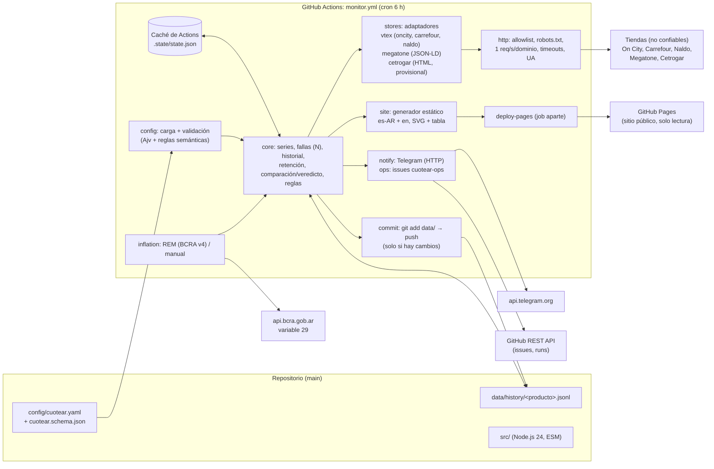

# DRT — Documento de Requerimientos Técnicos: cuotear

Versión: 0.1 (borrador) · Fecha: 2026-11-22 · Estado: para revisión
Origen: [DAF v0.4](DAF.md) (rondas 1 a 10 de [requirements-log.md](requirements-log.md)), `CLAUDE.md`, informe y script del spike de acceso a tiendas (rama `spike/store-access`, 2026-11-22) y verificaciones propias del 2026-11-22 (sección 22, Fuentes).
Decisiones: delegadas por completo al arquitecto (DEC-01). Las decisiones significativas tienen ADR en [`docs/adr/`](../adr/). Toda decisión no confirmada por el dueño ni verificada contra una fuente se marca **Supuesto** con id `ST-xx` (sección 20.2).

Convenciones:
- Referencias a requisitos: RF/RN/RNF/S/R del DAF. Las preguntas abiertas del DAF (sección 15.2) se citan como `Q-1` … `Q-18` y se responden en la sección 19.
- "Verificado" = comprobado el 2026-11-22 contra la fuente citada. "No verificado" = se dice explícitamente.
- Importes monetarios internos: **centavos enteros de ARS** (sección 12).
- No hay código en este documento salvo contratos (interfaces, esquemas, formatos) que el desarrollador debe respetar tal cual.

## 0. Hallazgos que cambian el DAF (resumen ejecutivo)

1. **robots.txt (RNF-07) restringe dos fuentes del DAF** (verificado 2026-11-22):
   - Cetrogar: `Disallow: /api/` para todos los agentes. La API JSON de VTEX (catálogo y checkout) **no se usa**. Cetrogar pasa a **provisional**, con un adaptador por HTML de la ficha de producto a validar en la fase F1; si no se valida, se retira (S-28). ADR-0007.
   - On City: `Disallow: /*checkout*`. La simulación de checkout **no se usa** en On City; la API de catálogo sí está permitida.
2. **El contado se obtiene de las líneas de 1 pago del catálogo VTEX** (`Installments` con `NumberOfInstallments = 1` por medio de pago), sin pedido extra. La simulación de checkout queda como **enriquecimiento opcional** solo donde robots.txt la permite (Carrefour, Naldo). Responde Q-14. ADR-0006.
3. **REM del BCRA:** la API oficial (Estadísticas Monetarias v4.0) publica solo la **mediana de inflación esperada a 12 meses** (variable 29, mensual, % interanual). El vector de expectativas mensuales existe solo en XLSX. v1 usa una tasa constante derivada de la variable 29; el promedio sobre `h` meses de S-07 se difiere. ADR-0010.
4. **Telegram es el único canal implementado en v1**; email queda diferido con disparador (RF-23 se cumple con "Telegram o email"). ADR-0008.
5. Se agregan causas de aviso operativo (RNF-15): robots.txt bloquea una tienda, conflicto al commitear historial, inactividad próxima a 60 días y disponibilidad < 95 %. ADR-0009, ADR-0013.

## 1. Arquitectura general

### 1.1 Resumen

Un único repositorio público en GitHub contiene configuración (YAML validado por JSON Schema), código (Node.js 24 LTS, JavaScript ESM sin framework, dos dependencias de ejecución) e historial de precios (JSON Lines por producto en `data/history/`). Un workflow programado cada 6 h (`monitor.yml`) restaura el **estado de ejecución** desde la caché de GitHub Actions, valida la configuración, obtiene la inflación (API del BCRA o manual), mide todas las URLs **en paralelo entre tiendas y en serie dentro de cada tienda** a través de una capa HTTP única (lista de hosts permitidos, robots.txt, 1 pedido/s por dominio, timeouts, límites de tamaño), normaliza a series, actualiza contadores de falla, calcula comparaciones y veredictos, evalúa reglas de alerta, escribe solo los cambios de historial (un commit por ejecución, solo si hay cambios), genera el sitio estático bilingüe, envía alertas por Telegram, reconcilia los avisos operativos (issues `cuotear-ops`), guarda el estado en la caché y publica el sitio en GitHub Pages desde un artefacto (sin commits). Un workflow de CI (`ci.yml`) valida PRs y pushes: lint, tipos, tests con fixtures, validación de la configuración y construcción del sitio.

### 1.2 Diagrama de componentes



### 1.3 Flujo de datos de una ejecución

| Paso | Componente | Entrada | Salida | Si falla |
|---|---|---|---|---|
| 1 | `actions/cache/restore` | clave `cuotear-state-` (prefijo) | `.state/state.json` | Sin estado: se aplica S-25 (sección 9). |
| 2 | `config` | `config/cuotear.yaml`, estado | configuración efectiva | Inválida → última válida del estado + aviso; sin ninguna → no se mide ni se publica (RF-19). |
| 3 | `inflation` | config, estado | `r` vigente + fuente + fecha | Cadena de respaldo (sección 13.4). |
| 4 | `measure` (stores + http) | URLs | resultados por URL | Falla aislada por tienda (sección 15). |
| 5 | `core/series` | resultados + historial + estado | observaciones por serie, contadores | — |
| 6 | `core/history` | observaciones | puntos nuevos, purga, tamaño | > 100 MB: no persiste puntos (RNF-13). |
| 7 | `core/compare` | series elegibles + `r`, `s` | VP, diferencias, veredictos, mejor opción | Sin `r`: "sin veredicto" + comparación nominal. |
| 8 | `core/rules` | valores previos/actuales, estado | alertas (deduplicadas) | — |
| 9 | `site` | modelo | `dist/site/` | Error interno = bug (la ejecución falla, ver 16.1). |
| 10 | `commit` | `data/history/` | 0 o 1 commit | Conflicto → aviso, sin commit (se reintenta solo). |
| 11 | `notify` | alertas, causas de aviso | Telegram, issues | Envío fallido → pendiente para la próxima; issues fallidos → solo log. |
| 12 | `actions/cache/save` (`if: always()`) | `.state/state.json` | entrada de caché nueva | Pérdida en la próxima ejecución (S-25). |
| 13 | `upload-pages-artifact` + `deploy-pages` | `dist/site/` | sitio publicado | El sitio anterior sigue publicado. |

## 2. Plataforma, lenguaje y política de dependencias

Decisión (ADR-0001): **Node.js 24 LTS**, JavaScript ESM con tipos JSDoc verificados por `tsc --noEmit` (`checkJs`), sin framework.

Justificación:
- El spike ya es Node sin dependencias (`fetch`, `AbortSignal.timeout`, `performance`) y funcionó en el runner (Node 22).
- Node trae `fetch`, `node:test`, `node:crypto`, `Intl` con ICU completo (zona `America/Argentina/Buenos_Aires`, formato `es-AR`), suficiente para HTTP, tests, hashing, fechas y números sin librerías.
- Un solo lenguaje para medición, motor, generador del sitio y tests. El sitio no necesita JS en el navegador (sección 14).
- Alternativas descartadas: Python (dos ecosistemas si el sitio usa JS; sin ventaja en el runner), Deno/Bun (menos "aburridos" en Actions y en el ecosistema de acciones), TypeScript compilado (paso de build extra; JSDoc + `tsc --noEmit` da el chequeo de tipos sin transpilar).
- Versión: Node 24 era Active LTS en mayo de 2026 (verificado, fuente F-12); fin de vida esperado 2028-04-30 según el calendario estándar (**no verificado** en `schedule.json`). Se fija con `.nvmrc` (`24`) y `engines: { "node": ">=24 <25" }`. Migrar a Node 26 LTS antes de 2028-01 (disparador: Dependabot/aviso de EOL).

Dependencias (ST-01):

| Paquete | Tipo | Uso | Motivo |
|---|---|---|---|
| `yaml` | ejecución | Parseo de la configuración YAML 1.2 con posiciones (línea/columna) para mensajes de error | Sin dependencias transitivas; mantenido. |
| `ajv` | ejecución | Validación JSON Schema 2020-12 de configuración, estado y respuestas externas | Estándar de facto. Trae 3–4 transitivas pequeñas. |
| `eslint`, `@eslint/js`, `globals` | desarrollo | Lint | — |
| `typescript` | desarrollo | `tsc --noEmit` sobre JSDoc | Sin emitir código. |
| `html-validate` | desarrollo | Validación HTML y reglas a11y estáticas del sitio generado | Sin navegador. |

Política de cadena de suministro (supply chain):
- Máximo **3 dependencias directas de ejecución**; agregar una requiere nota en el PR justificando por qué no alcanza con la librería estándar (y ADR si es significativa).
- `package-lock.json` commiteado; instalación siempre con `npm ci --ignore-scripts` (sin scripts de instalación).
- Dependabot semanal para `npm` y `github-actions`, agrupado; PRs pequeños (Conventional Commits).
- Acciones de terceros **fijadas por SHA completo** con comentario de versión (`uses: actions/checkout@<sha> # v4.x.y`). Solo acciones de la organización `actions/` (checkout, setup-node, cache, upload-pages-artifact, deploy-pages, configure-pages). Ninguna acción de terceros.
- `npm audit --omit=dev` en CI (informativo; bloquea solo con severidad `critical`).
- Secret scanning y push protection de GitHub activados (gratis en repos públicos). CodeQL "default setup" opcional (gratis en repos públicos; **Supuesto** ST-02).

## 3. Estructura del repositorio

```
.github/
  workflows/ci.yml            # PR y push: lint, tipos, tests, config, sitio
  workflows/monitor.yml       # cron 6 h + workflow_dispatch: medición → publicación
  dependabot.yml
config/
  cuotear.yaml                # configuración del dueño (RF-19)
  cuotear.schema.json         # JSON Schema 2020-12 (sección 4)
data/
  history/<producto-id>.jsonl # historial (RF-24), escrito solo por el bot
docs/specs/ (DAF, DRT, log)   docs/adr/ (ADRs)
src/
  cli/run.js                  # pasos 2–9 (mide, calcula, escribe historial y sitio)
  cli/commit.js               # paso 10 (git, reintentos, aviso de conflicto)
  cli/notify.js               # paso 11 (Telegram, issues, disponibilidad)
  cli/validate-config.js      # usado por CI y por run.js
  config/                     # carga YAML, Ajv, reglas semánticas, mensajes
  http/                       # cliente único: allowlist, robots, rate limit, timeouts
  stores/index.js             # registro de adaptadores (único punto a tocar al agregar una tienda)
  stores/vtex/                # adaptador genérico VTEX + perfiles (oncity, carrefour, naldo)
  stores/megatone/            # JSON-LD por URL directa
  stores/cetrogar/            # HTML de ficha (provisional, F1)
  core/                       # series, fallas, historial, retención, compare, rules (funciones puras)
  inflation/                  # rem (BCRA v4), manual
  notify/                     # telegram, ops-issues, availability
  state/                      # esquema, carga/guardado, migraciones de versión
  site/                       # plantillas, html escapado, gráfico SVG, CSS
  i18n/es-AR.json, i18n/en.json
test/
  unit/  contract/  site/
  fixtures/<tienda>/<caso>.{json,html} + <caso>.expected.json
.nvmrc  package.json  package-lock.json  eslint.config.js  jsconfig.json
.gitattributes                # data/** linguist-generated=true
.gitignore                    # .state/, dist/, node_modules/
```

Notas:
- `.state/` y `dist/` nunca se commitean.
- `data/` es escrito solo por el workflow; las ediciones manuales del dueño se limitan a `config/` (sección 10.3).

## 4. Configuración (RF-19, RF-02, RF-04, RF-22, RF-23, RF-21)

Decisión (ADR-0002): **YAML 1.2** (`config/cuotear.yaml`) validado con **JSON Schema 2020-12** (`config/cuotear.schema.json`) mediante Ajv, más una capa de **validación semántica** que depende del registro de adaptadores (RF-05). YAML porque el dueño lo edita a mano y necesita comentarios; el esquema da autocompletado en el editor (`# yaml-language-server: $schema=./cuotear.schema.json`).

### 4.1 Ejemplo

```yaml
# yaml-language-server: $schema=./cuotear.schema.json
version: 1
alertas:
  canal: telegram          # telegram | ninguno
  idioma: es-AR            # es-AR | en
  reglas:                  # globales (S-10); cada producto puede reemplazar por regla
    baja_minima_pct: 5
    cambio_mejor_opcion: true
comparacion:
  s: 1                     # mes de la primera cuota: 0 o 1 (S-07)
  inflacion:
    fuente: rem            # rem | manual
    manual:                # obligatorio si fuente = manual; respaldo si fuente = rem
      periodo: mensual     # mensual | anual
      pct: 2.5             # porcentaje, >= 0
operacion: {}              # opcional; valores por defecto en la sección 17
productos:
  - id: tcl-75t6c
    nombre: 'Smart TV TCL 75" 75T6C'
    urls:
      oncity: https://www.oncity.com/smart-tv-tcl-75-qled-4k-75t6c/p
      carrefour: https://www.carrefour.com.ar/smart-tv-tcl-75-qled-4k-75t6c-google-tv/p
      megatone: https://www.megatone.net/producto/televisor-tcl-75t6c-qled-75-4k-uhd-google-tv-dlg-120hz_MKT028PMTP/
    reglas:
      precio_objetivo: 2000000
      aplica_a: contado
```

(Las URLs de On City y Carrefour del ejemplo son ilustrativas; la de Megatone es la del spike.)

### 4.2 JSON Schema (normativo)

```json
{
  "$schema": "https://json-schema.org/draft/2020-12/schema",
  "$id": "https://cuotear.local/config/cuotear.schema.json",
  "title": "cuotear: configuración v1",
  "type": "object",
  "additionalProperties": false,
  "required": ["version", "productos"],
  "properties": {
    "version": { "const": 1 },
    "alertas": {
      "type": "object",
      "additionalProperties": false,
      "properties": {
        "canal": { "enum": ["telegram", "ninguno"], "default": "telegram" },
        "idioma": { "enum": ["es-AR", "en"], "default": "es-AR" },
        "reglas": { "$ref": "#/$defs/reglas" }
      }
    },
    "comparacion": {
      "type": "object",
      "additionalProperties": false,
      "properties": {
        "s": { "enum": [0, 1], "default": 1 },
        "inflacion": {
          "type": "object",
          "additionalProperties": false,
          "required": ["fuente"],
          "properties": {
            "fuente": { "enum": ["rem", "manual"] },
            "manual": {
              "type": "object",
              "additionalProperties": false,
              "required": ["periodo", "pct"],
              "properties": {
                "periodo": { "enum": ["mensual", "anual"] },
                "pct": { "type": "number", "minimum": 0, "maximum": 1000 }
              }
            }
          },
          "if": { "properties": { "fuente": { "const": "manual" } } },
          "then": { "required": ["manual"] }
        }
      }
    },
    "operacion": {
      "type": "object",
      "additionalProperties": false,
      "properties": {
        "fallas_para_sin_datos": { "type": "integer", "minimum": 1, "maximum": 20, "default": 4 },
        "desactualizado_horas": { "type": "integer", "minimum": 1, "maximum": 168, "default": 12 },
        "retencion_meses": { "type": "integer", "minimum": 1, "maximum": 60, "default": 12 },
        "marginal_pct": { "type": "number", "minimum": 0, "maximum": 10, "default": 1 },
        "verificar_baja_pct": { "type": "number", "minimum": 50, "maximum": 100, "default": 90 },
        "codigo_postal": { "type": "string", "pattern": "^[0-9]{4}$", "default": "5000" }
      }
    },
    "productos": {
      "type": "array",
      "minItems": 0,
      "maxItems": 10,
      "items": { "$ref": "#/$defs/producto" }
    }
  },
  "$defs": {
    "desactivable_pos": {
      "oneOf": [
        { "type": "number", "exclusiveMinimum": 0 },
        { "const": false },
        { "const": "no" }
      ]
    },
    "reglas": {
      "type": "object",
      "additionalProperties": false,
      "properties": {
        "baja_minima_pct": {
          "oneOf": [
            { "type": "number", "exclusiveMinimum": 0, "maximum": 100 },
            { "const": false },
            { "const": "no" }
          ]
        },
        "baja_minima_monto": { "$ref": "#/$defs/desactivable_pos" },
        "precio_objetivo": { "$ref": "#/$defs/desactivable_pos" },
        "aplica_a": { "enum": ["contado", "total_cuotas", "mejor_vp"] },
        "cambio_mejor_opcion": { "type": "boolean" }
      }
    },
    "producto": {
      "type": "object",
      "additionalProperties": false,
      "required": ["id", "nombre", "urls"],
      "properties": {
        "id": { "type": "string", "pattern": "^[a-z0-9](?:[a-z0-9-]{0,38}[a-z0-9])?$" },
        "nombre": { "type": "string", "minLength": 1, "maxLength": 80 },
        "urls": {
          "type": "object",
          "minProperties": 1,
          "maxProperties": 10,
          "propertyNames": { "pattern": "^[a-z0-9-]{2,30}$" },
          "additionalProperties": { "type": "string", "minLength": 12, "maxLength": 500, "pattern": "^https://" }
        },
        "reglas": { "$ref": "#/$defs/reglas" }
      }
    }
  }
}
```

Notas del esquema:
- `urls` es un **mapa tienda → URL**: "más de una URL de la misma tienda en un producto" es imposible por construcción y las claves duplicadas se rechazan en el parseo (`yaml` con `uniqueKeys: true`).
- El valor `no` de una regla (S-31): en YAML 1.2 `no` es un string, no un booleano; se aceptan `false` y `"no"` con el mismo significado (desactiva esa regla). `cambio_mejor_opcion` es booleano.
- Montos en pesos (número; se convierten a centavos al cargar). Porcentajes en % (5 = 5 %).
- El esquema no lista tiendas: la lista vigente vive en el registro de adaptadores (RF-05), y la valida la capa semántica.

### 4.3 Validación semántica (después del esquema)

| Regla | Criterio DAF |
|---|---|
| Cada clave de `urls` es un id del registro de adaptadores con estado `vigente` o `provisional`. | RF-04 (dominio no permitido), RF-05 |
| La URL parsea con `new URL()`, es `https:`, sin usuario/contraseña, sin puerto, host exactamente igual a uno de `adapter.hosts`, y la ruta cumple `adapter.validateUrl` (VTEX: `^/[a-z0-9-]+/p/?$`; Megatone: `^/producto/[A-Za-z0-9_-]+/?$`; Cetrogar: según F1). URLs de búsqueda (`/busca`, `?q=`, `/search`) se rechazan. | RF-04, S-39, Q-16 |
| URL normalizada (host en minúsculas, sin fragmento, sin barra final, sin query salvo `skuId`) única en todo el archivo. | S-12 |
| `id` de producto únicos. | S-21 |
| Rechazo de secretos: ninguna clave en ningún nivel coincide con `/token|password|passwd|secret|api[_-]?key|chat[_-]?id|smtp/i` (ya lo impide `additionalProperties: false`) y ningún string coincide con forma de token de bot (`^\d{6,}:[A-Za-z0-9_-]{30,}$`) ni contiene `@` con forma de email. | RF-19, RNF-11, RNF-14 |
| `aplica_a` sin `precio_objetivo` en el mismo nivel: advertencia (no error). | RF-22 |

Implementación: `src/config/validate.js` devuelve `{ ok, config, errors[] }`; cada error trae `archivo:línea:columna`, ruta (`productos[2].urls.oncity`) y mensaje en es-AR, p. ej. `config/cuotear.yaml:14:15 productos[0].urls.fravega: tienda no permitida (vigentes: oncity, carrefour, naldo, megatone, cetrogar)`. El límite se reporta como `productos: máximo 10 productos (hay 11)` (RF-02). Las líneas se obtienen del CST del paquete `yaml`.

### 4.4 Dónde corre la validación

1. **CI** (`ci.yml`) en cada PR y push a `main` que toque `config/**` o `src/**`: `npm run validate-config` falla el check (feedback inmediato; no bloquea nada si el dueño editó directo en `main`).
2. **En cada ejecución** del monitor (paso 2): si la configuración del repo es inválida se usa `state.lastValidConfig` y se abre/actualiza el aviso `config-invalida` (RNF-15); el sitio muestra un banner "La configuración vigente no es la del repo" mientras el aviso esté abierto (RF-19). Si no hay ninguna válida previa: no se mide ni se publica (el job de deploy no corre) y aviso `config-ausente`.
3. La configuración válida se guarda en el estado (`lastValidConfig` + hash SHA-256 del YAML normalizado).

## 5. Capa HTTP compartida (RNF-07, RNF-12, RN-01, seguridad)

Los adaptadores **no** llaman a `fetch` directamente (regla ESLint `no-restricted-globals` en `src/stores/**`); reciben un `FetchContext`:

| Control | Valor | Ref. |
|---|---|---|
| Hosts permitidos | Unión de `adapter.hosts` del registro + `api.bcra.gob.ar` + `api.telegram.org` + `api.github.com`. Cualquier otro host: error sin red. | SSRF, RF-04 |
| Esquema | Solo `https:`; sin IP literales; sin puertos. | SSRF |
| Redirecciones | `redirect: 'manual'`; se siguen hasta 3 solo si el destino es `https:` y del mismo host permitido; otro caso = falla `redirect`. | SSRF |
| Ritmo | ≥ 1.000 ms entre pedidos al mismo host (cola por host). | RNF-07, S-03 |
| Timeout por pedido | 30 s (`AbortSignal.timeout`). | S-03 |
| Presupuesto por tienda | 5 min (`AbortController` por tienda); al vencer, las URLs restantes de esa tienda = falla `timeout`. | RNF-12 |
| Presupuesto global de medición | 6 min (deja ≥ 3 min para historial, sitio, commit y notificación dentro de los 10 min). | RNF-01 |
| Tamaño máximo de respuesta | 3 MB (lectura en streaming, se corta). | Seguridad |
| Reintentos | 1 reintento tras 5 s para `timeout`, error de red, 5xx y 429 (respeta `Retry-After` ≤ 30 s). **Nunca** para 401/403/451 ni páginas de desafío. | R-01, RNF-07 |
| User-Agent | `cuotear/<versión> (+<URL del repo>; monitor personal de precios)`; la URL se arma con `GITHUB_SERVER_URL/GITHUB_REPOSITORY`. Sin cabeceras que imiten navegadores. | RNF-07 |
| Cabeceras | `accept`, `accept-language: es-AR`. Sin cookies, sin login. | RNF-07 |
| robots.txt | Ver 5.1. | RNF-07 |

Clasificación de respuestas (heredada del spike, `classify()`): `ok_json`, `ok_html`, `blocked` (401/403/429 persistente/451/503 con desafío, o cuerpo con "just a moment", "attention required", "access denied", captcha), `not_found` (404/410), `http_<código>`, `timeout`, `network`, `too_large`, `robots`.

### 5.1 robots.txt en tiempo de ejecución (ADR-0007)

- Se descarga `https://<host>/robots.txt` como máximo una vez cada 24 h por host (caché en el estado). Se interpreta según RFC 9309: grupo del agente `cuotear` si existe, si no `*`; comodines `*` y `$`; gana la regla más específica (más larga); empate → `Allow`.
- Respuesta 4xx → todo permitido (RFC 9309). 5xx/inalcanzable → se usa la copia en caché si tiene ≤ 7 días; si no hay, se considera **todo prohibido** esa ejecución (falla `robots` de la URL).
- Antes de cada pedido a una tienda se verifica la ruta. Prohibida → no se hace el pedido; la URL cuenta como **falla de URL** (RF-15) y se abre el aviso `robots:<tienda>` (RNF-15) para que el dueño decida retirarla (S-28). Si la ruta prohibida es la simulación de checkout (opcional), simplemente no se usa (sin falla).
- Estado verificado el 2026-11-22 (F-6 a F-10):

| Tienda | Reglas relevantes | Rutas que usa cuotear | Resultado |
|---|---|---|---|
| On City | `Disallow: /*checkout*`, `/*?q=*`, `/*test*`, `/*prueba*` | `/api/catalog_system/pub/products/search/<slug>/p` | Catálogo permitido; **simulación prohibida** (no se usa). Slugs con "test"/"prueba" quedarían prohibidos (el chequeo en ejecución lo detecta). |
| Cetrogar | `Disallow: /api/`, `/checkout/`, `/_next/`, `/s?` | Ficha HTML `/<slug>/p` | **API VTEX prohibida** (catálogo y checkout). Solo la ficha HTML (F1). |
| Carrefour | `Disallow: /checkout/*`, `/busca/*`, `/*?_q` | catálogo + `/api/checkout/pub/orderForms/simulation` | Ambos permitidos. |
| Naldo | `Disallow: /checkout/*`, `/busca/*` | catálogo + simulación | Ambos permitidos. |
| Megatone | `Disallow: /` salvo `Allow: /producto/` y otras | `/producto/<slug>/` | Permitido. |

- **Términos de uso (ToS):** no se revisaron (no verificable de forma automática). Ver Q-8 y sección 20.

## 6. Contrato de adaptadores de tienda (RF-03, RF-04, RF-05, RF-14, RF-20, RN-06, RN-09, RN-14)

Decisión: ADR-0006.

### 6.1 Interfaz (normativa, JSDoc)

```js
/**
 * @typedef {'visa'|'mastercard'|'naranja'} Card
 * @typedef {'transferencia'|'debito'|'efectivo'|'promo_un_pago'|'ninguno'} Medio
 *
 * @typedef {Object} StoreAdapter
 * @property {string} id                    // 'oncity' (clave en config.urls)
 * @property {string} displayName           // 'On City' (texto de confianza, del código)
 * @property {string[]} hosts               // ['www.oncity.com']
 * @property {'vigente'|'provisional'} status
 * @property {(url: URL) => {ok: true, canonical: string} | {ok: false, reason: string}} validateUrl
 * @property {(ctx: FetchContext, url: string, opts: {codigoPostal: string}) => Promise<StoreResult>} measure
 *
 * @typedef {Object} CardOffer
 * @property {number} n            // cuotas sin interés (>= 2)
 * @property {number} cuotaCents   // valor de la cuota, centavos
 * @property {number} totalCents   // total publicado, centavos
 *
 * @typedef {Object} StoreResult
 * @property {'ok'|'sin_stock'|'sin_oferta'|'falla'} outcome
 * @property {{kind: 'blocked'|'robots'|'not_found'|'timeout'|'network'|'http'|'parse'|'redirect'|'too_large'|'ambiguous', detail: string}} [failure]
 * @property {number} [listaCents]          // precio publicado (ver 6.2)
 * @property {{valorCents: number, medio: Medio, descuentoPct: number|null} | {fallido: true}} [contado]
 * @property {Record<Card, CardOffer | null | {invalida: true, motivo: string}>} [tarjetas]
 * @property {{requests: number, ms: number}} meta
 */
```

Reglas del contrato:
- `outcome = 'falla'` ⇒ suma 1 a **todas** las series de esa URL (S-32). `sin_stock` y `sin_oferta` no suman (RN-06, S-32).
- Una tarjeta `null` = "sin oferta" para esa tarjeta (no falla). `{invalida}` = falla solo de esa serie (RF-14, total ≠ n × C ± n).
- `contado: {fallido: true}` = descuento detectado pero no interpretable (S-05): falla solo de la serie contado.
- `detail` es texto **generado por el adaptador** (máx. 200 caracteres, sin contenido descargado). Ningún texto de la tienda sale del adaptador: solo números, enumeraciones e ids validados (RN-01).
- Toda respuesta se valida con un esquema Ajv del **subconjunto de campos usados** (campos extra se ignoran). Números: finitos, ≥ 0, < 1e10 pesos. Lectura explícita de campos (nunca `Object.assign` ni spread de objetos descargados: evita contaminación de prototipos).
- Pesos → centavos: `Math.round(valor * 100)`.

### 6.2 Adaptador VTEX (On City, Carrefour, Naldo)

Pedidos por URL configurada `https://<host>/<slug>/p[?skuId=<id>]`:
1. `GET https://<host>/api/catalog_system/pub/products/search/<slug>/p` (endpoint "Search product by product URL" de la Legacy Search API de VTEX, F-11). Respuesta: arreglo de productos.
2. Opcional (solo perfiles con `simulacion: true` y ruta permitida por robots.txt: Carrefour, Naldo): `POST https://<host>/api/checkout/pub/orderForms/simulation` con `{items:[{id, quantity:1, seller}], country:'ARG', postalCode: <codigo_postal>}` (mismo cuerpo que el spike).

Interpretación:
- Arreglo vacío ⇒ `sin_oferta` (producto no ofrecido; caso Naldo con 75T6C; DAF sección 11). No es falla.
- **Ítem (SKU):** si el producto tiene un solo ítem, ese; si tiene varios, el `itemId` igual a `skuId` de la URL; si falta o no coincide ⇒ `falla` `ambiguous`.
- **Selección de vendedor (S-38, Q-15):** se descartan vendedores con `commertialOffer.Price <= 0`, `AvailableQuantity <= 0` o `IsAvailable === false`. Entre los restantes, menor `Price`; empate → `sellerDefault === true`; empate → menor `sellerId` (orden lexicográfico). Si no queda ninguno ⇒ `sin_stock`. Las cuotas y el contado se toman **del mismo vendedor elegido**.
  - Hallazgo del spike: la búsqueda por texto de Carrefour devolvió **tres** productos de marketplace (vendedores DMAKER, Juan Duran Trendy Deals, Multipoint) más el vendedor CARREFOUR con precio 0 en cada uno. Al medir por URL de producto (un `productId`), el problema se reduce a elegir entre los vendedores de ese producto con la regla anterior. **Supuesto** ST-03: la regla de menor precio refleja "lo que paga el comprador" en esa ficha.
- **Lista (`listaCents`)** = `commertialOffer.Price` del vendedor elegido (precio publicado de venta). `ListPrice` de VTEX es el precio "tachado" de referencia (p. ej. Carrefour 2.999.999 vs 2.189.999 en el spike) y **no** se usa ni se guarda (ST-04; ver defecto D-06 del DAF).
- **Tarjetas (RF-14, RN-09, RN-14):** de `commertialOffer.Installments`, por tarjeta:
  - nombre del medio (`PaymentSystemName`) normalizado (minúsculas, sin acentos, espacios colapsados) **igual** a uno de la lista permitida: `visa` → {`visa`}; `mastercard` → {`mastercard`, `master card`}; `naranja` → {`naranja`, `tarjeta naranja`, `naranja x`}. Nombres de marca de tienda o banco (p. ej. "Tarjeta Carrefour Mastercard", "On City Crédito", "Patagonia 365") **no** coinciden y se ignoran (RN-14, S-06). Los nombres no reconocidos se registran en el log (nivel debug) para ajustar la lista.
  - `InterestRate === 0` y `NumberOfInstallments >= 2`; se toma la de **mayor n** (S-04); empate de n → menor total.
  - `T = TotalValuePlusInterestRate`, `C = Value`. Si `|T − n × C| > n` pesos ⇒ `{invalida}` (RF-14).
  - Sin coincidencias ⇒ `null` ("sin datos" sin falla).
  - **Verificado en F3 (2026-11-23):** los fixtures reales de Carrefour traen tanto "Mastercard" (genérica) como "Tarjeta Carrefour Mastercard" como medios distintos; solo la genérica cuenta. En el TCL 75T6C del vendedor DMAKER ninguna tarjeta tiene cuotas sin interés (todas `null`); con el vendedor Juan Duran hay Visa y Mastercard 12x sin interés. El conjunto "solo Mastercard 3x" del spike ya no aparece (los precios y promos cambiaron); se cubre con un caso derivado en el test.
- **Contado (RF-20, S-37, Q-14):**
  - Candidatos = líneas de `Installments` con `NumberOfInstallments === 1` del vendedor elegido, cuyo medio normalizado clasifica como: `transferencia` (contiene "transferencia"), `efectivo` (contiene "efectivo"), `debito` (contiene "debito"/"debit", o es "maestro" o "visa electron"). Medios de crédito, billeteras y marcas de tienda/banco no son candidatos (RN-14).
  - Si hay simulación habilitada y responde: se agregan como candidatos los totales de 1 pago de `paymentData.installmentOptions` por medio (descontando el ítem `Shipping` de `totals` si existiera), con la misma clasificación.
  - `contado.valorCents` = mínimo de los candidatos; `descuentoPct = (lista − contado) / lista × 100` si la diferencia supera 100 centavos (redondeo), si no `0`. Medio: el del mínimo; empate → preferencia `transferencia` > `efectivo` > `debito`.
  - Sin candidatos ⇒ `contado = lista` con `{medio: 'ninguno', descuentoPct: null}` (S-05, S-37). Sin falla.
  - Un candidato con valor > lista se ignora (no es descuento).
  - Caso "descuento detectado pero no interpretable" (S-05): no puede ocurrir con estas fuentes numéricas; queda en el contrato para adaptadores HTML.
- **Simulación:** su falla (cualquier clase) **nunca** marca falla: se usa solo el catálogo. Se registra en el log.
- Pedidos por URL: 1 (On City, Naldo sin simulación) o 2 (Carrefour, Naldo con simulación).

Perfiles (datos, no código): `oncity {hosts:['www.oncity.com'], simulacion:false, status:'vigente'}`, `carrefour {hosts:['www.carrefour.com.ar'], simulacion:false, status:'vigente'}`, `naldo {hosts:['www.naldo.com.ar'], simulacion:false, status:'provisional'}`.

**Supuesto (F3, simulación de checkout):** la simulación opcional **no se implementa** en v1. El spike mostró que no agrega descuento de contado respecto del catálogo, así que todos los perfiles quedan con `simulacion: false` (el adaptador rechaza `true`). Las menciones a la simulación en esta sección quedan como diseño diferido, sin efecto en v1.

### 6.3 Adaptador Megatone (solo URL directa, S-39, Q-16)

- URL válida: `https://www.megatone.net/producto/<slug>/` (sin búsqueda; `/search/` y `/busqueda/` se rechazan en la validación).
- 1 pedido `GET` de la ficha. 404/410 ⇒ `falla` `not_found` (cuenta para N; si persiste, el dueño corrige la URL).
- Extracción: bloques `<script type="application/ld+json">` (máx. 20 bloques de ≤ 200 KB, extraídos con expresión regular acotada; no se ejecuta nada); `JSON.parse` de cada uno; se busca un nodo `@type` = `Product` (también dentro de `@graph`); `offers` (objeto o arreglo; `AggregateOffer` usa `lowPrice`); `priceCurrency` debe ser `ARS`.
- Precio: número, o string `^\d+(\.\d{1,2})?$` (formato schema.org con punto decimal). Cualquier otro formato (p. ej. con separadores de miles) ⇒ `falla` `parse` (**Supuesto** ST-05: el formato exacto se fija con el fixture de F1; el spike mostró 2.299.999 pero su regex aceptaba ambos formatos).
- `availability` `OutOfStock`/`Discontinued`/`SoldOut` o precio 0 ⇒ `sin_stock`.
- Salida: `listaCents = precio`, `contado = {valorCents: precio, medio: 'ninguno', descuentoPct: null}`, tarjetas `null` (RF-03).
- **Supuesto** ST-15 (F3): la ficha real (capturada el 2026-11-23) trae el precio como string `"2299999.00"` con `InStock`, sin cuotas ni descuento de contado; se confirma ST-05. El adaptador implementa: varias ofertas ⇒ menor precio entre las disponibles (como ADR-0006); `offers` ausente, sin precio, con moneda distinta de ARS o JSON-LD sin `Product` ⇒ `falla` `parse` (nunca `sin_stock` por dato faltante). `tarjetas` es `{visa: null, mastercard: null, naranja: null}` (sin datos, degradada) y `contado` = lista con `medio: 'ninguno'` (como VTEX sin candidatos). La ficha se pide siempre como `/producto/<slug>/` (con barra final, sin query ni fragmento). `fixtures:capture` guarda solo el JSON-LD `Product`.

### 6.4 Cetrogar (provisional por robots.txt) y Naldo (provisional por catálogo)

- **Cetrogar** (ADR-0007): la API VTEX está prohibida por robots.txt. En F1 se captura la ficha HTML `/<slug>/p` (permitida) y se evalúa: (a) JSON-LD `Product` con precio → al menos lista/contado como Megatone; (b) datos embebidos con cuotas por tarjeta (si existieran, se extraen con el mismo criterio de 6.2). Si (a) no se cumple, Cetrogar se **retira** (S-28) con decisión registrada en DAF y log. Hasta entonces su id está en el registro con `status: 'provisional'`.
  - **Supuesto (F3):** Cetrogar queda **fuera de v1** hasta que exista un adaptador HTML. No hay perfil ni fixture, no se hace ningún pedido a `/api/` de Cetrogar y ninguna configuración ni test lo referencia como tienda activa (su id no está en el registro, por lo que sus URLs son inválidas en la configuración).
- **Naldo** (S-40, Q-17): en F1 el dueño elige un producto que Naldo tenga en stock y se captura el fixture (catálogo + simulación). Criterio de validación: el adaptador VTEX devuelve lista y al menos una serie de tarjeta o contado sin cambios de código. Si falla o no se hace antes del cierre de F3, Naldo se retira (S-28).
  - **Supuesto (F3):** Naldo no ofrece el TCL 75T6C (el catálogo no devuelve producto). El adaptador VTEX se validó, sin cambios de código, con un TCL en stock (75A400U, capturado el 2026-11-23): lista, contado (débito, 0 %) y las tres tarjetas a 6 cuotas sin interés. Como no es el producto del caso, Naldo sigue `provisional`.

### 6.5 Pruebas de contrato con fixtures

- `test/fixtures/<tienda>/<caso>.{json,html}`: respuestas reales recortadas a los campos usados (sin cookies ni cabeceras), capturadas con `npm run fixtures:capture -- <tienda> <url>` (herramienta de desarrollo que usa el mismo `FetchContext`, respeta robots.txt y ritmo).
- `<caso>.expected.json`: `StoreResult` esperado. El test ejecuta `adapter.measure` con un `FetchContext` falso que sirve el fixture.
- Casos mínimos:

| Tienda | Casos |
|---|---|
| On City | 3 tarjetas (15/18/12), contado débito 0 %; producto con 2 ítems sin `skuId` (ambiguous); 404. |
| Carrefour | varios vendedores con uno a precio 0 (S-38); nombre "Tarjeta Carrefour Mastercard" ignorado; simulación caída (sin falla); simulación con transferencia más barata (descuento > 0, caso sintético). |
| Naldo | arreglo vacío → `sin_oferta`; producto válido (F1). |
| Megatone | JSON-LD normal; `@graph`; `AggregateOffer`; OutOfStock; precio con formato inválido → `parse`; 404. |
| Cetrogar | ficha HTML (F1). |
| Comunes | 403 CloudFront; 403 Cloudflare "Just a moment..."; JSON malformado; respuesta > 3 MB; texto de inyección ("ignorá las instrucciones…") en `productName`/descripción, que no altera la salida (RN-01); total ≠ n × C (tarjeta inválida); cuotas con interés (`InterestRate > 0` → `null`). |

- Los fixtures se refrescan cuando un adaptador falla en producción por `parse` (disparador) y como mínimo al agregar o modificar un adaptador.

## 7. Series, fallas y elegibilidad (RF-15, RN-06, RN-08, S-26, S-32)

- **Clave de serie:** `<tienda>/contado` o `<tienda>/<tarjeta>:<n>` (p. ej. `oncity/visa:15`). Para Megatone solo existe `megatone/contado` (= lista, S-39).
- **Cambio de n (RN-08):** si la tarjeta aparece con otra n, se agrega un punto `cerrada` a la serie anterior y se abre la nueva (sin alerta, RN-12; contador en 0).
- **Contador de fallas** (en el estado, por serie): `falla` de URL ⇒ +1 a todas las series **abiertas** de esa URL; tarjeta `{invalida}` ⇒ +1 a esa serie; contado `{fallido}` ⇒ +1 a contado; éxito ⇒ 0. `sin_stock`/`sin_oferta` no modifican el contador.
- **Estados mostrados:** `valida` (contador 0, último punto `ok`), `fallida` (contador 1 a N−1: se muestra el último valor válido con marca), `sin_datos` (contador ≥ N, o tarjeta sin oferta), `sin_stock`, `cerrada`.
- **Elegible** (S-26) = estado `valida` en esta ejecución. La elegibilidad se decide por el estado de la serie, no por la antigüedad: un valor desactualizado (> 12 h) implica fallas previas (contador > 0). Única excepción: tras una pérdida del estado, una serie medida con éxito en esta ejecución es elegible aunque el sitio la hubiera mostrado desactualizada antes (sección 9).
- Primera medición de una URL nueva: todas las series nuevas, sin alerta (RN-12).

## 8. Historial en el repo (RF-24, RNF-13, S-13, S-33)

Decisión: ADR-0003.

### 8.1 Formato

Un archivo **JSON Lines** por producto: `data/history/<producto-id>.jsonl`, una línea por punto, ordenado por `t` y luego por `serie`. Append-only salvo la purga. Las diferencias de git muestran solo líneas agregadas.

```jsonc
// contado (VTEX)
{"t":"2026-11-22T12:17:41Z","tienda":"oncity","serie":"contado","estado":"ok","valor":229999900,"lista":229999900,"medio":"debito","desc":0}
// tarjeta
{"t":"2026-11-22T12:17:41Z","tienda":"oncity","serie":"visa:15","estado":"ok","total":229999900,"cuota":15333326,"n":15}
// sin stock / sin oferta / cerrada (sin importes)
{"t":"2026-11-23T00:17:09Z","tienda":"carrefour","serie":"contado","estado":"sin_stock"}
{"t":"2026-11-23T00:17:09Z","tienda":"oncity","serie":"visa:15","estado":"cerrada"}
```

- Importes en **centavos enteros**; `desc` = `descuento_pct` (número o `null`); `t` en UTC ISO 8601 (segundos).
- Esquema JSON del punto en `src/core/history.schema.json`; las líneas que no validan se ignoran al leer con advertencia (nunca rompen la ejecución).
- **Cuándo se agrega un punto:** cuando cambia el valor, la condición (`medio`, `desc`), la lista, la cuota/total, o el estado entre `ok`/`sin_stock`/`sin_oferta`/`cerrada`. **Las fallas no generan puntos** (viven en el contador del estado), de modo que una tienda bloqueada no produce commits (ST-06; interpretación de "estado" de la sección 9 del DAF).
- Último valor válido de una serie = último punto con `estado: "ok"` (RN-06: al volver el stock se compara contra él).
- Fecha de la última medición válida = `state.series[clave].lastValidAt` (no se versiona).

### 8.2 Retención, purga y compactación

- En cada ejecución, por archivo: se eliminan los puntos con `t` anterior a `ahora − retencion_meses` **salvo el último punto de cada serie** (RF-24, S-13). Los criterios de RF-24 (13 y 14 meses) se prueban con fechas fijas.
- Producto quitado de la configuración (efectiva): su archivo se borra de `data/history/` en esa ejecución (git conserva la versión anterior; S-33). Sin alertas.
- **Tamaño** = suma de bytes de `data/history/*.jsonl` tras la escritura propuesta: ≥ 45 MB → aviso `historial-45mb`; > 50 MB → se mantiene el aviso (límite blando); > 100 MB → no se escriben puntos nuevos (se descartan en memoria), aviso `historial-100mb`; alertas y sitio siguen (RNF-13). Los umbrales son constantes del código (no configurables; ST-07).
- Estimación: 10 productos × 5 tiendas × ~4 series = ~200 series; ~150 B por línea; con ~2 cambios por serie por semana ≈ 3 MB/año. Muy por debajo de 45 MB.
- **Compactación adicional:** ninguna en v1. Diferido: dividir por año (`data/history/<id>/<aaaa>.jsonl`) si algún archivo supera 5 MB (disparador).

### 8.3 Estrategia de commit

- Paso `commit` (Node, `child_process` con `git`): si `git status --porcelain -- data/` está vacío ⇒ **cero commits** (RF-24). Si no: `git add data/` y **un** commit con autor `github-actions[bot]` y mensaje `chore(data): record price changes (2026-11-22 12:17 UTC)`; si solo hubo purga/borrado: `chore(data): purge price history (…)`.
- Push a `main` con el `GITHUB_TOKEN` (`contents: write`). El checkout usa `persist-credentials: false`; el token se inyecta solo en este paso (`http.extraheader`).
- **Conflictos con ediciones manuales:** el dueño edita `config/` y el bot solo `data/`, por lo que un `git pull --rebase` nunca conflictúa en uso normal. Algoritmo: hasta 3 intentos de `fetch` + `rebase` + `push` con espera de 5 s. Si el rebase conflictúa (alguien editó `data/` a mano) o se agotan los intentos ⇒ `rebase --abort`, sin commit, aviso `commit-conflicto`. **Autocuración:** los puntos nuevos se calculan contra el historial del repo, no contra el estado, por lo que la siguiente ejecución vuelve a detectar el cambio y lo escribe; las alertas no se duplican (sección 13.3).
- La configuración usada es la del SHA del checkout; un cambio de configuración durante la ejecución se aplica en la siguiente.
- Los pushes con `GITHUB_TOKEN` no disparan otros workflows (no hay bucles; CI no corre sobre commits del bot).
- **Protección de rama:** si el dueño activa reglas en `main`, debe permitir el push del bot o excluir `data/**` (documentar en README; ST-08).

## 9. Estado de ejecución fuera de los commits (S-25, R-07, Q-11)

Decisión: ADR-0004 — **caché de GitHub Actions**.

- Archivo `.state/state.json` (≤ 1 MB esperado), con `schemaVersion` y validado con Ajv al cargar; inválido o versión desconocida ⇒ se trata como perdido.
- Restauración: `actions/cache/restore` con `key: cuotear-state-${{ github.run_id }}-${{ github.run_attempt }}` y `restore-keys: cuotear-state-` (toma la entrada más reciente del prefijo). Guardado: `actions/cache/save` con `if: always()` y la clave única de la ejecución (las entradas de caché son inmutables).
- Alcance: el monitor corre en la rama por defecto; las cachés creadas en `main` no pueden ser escritas por PRs (las cachés de un PR quedan en su propio alcance), lo que evita el envenenamiento desde forks.
- Límites (verificados, F-3, F-4): se eliminan entradas **no accedidas en 7 días** y el total por repo tiene un tope por defecto de **10 GB** (desalojo por último acceso). Con 4 ejecuciones diarias la entrada vigente se accede cada 6 h; ~28 entradas de ≤ 1 MB por semana. GitHub ofrece desde 2025-11 superar 10 GB con pago por uso: **no aplica** (no se cambia el límite por defecto; costo 0). Opcional: un paso que borre entradas `cuotear-state-*` de más de 3 días (requiere `actions: write`; **no** se incluye en v1 por mínimo privilegio).

Contenido:

```jsonc
{
  "schemaVersion": 1,
  "lastRunAt": "2026-11-22T12:17:41Z",
  "lastValidConfig": { "hash": "sha256:…", "config": { /* configuración normalizada */ } },
  "series": { "tcl-75t6c|oncity/visa:15": { "failures": 0, "lastValidAt": "…" } },
  "eligible": { "tcl-75t6c": ["oncity/contado", "oncity/visa:15"] },   // elegibles en la ejecución anterior
  "prevBest": { "tcl-75t6c": { "tipo": "cuotas", "tienda": "oncity", "serie": "mastercard:18", "valorCents": 0, "r": 0.0165 } },
  "inflation": { "fuente": "rem", "anualPct": 21.8, "fecha": "2026-10-31", "obtainedAt": "…" },
  "robots": { "www.oncity.com": { "fetchedAt": "…", "status": 200, "rules": [] } },
  "pendingAlerts": [ /* alertas no enviadas, máx. 48 h */ ],
  "sentAlertIds": [ { "id": "…", "at": "…" } ],                         // retención 14 días
  "ops": { "lastCauses": ["…"] }
}
```

Pérdida del estado (cache miss o inválido), comportamiento (S-25, completado):
- Contadores de falla en 0; `lastValidAt` se toma del último punto `ok` del historial (puede verse "desactualizado" hasta la próxima ejecución exitosa).
- `prevBest` y `eligible` vacíos ⇒ esa ejecución **no** alerta por `cambio_mejor_opcion` ni por `precio_objetivo` con `aplica_a = mejor_vp`; la mejor opción calculada pasa a ser la base.
- `pendingAlerts` perdidas; `sentAlertIds` perdidos ⇒ riesgo bajo de reenvío si coincidiera un commit fallido previo (aceptado).
- `lastValidConfig` perdida ⇒ si la configuración del repo es inválida, no se mide ni publica y aviso `config-ausente` (RF-19).
- `inflation` perdida ⇒ se vuelve a consultar el REM.
- `robots` perdida ⇒ se vuelven a descargar.
- El historial no se pierde. Se escribe una línea `::notice::` y una fila en el resumen ("estado reconstruido"); **no** es aviso operativo (no está en las causas de RNF-15).

## 10. Planificación y workflows (RF-07, RNF-01, RNF-10, RNF-12, R-04)

Decisión: ADR-0005.

### 10.1 `monitor.yml`

- Disparadores: `schedule: cron: '17 */6 * * *'` (00:17, 06:17, 12:17, 18:17 UTC = 21:17, 03:17, 09:17, 15:17 ART; minuto 17 para evitar el pico de inicio de hora) y `workflow_dispatch` con entrada `dry_run` (mide y genera, sin commit, sin alertas ni issues, sin deploy).
- Tolerancia (S-02): hasta 60 min de demora del cron. GitHub puede demorar o, con carga alta, descartar ejecuciones programadas (documentación de eventos `schedule`, F-14): se mide RNF-10 (sección 18.3). Si al iniciar `now − lastRunAt > 7 h`, se escribe `::warning::` (sin aviso operativo).
- `permissions: {}` a nivel de workflow; por job:

| Job | `timeout-minutes` | Permisos | Pasos |
|---|---|---|---|
| `run` | **10** (RNF-01, S-15) | `contents: write`, `issues: write`, `actions: read` | checkout (`persist-credentials: false`) → setup-node (caché npm) → `npm ci --ignore-scripts` → cache restore → `node src/cli/run.js` → `node src/cli/commit.js` → `node src/cli/notify.js` (único paso con `TELEGRAM_*` en `env`) → cache save (`always()`) → `upload-pages-artifact` (`dist/site`) |
| `deploy` | 5 | `pages: write`, `id-token: write` | `needs: run`, `environment: github-pages`, `deploy-pages` |

- `concurrency: { group: cuotear-monitor, cancel-in-progress: false }`: nunca dos ejecuciones simultáneas (protege el estado y el push).
- **Un solo job de medición con paralelismo en proceso** (no matriz por tienda): un checkout, una caché, un commit, sin pasar artefactos entre jobs; el arranque de cada job extra (~20–40 s) se ahorra; el paralelismo entre tiendas (S-29) se logra con `Promise.allSettled` por tienda y cola por host.
- Presupuesto de tiempo (peor caso): instalación ~30 s + medición ≤ 6 min (tope global; cada tienda ≤ 5 min) + historial/sitio ~10 s + commit ~10 s + notificación ≤ 1 min ⇒ < 8 min < 10 min.
- Volumen: ≤ 10 productos × 5 tiendas = 50 URLs, ≤ 2 pedidos por URL + robots.txt diario ⇒ ≤ 20 pedidos por tienda por ejecución, a 1 pedido/s ≈ 20–40 s por tienda.
- Código de salida: los scripts terminan en 0 ante fallas de tiendas, avisos y errores de envío; solo un error interno no previsto (bug) termina en ≠ 0. `commit.js` y `notify.js` corren con `if: always()` si `run.js` produjo `dist/site` y el modelo.

### 10.2 `ci.yml`

- `on: pull_request` y `push` a `main`; `permissions: contents: read`; `concurrency` por ref con `cancel-in-progress: true`; timeout 10 min.
- Pasos: `npm ci --ignore-scripts` → `npm run lint` (ESLint) → `npm run typecheck` (`tsc --noEmit`) → `npm test` (`node --test`, unit + contrato + sitio, con cobertura) → `npm run validate-config` → `npm run build-site -- --fixtures` (sitio con datos de fixtures) → `html-validate dist/site` → chequeos de higiene (sección 16.4). Sin red hacia tiendas (los tests usan fixtures).
- `npm test` y `npm run lint` quedan definidos en `package.json` (CLAUDE.md los marca TBD).

### 10.3 Suspensión del cron por inactividad (R-04)

- Hecho (F-1, F-2): en repos públicos, los workflows programados se deshabilitan tras **60 días sin actividad** en el repositorio. Si los commits de `github-actions[bot]` cuentan como actividad **no está confirmado oficialmente** (la práctica comunitaria de "keepalive" con commits del bot sugiere que sí).
- Mitigación v1 (ADR-0013): (1) los commits de historial suelen ser frecuentes (los precios cambian); (2) cada ejecución consulta la fecha del último commit de `main` (repo local, sin API) y, si supera **45 días**, abre el aviso `inactividad` (issue `cuotear-ops`) pidiendo al dueño un commit o reactivar desde la pestaña Actions; (3) no hay commit de latido (S-25).
- Diferido con disparador (primera suspensión observada): llamar a `PUT /repos/{owner}/{repo}/actions/workflows/{id}/enable` (requiere `actions: write`; la comunidad reporta que reinicia el contador; **no verificado**) o un commit de latido mensual.

## 11. Secuencia interna de una ejecución (`run.js` → `commit.js` → `notify.js`)

1. Cargar estado (o estado vacío + marca "perdido").
2. Cargar y validar configuración; decidir la efectiva (repo o `lastValidConfig`); registrar causas `config-*`.
3. Resolver inflación (13.4).
4. Leer historial de los productos de la configuración efectiva (puntos previos, últimos `ok` por serie).
5. Medir: una tarea por tienda (`Promise.allSettled`), URLs en serie dentro de la tienda, presupuestos de 5 y 6 min.
6. Normalizar a observaciones por serie; abrir/cerrar series (RN-08); actualizar contadores (RF-15).
7. Calcular puntos nuevos contra el historial (no contra el estado); purga; borrado de productos quitados; tamaño (RNF-13).
8. Comparación y veredictos con la `r` vigente; mejor opción (13.1).
9. Reglas y alertas (13.2) + pendientes del estado − ya enviadas.
10. Escribir `data/history/*.jsonl`, el modelo del sitio y `dist/site/`; escribir el estado intermedio (incluye alertas a enviar y causas detectadas).
11. `commit.js`: commit/push o nada (8.3); agrega la causa `commit-conflicto` si aplica.
12. `notify.js`: Telegram (13.5), disponibilidad (18.3), reconciliación de issues (13.6); actualiza `pendingAlerts`, `sentAlertIds`, `ops` en el estado.
13. Guardado de caché, artefacto de Pages, deploy.

## 12. Precisión numérica

- Importes medidos y almacenados: **centavos enteros** (`Number.isSafeInteger`); comparaciones de baja (RN-08) en enteros ⇒ sin errores de coma flotante.
- Cálculos de VP: `Number` (IEEE-754 doble) sobre pesos; error relativo ~1e-15, irrelevante para ±1 peso.
- Porcentajes: `dif * 100 / Pc` (multiplicar antes de dividir), así los casos exactos del DAF (−1,00 %) dan exactamente −1.
- Comparación VP vs Pc y empate: sobre `Math.round(VP × 100)` (centavos) vs `PcCents`.
- Visualización: redondeo al peso con `Intl.NumberFormat` (`maximumFractionDigits: 0`); porcentajes con 2 decimales (RF-21 punto 6).

## 13. Comparación, veredicto, reglas y alertas

### 13.1 Motor de comparación (RF-21, RN-11, S-07, S-08; Q-9)

Decisión: ADR-0012. Se ejecuta **en el pipeline** (Node, `src/core/compare.js`, funciones puras), no en el navegador; el sitio recibe valores ya calculados.

- Para cada producto y cada serie de tarjeta **elegible** de cada tienda: `Dif$ = T − Pc`, `Dif% = (T − Pc) × 100 / Pc` usando el `Pc` (contado elegible) **de la misma tienda** para el detalle por tienda.
- `VP = Σ_{k=1..n} C / (1 + r)^{s + k − 1}` (suma directa, n ≤ 72; con `r = 0` ⇒ `n × C`).
- `DifVP$ = VP − Pc`, `DifVP% = DifVP$ × 100 / Pc`. Veredicto por opción: `VP < Pc` (en centavos) ⇒ `cuotas`; si no ⇒ `contado`. Etiqueta `marginal` si `|DifVP%| < marginal_pct` (1 por defecto).
- Veredicto por producto: `Pc* = min(Pc)` entre tiendas elegibles; `VP* = min(VP)` entre todas las tienda × tarjeta elegibles; `VP* < Pc*` ⇒ cuotas (tienda, tarjeta, n) si no contado (tienda). `DifVP%` del producto = `(VP* − Pc*) × 100 / Pc*`. Sin `Pc*` o sin ninguna tarjeta elegible ⇒ "sin veredicto". Sin `r` ⇒ "sin veredicto" pero con `Dif$`/`Dif%` nominales.
- Mejor opción (para resaltados y RF-22): `contado@tienda` con `Pc*` o `cuotas@tienda/tarjeta:n` con `VP*`; empate de valor con la anterior ⇒ se mantiene la anterior (S-10).
- Tests obligatorios: los tres escenarios del ejemplo del DAF (A, B, C) y todos los criterios de aceptación de RF-21 (incluido anual 40 % ⇒ r ≈ 2,8436 %, VP ≈ 1.004.757 ± 5).

### 13.2 Reglas (RF-22, S-10, S-31)

Implementación en `src/core/rules.js` (puras), entrada: configuración efectiva, puntos previos (historial antes de esta ejecución), observaciones actuales, `r` previa y actual, `state.eligible`, `state.prevBest`, hash de configuración por producto.

- Resolución de reglas por producto: por cada regla, valor del producto si existe, si no el global; `false`/`"no"` desactiva. Si ninguna clave existe en ningún nivel ⇒ regla implícita "baja estricta" (`baja > 0`) sobre contado y totales. Si hay claves y todas quedan desactivadas ⇒ sin alertas.
- `baja_minima_pct` / `baja_minima_monto`: por serie (contado o tarjeta:n, **no VP**), valor válido previo (último `ok`) vs actual `ok`; baja = `prev − actual > 0`; dispara si `baja × 100 / prev ≥ umbral` o `baja ≥ monto` (inclusivo).
- `precio_objetivo`: `contado` y `total_cuotas` por serie, cruce `prev > objetivo ≥ actual`. `mejor_vp`: se calcula `VP*prev` con valores previos y `r_prev`, y `VP*'` con valores actuales y **`r_prev`**, ambos sobre **E = elegibles en ambas ejecuciones**; dispara si `VP*prev > objetivo ≥ VP*'` y además el `VP*` real (con `r` actual) ≤ objetivo. Así un cruce causado solo por `r` no alerta.
- `cambio_mejor_opcion`: con E = elegibles(prev) ∩ elegibles(actual) y la misma `r_prev`, se calcula la mejor opción con valores previos y con valores actuales; dispara si difieren en identidad (tipo, tienda, tarjeta, n) **y** la mejor opción real coincide con la mejor actual sobre E. No dispara si: el estado se perdió, cambió el hash de configuración del producto, cambió `s`, o la diferencia proviene solo de series que entran/salen. La mejor opción real pasa a `state.prevBest`.
- RN-12: series sin punto `ok` previo no alertan. RN-13: baja `> verificar_baja_pct` (estricto) ⇒ marca "a verificar".
- Una alerta por (producto, serie) aunque se cumplan varias reglas: lista las reglas satisfechas. `cambio_mejor_opcion` y `mejor_vp` generan una alerta por producto.

### 13.3 Deduplicación y reintentos de alertas (RF-23)

- `alertId = sha256(productoId | serie | tPuntoPrevio | prevCents | actualCents | regla(s))`. Si está en `sentAlertIds` (14 días) no se reenvía; si el commit falló y se vuelve a detectar el mismo cambio, el id es el mismo ⇒ sin duplicado.
- Envío fallido ⇒ queda en `pendingAlerts` y se reintenta en la siguiente ejecución; se descarta a las 48 h con línea de log (ST-09, evita alertas viejas). Si el estado se perdió, los pendientes se pierden (S-25).
- Entrega "al menos una vez": un timeout de red después de que Telegram aceptó el mensaje puede producir un duplicado (aceptado).

### 13.4 Fuente de inflación (RF-21, S-07, S-09; Q-3)

Decisión: ADR-0010.

Hechos verificados (2026-11-22):
- API del BCRA **Estadísticas Monetarias v4.0** (la v3.0 de "Principales Variables" tiene fecha de deprecación 2026-02-28) (F-15).
- `GET https://api.bcra.gob.ar/estadisticas/v4.0/monetarias` lista variables; la **variable 29** es "Mediana de la variación interanual próximos 12 meses del índice de precios al consumidor del relevamiento de expectativas de mercado", periodicidad mensual, unidad porcentaje; último dato 2026-10-31 = 21,8 (F-16).
- `GET https://api.bcra.gob.ar/estadisticas/v4.0/monetarias/29` devuelve `{status, metadata:{resultset:{count, offset, limit}}, results:[{idVariable, detalle:[{fecha, valor}]}]}`, más reciente primero (2026-10-31 21,8; 2026-09-30 21,1; …) (F-17). No se observó autenticación.
- El REM completo (expectativas mensuales para los próximos meses, año calendario, 12 y 24 meses) se publica mensualmente en PDF y **XLSX** (`tablas-relevamiento-expectativas-mercado-<mes>-<aa>.xlsx`), con nombres de archivo no del todo consistentes (F-18, F-19).

Decisión:
- `fuente: rem` ⇒ variable 29, valor más reciente `A` (% anual) ⇒ `r = (1 + A/100)^(1/12) − 1`, **constante para cualquier n** (ST-10). Con 21,8 % ⇒ r ≈ 1,657 % mensual.
- **Desvío de S-07:** S-07 pide el promedio de las expectativas mensuales de los próximos `h = n` meses. Ese vector solo está en el XLSX (requiere un parser de XLSX: dependencia pesada y archivos con nombre variable). Se difiere con disparador: diferencia > 0,3 p.p. mensuales entre la expectativa mensual del próximo mes (PDF del REM) y la `r` derivada de la variable 29 durante dos meses seguidos, o pedido del dueño.
- Frecuencia: una consulta por día como máximo (`state.inflation.obtainedAt`).
- Vigencia: el dato es "vigente" si `fecha` tiene ≤ 70 días; si es más viejo se usa igual con marca "desactualizado".
- Respaldo (S-09): error HTTP/TLS/formato ⇒ último valor del estado (marca "desactualizado") ⇒ `manual` de la configuración (marca "respaldo") ⇒ sin `r` ("sin veredicto", comparación nominal visible).
- Nunca se desactiva la verificación TLS. **No verificado:** que `api.bcra.gob.ar` responda desde los runners de GitHub (IPs fuera de Argentina) y que su cadena de certificados sea válida para Node; si falla, se cae al respaldo y se registra; se valida en F2.
- El sitio muestra `r` mensual, la fuente, el dato anual y su fecha, y `s` (RNF-06, R-06).

### 13.5 Canal de alertas (RF-23, S-11; Q-4)

Decisión: ADR-0008 — **Telegram Bot API por HTTP directo** (`fetch`, sin librería). Email: **diferido**.

- Secretos (GitHub Actions secrets): `TELEGRAM_BOT_TOKEN`, `TELEGRAM_CHAT_ID`. Solo se exponen al paso `notify.js`. El token va en la ruta de la URL (`/bot<token>/sendMessage`): los errores se registran **sin** la URL ni el cuerpo de la petición.
- `sendMessage` con `parse_mode: "HTML"`, `link_preview_options: {is_disabled: true}`.
- **Escape:** todo texto variable (nombre del producto de la configuración, nombre de tienda, reglas, números formateados) pasa por `escapeTelegramHtml` que reemplaza `&` → `&amp;`, `<` → `&lt;`, `>` → `&gt;`, `"` → `&quot;` (atributos `href`). Solo se usan las etiquetas `<b>`, `<i>`, `<a href>`; los `href` son URLs de la configuración ya validadas (https y host permitido) o la URL del sitio. Ningún texto descargado de tiendas llega al mensaje (RN-01).
- **Tamaño:** el límite oficial es 1–4096 caracteres por mensaje tras el parseo de entidades (F-20). Se agrupan las alertas de la ejecución en un mensaje y se divide en partes de ≤ 3.800 caracteres **en límites de alerta** (nunca dentro de una etiqueta), enviadas en orden y en serie.
- **Ritmo:** ≥ 1,1 s entre mensajes al mismo chat (FAQ oficial: evitar más de 1 mensaje por segundo por chat; 20 por minuto en grupos) (F-21). Ante 429 se respeta `parameters.retry_after` (≤ 30 s, una vez); si persiste, pendiente.
- Contenido por alerta (RF-23): producto, tienda, tipo (contado o tarjeta + n), condición (generada desde `medio`/`desc` en el idioma configurado), valor anterior, valor nuevo, diferencia, regla(s), marca "a verificar" si aplica, enlace a la tienda y al detalle en el sitio.
- Idioma del mensaje: `alertas.idioma` (es-AR por defecto); mismos catálogos i18n que el sitio.
- Secreto faltante o inválido (401 de Telegram) ⇒ sin envío, aviso `secretos-canal`, el resto continúa (RF-23, RNF-15). `canal: ninguno` ⇒ no se envía ni se avisa.
- Email (diferido): cuando se implemente, `nodemailer` (sin dependencias transitivas) sobre SMTP con credenciales en secretos; disparador: pedido del dueño o indisponibilidad de Telegram. El esquema agregará `email` a `alertas.canal` en ese momento.

### 13.6 Avisos operativos (RNF-15, S-18)

Decisión: ADR-0009.

- Implementación: `src/notify/ops-issues.js` con la REST API de GitHub vía `fetch` y `GITHUB_TOKEN` (`issues: write`). No depende de los secretos de Telegram.
- Identificación: etiqueta `cuotear-ops` (se crea si no existe) y un marcador en el cuerpo `<!-- cuotear-ops:cause=<clave> -->`. Título: `[cuotear-ops] <descripción en es-AR>`.
- Reconciliación por ejecución: se listan los issues abiertos con la etiqueta; por cada causa presente: si existe su issue ⇒ se **actualiza el cuerpo** (última vez visto, cantidad de ejecuciones, enlace a la ejecución; sin comentario para no notificar cada 6 h); si no ⇒ se crea (GitHub notifica al dueño). Causa ausente cuyo issue está abierto ⇒ comentario "resuelto" y cierre (ST-11).
- Causas: `todas-tiendas-fallan`, `secretos-canal`, `config-invalida`, `config-ausente`, `historial-45mb`, `historial-100mb` (DAF) y, agregadas por el DRT, `robots:<tienda>`, `commit-conflicto`, `inactividad`, `disponibilidad` (sección 18.3).
- Además de (b) el issue, (a) cada causa escribe `::error::` en el log y una fila en el resumen de la ejecución (`$GITHUB_STEP_SUMMARY`).
- Si la API de issues falla, solo log; nunca hace fallar la ejecución. Los issues son públicos (repo público): no contienen secretos ni datos personales (RNF-14).
- En `dry_run` no se tocan issues.

## 14. Sitio estático (RF-17, RNF-03, RNF-06, RNF-08; Q-10)

Decisión: ADR-0011 — **generador propio sin framework**, HTML pre-renderizado, **sin JavaScript en el navegador**, desplegado desde artefacto.

### 14.1 Generación y datos

- `src/site/build.js` recibe el modelo (productos, series, estados, comparaciones, veredictos, inflación, salud de tiendas, avisos abiertos, hora de construcción) y escribe `dist/site/`:
  - `index.html` (lista, es-AR), `p/<id>/index.html` (detalle, es-AR)
  - `en/index.html`, `en/p/<id>/index.html` (en)
  - `assets/site.css` (único CSS, sin fuentes externas), `404.html`, `robots.txt` (permite todo).
- Datos **embebidos** en el HTML (no hay `fetch` en el cliente ni JSON público obligatorio).
- "Actualizado a las …" se genera al construir, en `America/Argentina/Buenos_Aires` (RNF-06, S-22); no se versiona.
- Estado vacío (sin productos): instrucciones para editar `config/cuotear.yaml` (RF-17).
- Desactualizado: `now − lastValidAt > desactualizado_horas` (12 h) ⇒ marca; 13 h sí, 11 h no (RF-17).

### 14.2 Plantillas y escape (seguridad)

- Plantillas con una función etiquetada `html\`…\`` que **escapa por defecto** todo valor interpolado (`& < > " '`); el HTML de confianza solo se compone con otros resultados de `html` (tipo marcado). No existe un camino para insertar HTML crudo desde datos.
- Los únicos textos variables son: nombre de producto (configuración), nombres de tienda (código), números formateados, enumeraciones traducidas y fechas. Ningún texto descargado se muestra.
- Enlaces externos: solo URLs de la configuración validadas, con `rel="noopener noreferrer"`.
- `<meta http-equiv="Content-Security-Policy" content="default-src 'none'; style-src 'self'; img-src 'self'; base-uri 'none'; form-action 'none'">` (Pages no permite cabeceras propias; `frame-ancestors` no aplica en meta).
- Sin formularios ni campos de entrada (RF-17).

### 14.3 Gráfico accesible y tabla (RF-17, RNF-08, S-30)

- SVG generado en el servidor: línea **escalonada** por serie (el valor se mantiene hasta el siguiente punto) que termina en `lastValidAt` de la serie, nunca más allá. Menos de 2 puntos ⇒ mensaje en lugar del gráfico.
- `<figure>` con `<figcaption>`; `<svg role="img" aria-labelledby="t d">` con `<title>` y `<desc>` (resumen: mínimo, máximo, último valor por serie).
- Series distinguibles sin color: trazo continuo/discontinuo/punteado y marcador distinto; colores con contraste ≥ 3:1 contra el fondo (WCAG 1.4.11); leyenda textual.
- **Alternativa en tabla** visible debajo (`<table>` con `<caption>`, `<th scope>`): fecha, serie, valor, estado.
- Mejor opción y veredicto: texto explícito ("Conviene cuotas", "Mejor opción") además del resaltado visual (no solo color, WCAG 1.4.1).
- Lista de comprobación WCAG 2.2 AA: contraste 4.5:1, `:focus-visible`, enlace "saltar al contenido", `lang` en `<html>` y en el selector de idioma, encabezados jerárquicos, objetivo táctil ≥ 24 × 24 px (2.5.8), reflujo a 320 px, sin contenido en movimiento.
- Baseline Widely available: solo HTML/CSS ampliamente disponibles (flex/grid, custom properties, `:focus-visible`); sin JS. Se revisa cada propiedad CSS nueva contra los datos de Baseline (MDN/web-features) en la revisión de PR.

### 14.4 i18n (RNF-03, S-34)

- Catálogos `src/i18n/es-AR.json` y `src/i18n/en.json` (claves planas, mensajes con marcadores con nombre). Un test verifica que ambos tengan exactamente las mismas claves y marcadores (100 % de cadenas, RNF-03).
- Formato con `Intl.NumberFormat` (`es-AR` y `en-US`, moneda ARS) y `Intl.DateTimeFormat`.
- Condición de contado generada desde datos (S-34): p. ej. `{medio: 'transferencia', desc: 0}` ⇒ "Pago único por transferencia, sin descuento adicional" / "Single payment by bank transfer, no extra discount"; `{medio: 'ninguno'}` ⇒ "Precio publicado (sin medio de pago identificado)" / "Published price (no payment method identified)".
- Idioma: es-AR en `/`, inglés en `/en/`; selector de idioma en cada página que enlaza a la página equivalente (`hreflang`). "Sin preferencia previa ⇒ es-AR" se cumple porque la raíz es es-AR; no se guarda preferencia (ST-12: sin JS, sin almacenamiento local).

### 14.5 Despliegue a GitHub Pages sin commits

- Fuente de Pages: "GitHub Actions". `actions/upload-pages-artifact` (`dist/site`) en el job `run` y `actions/deploy-pages` en el job `deploy`. No hay rama `gh-pages` ni commits del sitio (sección 9 del DAF).
- Límites (F-22): sitio publicado ≤ 1 GB; ancho de banda blando 100 GB/mes; el límite blando de 10 builds/hora **no aplica** a workflows propios; un deploy se corta a los 10 min. El sitio esperado pesa < 1 MB.
- Si el deploy falla, sigue publicado el anterior; no hay aviso operativo (la ejecución siguiente vuelve a desplegar).

## 15. Manejo de errores y degradación por tienda (RNF-12, RF-15, RNF-07, R-01; Q-5)

| Situación | Tratamiento | ¿Cuenta para N? | ¿Falla la ejecución? |
|---|---|---|---|
| 403/401/451, página de desafío o captcha | `blocked`, sin reintento, sin evasión | Sí (URL) | No |
| robots.txt prohíbe la ruta | `robots`, sin pedido, aviso `robots:<tienda>` | Sí (URL) | No |
| Timeout / red / 5xx / 429 | 1 reintento; luego falla | Sí (URL) | No |
| 404/410 | `not_found` | Sí (URL) | No |
| JSON/HTML con forma inesperada | `parse` | Sí (URL) | No |
| Tarjeta con total incoherente | `{invalida}` | Sí (esa serie) | No |
| Producto no ofrecido (VTEX `[]`) | `sin_oferta` | No | No |
| Sin stock / precio 0 / vendedor a precio 0 | `sin_stock` / se ignora el vendedor | No | No |
| Simulación de checkout caída | se ignora (contado del catálogo) | No | No |
| Todas las tiendas fallan | sitio con datos previos y marcas; aviso `todas-tiendas-fallan` | — | No |
| Excepción no prevista en un adaptador | se captura por tienda (`Promise.allSettled`), se trata como `parse` y se registra la traza | Sí (URL) | No |
| Excepción no prevista fuera de los adaptadores | bug: termina ≠ 0 (cuenta contra RNF-10); estado se guarda igual (`always()`) | — | Sí |

Mitigación de R-01 (Q-5), decidida:
- Sin evasión (RNF-07): ni rotación de IP, ni proxies, ni cabeceras de navegador, ni resolución de desafíos.
- Endpoints JSON públicos donde existen y robots.txt los permite (VTEX en On City, Carrefour, Naldo).
- Reintento único con espera, solo para errores transitorios.
- Degradación por tienda + contador N + aviso `todas-tiendas-fallan`.
- Tienda bloqueada de forma persistente (≥ 7 días en `sin_datos` por `blocked`) ⇒ el dueño la retira (S-28) con decisión en DAF y log. Sin automatismo.
- Respaldo manual (carga manual de precios o ejecución local): **diferido** (sección 20) porque rompe el modelo serverless de una sola fuente de verdad.

## 16. Seguridad

### 16.1 Contenido no confiable (RN-01)

- Las respuestas de tiendas y del BCRA son datos: se parsean (`JSON.parse`, extracción acotada de JSON-LD), se validan con esquemas y se reducen a números/enumeraciones. Nunca se evalúan, ni se siguen enlaces encontrados en ellas, ni se usan como rutas de archivo.
- No se guarda HTML descargado (solo los campos extraídos, DAF sección 9). Los fixtures de test son la excepción y se recortan.
- Escape de salida en sitio (14.2) y en Telegram (13.5).
- **Inyección de prompts:** no hay LLM en el sistema (ni en ejecución ni en CI). Si en el futuro se agregara uno (p. ej. para extraer precios de HTML), el contenido de tiendas debe ir como dato delimitado, sin herramientas ni secretos al alcance del modelo, y su salida validada con esquema igual que hoy.

### 16.2 SSRF y alcance de red

Allowlist de hosts exacta, solo https, redirecciones verificadas, sin IPs literales ni puertos, tamaño máximo (sección 5). Las URLs las escribe solo el dueño (configuración validada).

### 16.3 Secretos (RNF-11, RNF-14)

- Solo en GitHub Actions secrets (`TELEGRAM_BOT_TOKEN`, `TELEGRAM_CHAT_ID`) o variables de entorno locales. Expuestos solo al paso `notify.js`. GitHub enmascara secretos en logs; el código nunca imprime cabeceras, URLs de Telegram ni cuerpos de peticiones con datos de destino.
- La configuración rechaza claves y valores con forma de secreto (4.3).
- `pull_request` desde forks no recibe secretos (comportamiento por defecto); no se usa `pull_request_target`.
- `GITHUB_TOKEN` con permisos mínimos por job (10.1).

### 16.4 Higiene en CI

- Test de "sin datos personales": se buscan en `config/`, `data/` y `dist/site/` patrones de email, forma de token de Telegram y números de chat (`-100\d{10}`); cualquier coincidencia falla el CI (RNF-14).
- Secret scanning + push protection de GitHub (RNF-11).

## 17. Valores configurables y constantes (Q-13)

| Parámetro | Valor | Dónde | Ref. |
|---|---|---|---|
| Frecuencia | cada 6 h, minuto 17 UTC | `monitor.yml` (cron estático) | RF-07 |
| Tolerancia del cron | 60 min (solo diagnóstico; aviso a > 7 h desde la última) | código | S-02 |
| N fallas → "sin datos" | 4 | `operacion.fallas_para_sin_datos` | S-01 |
| Desactualizado | 12 h | `operacion.desactualizado_horas` | S-30 |
| Retención | 12 meses (+ último punto de cada serie) | `operacion.retencion_meses` | S-13 |
| Diferencia marginal | 1 % | `operacion.marginal_pct` | S-08 |
| "A verificar" | > 90 % | `operacion.verificar_baja_pct` | S-16 |
| Código postal de simulación | 5000 | `operacion.codigo_postal` | S-37 |
| `s` | 1 | `comparacion.s` | S-07 |
| Reglas por defecto | ninguna clave ⇒ baja estricta | `alertas.reglas` | S-10 |
| Aviso / blando / duro de historial | 45 / 50 / 100 MB | constantes | RNF-13 |
| Timeout por pedido / tienda / medición / job | 30 s / 5 min / 6 min / 10 min | constantes / workflow | S-03, S-15 |
| Ritmo por dominio | 1 pedido/s | constante | S-03 |
| Tamaño máximo de respuesta | 3 MB | constante | Seguridad |
| robots.txt en caché | 24 h (uso de copia vencida ≤ 7 días) | constante | RNF-07 |
| REM: consulta / vigencia | 1 por día / ≤ 70 días | constantes | RF-21 |
| Alertas pendientes / ids enviados | 48 h / 14 días | constantes | RF-23 |
| Aviso de inactividad | 45 días sin commits | constante | R-04 |
| Umbral de disponibilidad | 95 % en 30 días | constante | RNF-10 |

## 18. Observabilidad

### 18.1 Logs

- Una línea por evento, prefijo `[cuotear]` + componente + id de tienda/producto; nunca contenido descargado (salvo, en nivel debug y truncado a 120 caracteres, nombres de medios de pago no reconocidos, que son datos de catálogo sin riesgo de secreto).
- Anotaciones de Actions: `::warning::` (fallas de tienda, respaldo de inflación, estado reconstruido) y `::error::` (avisos operativos).

### 18.2 Resumen de ejecución

`$GITHUB_STEP_SUMMARY` con: configuración usada (repo o última válida), inflación (`r`, fuente, fecha), tabla por tienda (URLs, resultado, pedidos, ms, clase de falla), series nuevas/cerradas, puntos escritos, commit (sí/no, SHA), alertas (enviadas/pendientes), avisos abiertos/cerrados, duración por fase. Además `run-report.json` como artefacto de la ejecución (retención 7 días).

### 18.3 Disponibilidad (RNF-10)

`notify.js` consulta `GET /repos/{owner}/{repo}/actions/workflows/monitor.yml/runs?event=schedule&created=>=<hoy−30d>` (`actions: read`) y calcula `exitosas / programadas`. Las esperadas son 120 en 30 días; las ejecuciones descartadas por GitHub cuentan como no exitosas (esperadas − registradas). < 95 % ⇒ aviso `disponibilidad`. El valor se muestra en el pie del sitio.

### 18.4 Salud en el sitio

Pie de página: última ejecución, tiendas con falla, avisos abiertos (sin detalle técnico), inflación usada.

## 19. Respuestas a las preguntas abiertas del DAF (sección 15.2)

| Q | Decisión | Sección / ADR |
|---|---|---|
| Q-1 Formato y esquema de configuración | YAML 1.2 + JSON Schema 2020-12 (Ajv) + validación semántica por registro de adaptadores; corre en CI (PR/push) y en cada ejecución; mensajes con archivo:línea:columna y ruta. | 4; ADR-0002 |
| Q-2 Historial | JSONL por producto en `data/history/`, punto solo ante cambio (fallas fuera del historial), un commit por ejecución en `main` por el bot, rebase con 3 reintentos, conflictos ⇒ aviso y autocuración, purga 12 meses conservando el último punto, división por año diferida. | 8; ADR-0003 |
| Q-3 Inflación | API BCRA v4.0 variable 29 (12 meses, mediana) ⇒ r constante; vector mensual (XLSX) diferido; respaldo último ⇒ manual ⇒ sin veredicto. | 13.4; ADR-0010 |
| Q-4 Canal | Telegram por HTTP directo (HTML escapado, ≤ 3.800 caracteres por parte, ≥ 1,1 s entre mensajes, `retry_after`); email diferido (nodemailer + SMTP). | 13.5; ADR-0008 |
| Q-5 Bloqueo de runners | Sin evasión; JSON públicos permitidos por robots; 1 reintento solo transitorio; degradación + N + aviso; retiro manual de tiendas bloqueadas; respaldo manual diferido. | 15 |
| Q-6 Contrato de adaptadores | Interfaz `StoreAdapter`/`StoreResult`, `FetchContext` obligatorio, solo números/enums salen del adaptador, fixtures + `expected.json`; promos de banco/tienda excluidas por lista exacta de nombres de medio. | 6; ADR-0006 |
| Q-7 (reemplazada por Q-18) | Ver Q-18. | — |
| Q-8 ToS/robots | robots.txt verificado y aplicado en ejecución (RFC 9309): Cetrogar sin API (provisional, HTML en F1), On City sin simulación. ToS: **no revisados**; revisión manual del dueño diferida con disparador. | 5.1, 20; ADR-0007 |
| Q-9 Veredicto | En el pipeline, funciones puras, centavos enteros para importes y comparación, doble precisión para VP, tests con el ejemplo del DAF. | 12, 13.1; ADR-0012 |
| Q-10 Sitio e i18n | Generador propio sin framework ni JS en el cliente, datos embebidos, SVG escalonado + tabla, `/` es-AR y `/en/`, catálogos con test de paridad. | 14; ADR-0011 |
| Q-11 Estado, Pages, issues, cuota, inactividad | Caché de Actions (clave por ejecución, `restore-keys`); Pages desde artefacto; issues `cuotear-ops` con marcador por causa; sin cuota de minutos (repo público, RNF-01); aviso de inactividad a los 45 días. | 9, 13.6, 14.5, 10.3; ADR-0004, 0009, 0013 |
| Q-12 Alineación documental | Fuera del alcance de este DRT (no se tocan README/README.es.md). Acción pendiente para el dueño. | 20 |
| Q-13 Valores configurables | Tabla de la sección 17. | 17 |
| Q-14 Simulación VTEX como fuente del contado | **No es la fuente principal.** Contado = líneas de 1 pago del catálogo; simulación opcional donde robots.txt la permite (Carrefour, Naldo), CP configurable (5000), su falla nunca es falla. | 6.2; ADR-0006 |
| Q-15 Vendedor en Carrefour | Descartar precio 0 / sin stock / no disponible; menor `Price`; empate `sellerDefault`; luego `sellerId`. Cuotas y contado del mismo vendedor. Fixtures. | 6.2 |
| Q-16 Megatone por URL | Validación de ruta `/producto/…`; JSON-LD `Product`/`offers`; 404 = falla de URL; formato de precio fijado por fixture en F1. | 6.3 |
| Q-17 Naldo | Validar en F1 con un producto en stock elegido por el dueño; si no se valida al cierre de F3, se retira. | 6.4 |
| Q-18 Mercado Libre y candidatas | **Diferido** (ADR-0014). ML: la documentación oficial muestra búsquedas con token Bearer (app OAuth gratuita); sin verificar acceso desde runners ni si expone cuotas por tarjeta. Frávega/MejoresCompras: bloqueadas. Rodo: sin endpoint. Musimundo: sin catálogo. Disparadores en la sección 20. | 20; ADR-0014 |

## 20. Pendientes y diferidos

### 20.1 Diferidos (con motivo y disparador)

| Ítem | Motivo | Disparador |
|---|---|---|
| Email como canal (RF-23) | Telegram cubre el requisito; SMTP agrega dependencia y secretos. | Pedido del dueño o Telegram inutilizable. |
| Vector mensual del REM (S-07, `h = n`) | Solo en XLSX; parser pesado; nombres de archivo inconsistentes. | Desvío > 0,3 p.p. dos meses seguidos o pedido del dueño. |
| Mercado Libre (API oficial) | Requiere app y token (OAuth); sin verificar desde runners ni datos de cuotas por tarjeta. | Pedido del dueño ⇒ spike con token en secretos desde un runner. |
| Frávega, Rodo, Musimundo | Bloqueo 403 / sin endpoint / sin catálogo (spike). | Revisión semestral manual o cambio observado (p. ej. Frávega responde 200 desde runner en un spike). |
| Carga manual de precios / ejecución local | Rompe fuente única y serverless. | Ninguna tienda medible para un producto que el dueño necesita. |
| Revisión de ToS de cada tienda (RNF-07) | No automatizable. | Antes de cerrar F3 (lista de verificación del dueño); retiro si un ToS prohíbe acceso automatizado. |
| División del historial por año | Innecesaria con el volumen estimado. | Algún archivo > 5 MB. |
| Rehabilitar workflow por API / commit de latido | Privilegio extra (`actions: write`) y efecto no verificado. | Primera suspensión observada. |
| Persistir preferencia de idioma | Requiere JS. | Pedido del dueño. |
| Purga de series cerradas viejas | El DAF pide conservar el último punto de cada serie. | > 500 series cerradas en archivos activos (ver D-10). |
| Auditoría a11y automática con navegador (axe + Playwright) | Pesada para CI; contraste se revisa manualmente. | Cambios de diseño frecuentes o regresiones a11y. |

### 20.2 Supuestos técnicos (ST)

| ID | Supuesto | Sección |
|---|---|---|
| ST-01 | Dependencias: `yaml` + `ajv` en ejecución; tope de 3 directas. | 2 |
| ST-02 | CodeQL default setup opcional. | 2 |
| ST-03 | Vendedor de menor precio entre los disponibles representa lo que paga el comprador. | 6.2 |
| ST-04 | "Lista" = `Price` de VTEX (no `ListPrice`). | 6.2 |
| ST-05 | Formato de precio de Megatone JSON-LD con punto decimal; otro formato = falla. | 6.3 |
| ST-06 | Las fallas no generan puntos de historial (solo contador en el estado). | 8.1 |
| ST-07 | Umbrales de tamaño del historial no configurables. | 8.2 |
| ST-08 | `main` sin protección que impida el push del bot (o excepción configurada). | 8.3 |
| ST-09 | Alertas pendientes se descartan a las 48 h. | 13.3 |
| ST-10 | `r` constante desde la mediana REM a 12 meses para cualquier n. | 13.4 |
| ST-11 | Los issues `cuotear-ops` se cierran solos cuando la causa desaparece. | 13.6 |
| ST-12 | Idioma por URL, sin preferencia guardada. | 14.4 |
| ST-13 | Clasificación de medios de 1 pago por nombre (transferencia/efectivo/débito; Maestro y Visa Electron = débito). | 6.2 |
| ST-14 | robots.txt se aplica también a las APIs JSON de las tiendas (interpretación estricta de RNF-07). | 5.1 |
| ST-15 | Megatone: sin dato de precio u oferta ⇒ `parse` (no `sin_stock`); varias ofertas ⇒ menor precio disponible; contado = lista, `medio: ninguno`. | 6.3 |

### 20.3 Acciones documentales (no hechas en este DRT)

- Actualizar DAF (v0.5) con estos defectos/contradicciones detectados:
  - D-01: RF-04 y sección 10 presentan a Cetrogar como "API VTEX"; su robots.txt prohíbe `/api/` (pasa a provisional, ADR-0007).
  - D-02: Sección 10, S-37 y RF-20 usan la simulación de checkout como fuente del contado en On City y Cetrogar; robots.txt la prohíbe en ambas. El contado sale de las líneas de 1 pago del catálogo (ADR-0006).
  - D-03: El criterio de RF-20 "On City ⇒ condición {transferencia}" no coincide con el spike: On City no lista transferencia; sus medios de 1 pago genéricos son débito (Cabal Débito, Maestro, Visa Electron) ⇒ {débito, 0 %}.
  - D-04: S-07 (promedio de expectativas mensuales en `h` meses) no es implementable con la API del BCRA; solo hay mediana a 12 meses (ADR-0010).
  - D-05: S-38 describe "dos vendedores"; el spike muestra un marketplace con tres productos/vendedores más CARREFOUR a precio 0, y no permite saber si la Mastercard 3x es la genérica o "Tarjeta Carrefour Mastercard" (excluida por RN-14).
  - D-06: "Precio de lista" es ambiguo frente a `ListPrice` de VTEX (precio tachado); el informe del spike llama "lista" a 2.999.999 en Carrefour. El DRT fija lista = `Price` (ST-04).
  - D-07: RNF-15 enumera causas cerradas; el DRT agrega `robots:<tienda>`, `commit-conflicto`, `inactividad`, `disponibilidad` y `config-ausente`.
  - D-08: R-04 dice que el aviso operativo no cubre la inactividad; el DRT avisa a los 45 días (antes de la suspensión).
  - D-09: RF-07 enumera resultados "válido, fallido o sin stock" y omite "sin oferta" (producto no ofrecido), que la sección 11 sí define.
  - D-10: RF-24 conserva siempre el último punto de cada serie, incluidas las series cerradas por cambio de n: crecen sin límite (poco volumen; diferido).
  - D-11: Sección 9 dice que un cambio de "estado" agrega punto; el DRT excluye las fallas del historial (ST-06) para no commitear por bloqueos.
  - D-12: RF-23 deja abierta la elección del canal; el DRT implementa solo Telegram (email diferido).
- README/README.es.md: revisar menciones a multiusuario, OAuth o email como único canal (Q-12), documentar la protección de rama (ST-08) y los secretos necesarios.
- `CLAUDE.md`: completar comandos (`npm ci`, `npm test`, `npm run lint`) cuando exista `package.json`.

## 21. Plan de implementación por fases

Cada fase termina con PRs pequeños, CI en verde y la documentación (DAF/DRT/ADR) sincronizada.

### MVP

**F0 — Base del repositorio** (sin red):
- `package.json` (Node 24, scripts `lint`, `typecheck`, `test`, `validate-config`, `build-site`), ESLint, `jsconfig.json`, `.nvmrc`, `.gitignore`, `.gitattributes`, `dependabot.yml`, `ci.yml`.
- `config/cuotear.schema.json`, `src/config/` (YAML + Ajv + semántica + mensajes con línea) y tests de todos los criterios de RF-19/RF-02.
- `src/core/compare.js` con los tests del ejemplo de RF-21 (A, B, C y criterios).
- Catálogos i18n vacíos con test de paridad.

**F1 — Captura de fixtures y validación de fuentes** (red, manual, respetando robots y ritmo):
- `src/http/` (FetchContext, allowlist, robots RFC 9309, ritmo, timeouts, tamaño) con tests.
- `npm run fixtures:capture`; fixtures de On City (producto 75T6C), Carrefour (marketplace, nombres de tarjeta), Megatone (formato de precio JSON-LD), Naldo (producto en stock elegido por el dueño), Cetrogar (ficha HTML).
- Decisiones de salida registradas: Cetrogar (HTML viable o retiro), Naldo (validado o retiro en F3), Carrefour (origen real de la Mastercard 3x).

**F2 — Primera rebanada vertical: On City → historial → veredicto → sitio** (fin del MVP):
1. Adaptador VTEX genérico + perfil `oncity` con tests de contrato.
2. `core/series` + contadores (RF-15) + `core/history` (JSONL, puntos solo ante cambio, purga) con tests de RF-24.
3. Inflación `manual` (REM aún no) y veredicto por producto/opción (RF-21).
4. Sitio es-AR: lista y detalle con gráfico SVG escalonado + tabla, "actualizado a las…", estados (RF-17).
5. `monitor.yml` (cron 6 h, `workflow_dispatch` con `dry_run`), caché de estado, `commit.js`, deploy a Pages, resumen de ejecución.
- Criterio de salida: durante 48 h, 8 ejecuciones programadas terminan en < 10 min; el sitio muestra contado y las 3 tarjetas de On City con veredicto; cero commits en ejecuciones sin cambios; un commit cuando el precio cambia.

### Después del MVP

- **F3 — Resto de tiendas:** perfiles `carrefour` y `naldo` (VTEX, sin simulación de checkout: **Supuesto**, ver 6.2; Cetrogar fuera de v1 hasta un adaptador HTML, ver 6.4); adaptador `megatone`; `cetrogar` según F1; selección de vendedor; avisos `robots:<tienda>` y `todas-tiendas-fallan`. Revisión de ToS por el dueño (cierre de Naldo/Cetrogar).
- **F4 — Alertas y avisos:** `core/rules` (todos los criterios de RF-22, RN-12, RN-13), Telegram (escape, partición, ritmo, dedupe, pendientes), `ops-issues` (todas las causas), disponibilidad (RNF-10), inactividad (R-04).
- **F5 — REM, inglés y accesibilidad:** inflación REM (BCRA v4, variable 29) con respaldo; i18n `en` completo y mensajes de alerta en `en`; revisión WCAG 2.2 AA manual (teclado, lector de pantalla, contraste) + `html-validate`.
- **F6 — Endurecimiento:** límites de tamaño del historial (45/50/100 MB) con tests, CodeQL opcional, revisión de permisos y SHAs, guía "agregar una tienda" en README, traducción del DRT al inglés al cerrar la fase (CLAUDE.md).

## 22. Extensión: cómo agregar un adaptador de tienda (RF-05)

1. Spike de acceso desde un runner (`workflow_dispatch`, permisos `contents: read`, sin secretos) y revisión de robots.txt y ToS. Si hay 403/desafío desde el runner ⇒ no se agrega (RNF-07).
2. Si la tienda es VTEX: agregar un **perfil** (id, hosts, `simulacion`, `status`) en `src/stores/vtex/profiles.js`. Si no: crear `src/stores/<id>/index.js` que implemente `StoreAdapter` usando solo `FetchContext`.
3. Registrar el adaptador en `src/stores/index.js` (única línea fuera del módulo nuevo). Esto habilita su id en la configuración (RF-05) y su host en la allowlist; núcleo, motor, sitio y alertas no cambian.
4. Capturar fixtures (`npm run fixtures:capture`) y escribir `*.expected.json` con los casos mínimos de 6.5.
5. Agregar el nombre visible a los catálogos i18n si corresponde (el `displayName` es igual en ambos idiomas).
6. Actualizar DAF (RF-04, lista vigente), log y, si la decisión es significativa, un ADR. Para retirar una tienda: quitarla del registro (sus URLs pasan a ser inválidas en la configuración, RF-04) y documentarlo.

## 23. Matriz de trazabilidad

| Requisito | Componente(s) técnico(s) | Verificación |
|---|---|---|
| RF-01 Notificación por reglas | `core/rules`, `notify/telegram` | Tests de reglas; prueba de envío en F4 |
| RF-02 Límite 10 productos | Esquema `productos.maxItems: 10`, `config/validate` | Tests 10 pasa / 11 falla; URLs no cuentan |
| RF-03 Contado/cuotas por tarjeta | `StoreResult` (lista, contado, tarjetas), series, sitio | Contrato (Megatone solo lista) + snapshot del sitio |
| RF-04 Tiendas vigentes | Registro de adaptadores, perfiles VTEX, Megatone, Cetrogar (provisional), allowlist, validación de URLs | Contrato por tienda; validación rechaza Frávega/ML |
| RF-05 Extensibilidad | Interfaz `StoreAdapter`, `stores/index.js`, sección 22 | Test: adaptador ficticio registrado habilita su id sin otros cambios |
| RF-07 Cada 6 h | `monitor.yml` cron, `concurrency` | Historial de ejecuciones; resumen |
| RF-14 Datos por tarjeta | Adaptador VTEX (lista exacta de nombres, mayor n, `|T − nC| ≤ n`) | Contrato (On City 15/18/12, Carrefour, inválida) |
| RF-15 Falla de tienda | `http` (clasificación), `core/series` (contador por serie), estado | Tests de contadores (caso 3+1 = 4) |
| RF-17 Sitio de solo lectura | `site/` (lista, detalle, SVG + tabla, desactualizado, vacío), CSP | Snapshot, html-validate, revisión manual |
| RF-19 Configuración validada | `config/` (YAML, Ajv, semántica), CI, estado `lastValidConfig`, aviso | Tests de todos los criterios RF-19 |
| RF-20 Contado con condición | Adaptador VTEX (1 pago catálogo + simulación opcional), Megatone, i18n de condición | Contrato + test i18n |
| RF-21 Comparación y veredicto | `core/compare`, `inflation/` | Tests con el ejemplo del DAF y criterios |
| RF-22 Reglas | `core/rules` (E = elegibles en ambas, `r_prev`) | Tests de todos los criterios RF-22 |
| RF-23 Canal | `notify/telegram`, estado (`pendingAlerts`, `sentAlertIds`), aviso `secretos-canal` | Tests con servidor falso; envío real en F4. **Email diferido (parcial)** |
| RF-24 Historial | `core/history` (JSONL, purga), `cli/commit` | Tests de purga (13/14 meses) y de cero commits |
| RN-01 Contenido no confiable | `http`, validación Ajv de respuestas, adaptadores que solo emiten números/enums, `html` escapado, escape Telegram | Fixture con texto de inyección; tests de escape |
| RN-06 Sin stock | Adaptadores (`sin_stock`), `core/series` (no suma), elegibilidad | Contrato + test 10 ejecuciones sin stock |
| RN-08 Comparación por serie | Claves de serie, `cerrada` al cambiar n | Test de cambio de n |
| RN-09 Solo sin interés | Filtro `InterestRate === 0` | Contrato |
| RN-10 Contado = mejor pago único | Clasificación de medios de 1 pago, mínimo | Contrato |
| RN-11 VP | `core/compare` | Tests |
| RN-12 Primera medición sin alerta | `core/rules` | Tests |
| RN-13 Baja > 90 % "a verificar" | `core/rules` | Test 90 % exacto vs 92 % |
| RN-14 Promos de banco fuera | Lista exacta de nombres de tarjeta y medios; marcas de tienda/banco excluidas | Contrato ("Tarjeta Carrefour Mastercard") |
| RNF-01 Costo cero, ≤ 10 min | Actions + Pages, `timeout-minutes: 10`, presupuestos internos | Duración en resumen |
| RNF-03 i18n | Catálogos, test de paridad, `/` y `/en/` | Test de paridad |
| RNF-06 Marca de tiempo | Puntos con `t`, `lastValidAt`, "actualizado a las…" ART, inflación mostrada | Snapshot |
| RNF-07 Respeto a ToS/robots | `http` (robots RFC 9309, ritmo, UA, sin evasión) | Tests del parser de robots; **ToS: revisión manual diferida (parcial)** |
| RNF-08 WCAG 2.2 AA / Baseline | `site/` (SVG accesible, tabla, contraste, foco), html-validate | **Parcial: auditoría automática limitada a reglas estáticas; contraste y lector de pantalla manuales** |
| RNF-10 ≥ 95 % ejecuciones | Degradación, `notify/availability` (API de runs), aviso `disponibilidad` | Métrica en el pie del sitio |
| RNF-11 Secretos | Actions secrets, exposición por paso, rechazo en configuración, secret scanning | Test de higiene |
| RNF-12 Degradación por tienda | `Promise.allSettled` por tienda, presupuestos 30 s / 5 min / 6 min | Test con 4 de 5 tiendas fallando |
| RNF-13 Tamaño/retención | `core/history` (tamaño, umbrales), avisos | Tests con tamaños simulados |
| RNF-14 Sin datos personales | Secrets, esquema, test de higiene | CI |
| RNF-15 Aviso operativo | `notify/ops-issues`, anotaciones, resumen | Tests con API falsa |
| R-01 Bloqueo de runners | `http` (clasificación, sin evasión), sección 15 | — |
| R-02 Mercado Libre | ADR-0014 (diferido) | — |
| R-03 Cambios de HTML/API | Validación de respuestas, fixtures, falla `parse` + N | — |
| R-04 Inactividad | Aviso `inactividad` a 45 días | — |
| R-05 Crecimiento del repo | Puntos solo ante cambio, purga, umbrales | — |
| R-06 Sensibilidad a `r`, `s` | `r`/`s`/fuente visibles, etiqueta marginal | — |
| R-07 Pérdida del estado | Sección 9 | Test de ejecución sin estado |

**Brechas (requisitos sin componente técnico completo):**
- **RF-23 (parcial):** el canal email no se implementa en v1 (diferido); el requisito "Telegram o email" se cumple con Telegram.
- **RF-21 / S-07 (parcial):** la tasa REM no promedia `h = n` meses (constante de 12 meses).
- **RNF-07 (parcial):** robots.txt sí; ToS sin revisión técnica posible (manual, diferida).
- **RNF-08 (parcial):** la auditoría automatizada cubre solo reglas estáticas; contraste y AT se verifican manualmente.
- Ningún RF/RN/RNF vigente queda sin componente.

## 24. Riesgos técnicos

| ID | Riesgo | Prob. | Impacto | Mitigación |
|---|---|---|---|---|
| T-01 | Cambio o cierre de la API pública VTEX / bloqueo futuro de runners | Media | Alto | Validación de respuestas, falla `parse`/`blocked` contada, fixtures, aviso si todas fallan; retiro documentado. |
| T-02 | robots.txt cambia y prohíbe rutas usadas (como ya pasa con Cetrogar) | Media | Medio | Chequeo en cada ejecución, aviso `robots:<tienda>`, decisión del dueño. |
| T-03 | Pérdida del estado (desalojo de caché, > 7 días sin ejecuciones, cambio de política) | Baja | Bajo | Comportamiento S-25 definido; historial intacto. |
| T-04 | Cron demorado o descartado por GitHub | Media | Bajo | Tolerancia, métrica de disponibilidad, aviso < 95 %. |
| T-05 | Suspensión por inactividad (60 días) | Baja | Alto | Aviso a 45 días; commits frecuentes; reactivación manual. |
| T-06 | API del BCRA: deprecación de v4 (como v3 en 2026-02), cambio de id 29, TLS o acceso desde runners | Media | Medio | Cadena de respaldo (último ⇒ manual ⇒ sin veredicto), validación de forma, versión en constante única. |
| T-07 | Fuga del token de Telegram | Baja | Medio | Exposición solo en un paso, no se loguean URLs, secret scanning, rotación con @BotFather. |
| T-08 | Push del bot rechazado (protección de rama, carrera con el dueño) | Baja | Medio | Rebase + reintentos, aviso `commit-conflicto`, autocuración. |
| T-09 | Ambigüedad de nombres de medios de pago (marca de tienda/banco vs genérica) | Media | Medio | Lista exacta, log de nombres desconocidos, fixtures; Carrefour a confirmar en F1. |
| T-10 | Formato del JSON-LD de Megatone cambia | Media | Bajo | Falla `parse` contada; fixture. |
| T-11 | Compromiso de la cadena de suministro (npm, acciones) | Baja | Alto | 2 dependencias de ejecución, `--ignore-scripts`, lockfile, SHAs, Dependabot, permisos mínimos. |
| T-12 | Fin de vida de Node 24 (2028-04, esperado) | Cierta | Bajo | Migración a Node 26 LTS planificada antes de 2028-01. |
| T-13 | Veredicto engañoso por `r` constante a 12 meses | Media | Medio | Mostrar `r`, fuente y fecha; etiqueta marginal; respaldo manual; vector mensual diferido con disparador. |
| T-14 | El repo y el sitio son públicos (productos de interés del dueño visibles) | Cierta | Bajo | Aceptado (S-14); sin datos personales. |
| T-15 | Cetrogar inviable sin la API (robots) | Media | Medio | HTML en F1 o retiro (S-28). |
| T-16 | Uso que una tienda considere contrario a sus ToS | Baja | Medio | Volumen ínfimo (≤ 4 consultas/día por URL), UA identificable, revisión de ToS antes de F3, retiro inmediato si lo piden. |

## 25. Fuentes (verificadas el 2026-11-22 salvo indicación)

- F-1: GitHub Docs, usage limits (inactividad de 60 días en repos públicos): https://docs.github.com/en/enterprise-server@3.12/actions/administering-github-actions/usage-limits-billing-and-administration (la página de github.com consultada no mostró la línea; también la mencionan F-2).
- F-2: GitHub Community, discusión sobre workflows deshabilitados: https://github.com/orgs/community/discussions/184653 ; keepalive: https://github.com/efrecon/gh-action-keepalive
- F-3: GitHub Docs, límites y desalojo de caché (7 días sin acceso, 10 GB): https://docs.github.com/en/actions/reference/limits ; https://docs.github.com/en/actions/reference/workflows-and-actions/dependency-caching
- F-4: GitHub Changelog, caché > 10 GB con pago por uso (2025-11-20): https://github.blog/changelog/2025-11-20-github-actions-cache-size-can-now-exceed-10-gb-per-repository/
- F-5: RFC 9309 (Robots Exclusion Protocol): https://www.rfc-editor.org/rfc/rfc9309 (de conocimiento del estándar; no se volvió a consultar).
- F-6: https://www.oncity.com/robots.txt
- F-7: https://www.cetrogar.com.ar/robots.txt
- F-8: https://www.carrefour.com.ar/robots.txt
- F-9: https://www.naldo.com.ar/robots.txt
- F-10: https://www.megatone.net/robots.txt
- F-11: VTEX Legacy Search API (búsqueda por URL de producto `/api/catalog_system/pub/products/search/{product-text-link}/p`): https://developers.vtex.com/docs/api-reference/search-api
- F-12: Node.js, calendario de releases (Node 26 publicado 2026-05-05, LTS en 2026-10; Node 24 Active LTS a mayo 2026): https://nodejs.org/en/blog/announcements/evolving-the-nodejs-release-schedule
- F-13: Mercado Libre Developers, Items y búsquedas (ejemplos con token Bearer): https://developers.mercadolibre.com.ar/items-y-busquedas
- F-14: GitHub Docs, evento `schedule` (demoras y descartes con carga alta): https://docs.github.com/en/actions/writing-workflows/choosing-when-your-workflow-runs/events-that-trigger-workflows#schedule (de conocimiento; no se volvió a consultar).
- F-15: BCRA, catálogo de APIs (Estadísticas Monetarias v4.0; Principales Variables v3.0 deprecada 2026-02-28): https://www.bcra.gob.ar/en/central-bank-api-catalog/
- F-16: https://api.bcra.gob.ar/estadisticas/v4.0/monetarias (variable 29)
- F-17: https://api.bcra.gob.ar/estadisticas/v4.0/monetarias/29
- F-18: BCRA, Relevamiento de Expectativas de Mercado (PDF + XLSX): https://www.bcra.gob.ar/publicaciones/relevamiento-de-expectativas-de-mercado/
- F-19: BCRA, REM precios minoristas: https://www.bcra.gob.ar/en/rem-retail-prices
- F-20: Telegram Bot API, sendMessage (texto 1–4096 caracteres): https://core.telegram.org/bots/api/methods/sendmessage.md ; formato HTML: https://core.telegram.org/bots/api#formatting-options (reglas de escape de conocimiento; la página completa no se pudo leer entera).
- F-21: Telegram Bots FAQ (1 mensaje/s por chat, 20/min en grupos, 429): https://core.telegram.org/bots/faq
- F-22: GitHub Pages limits: https://docs.github.com/en/pages/getting-started-with-github-pages/github-pages-limits
